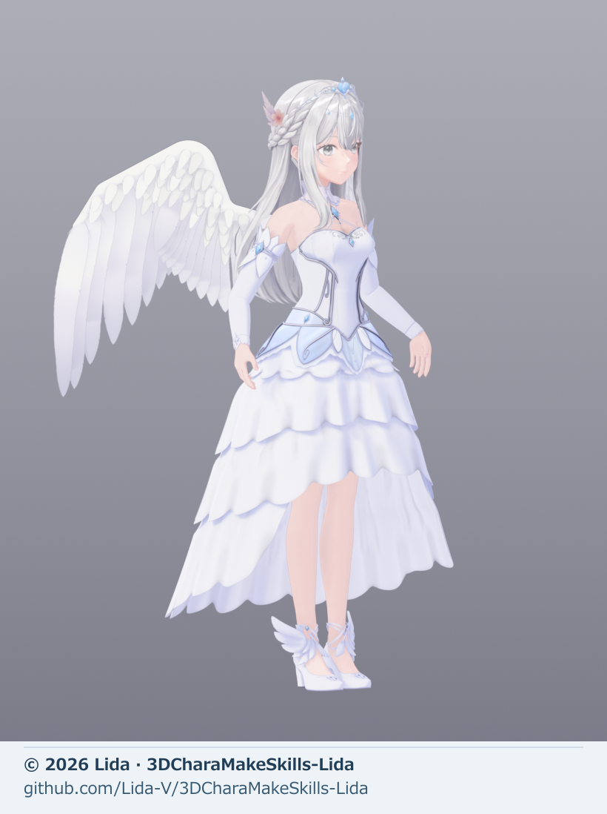
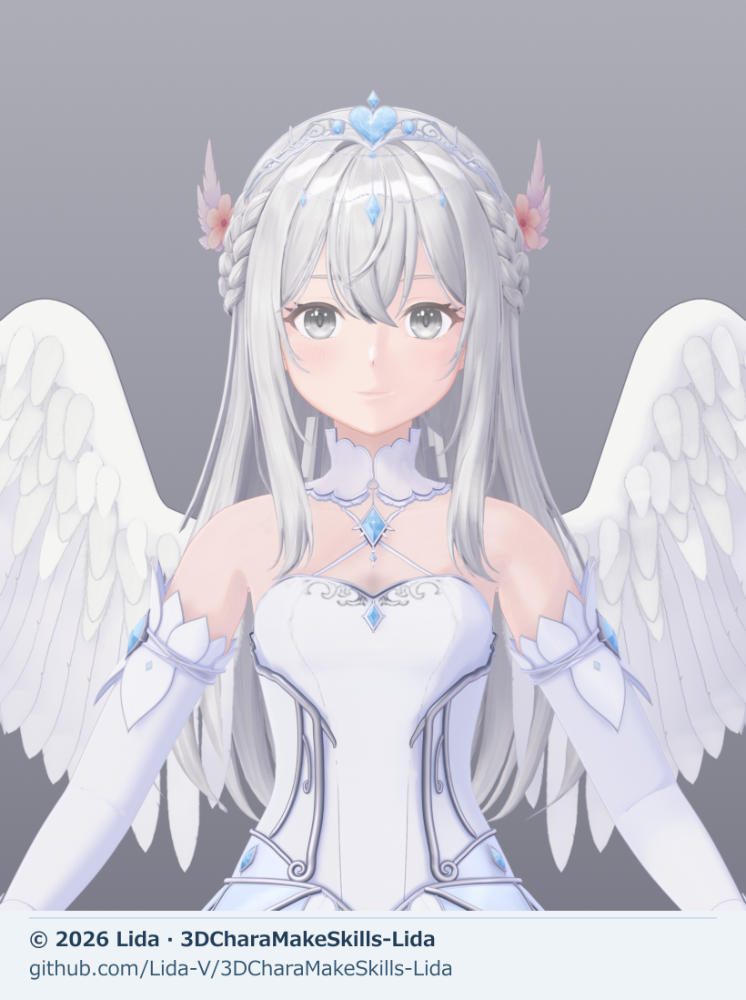
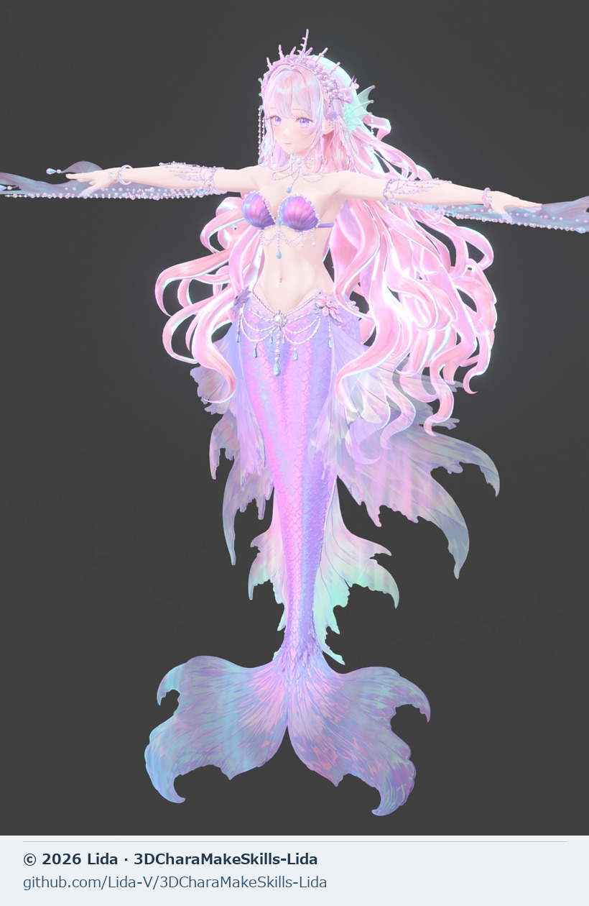
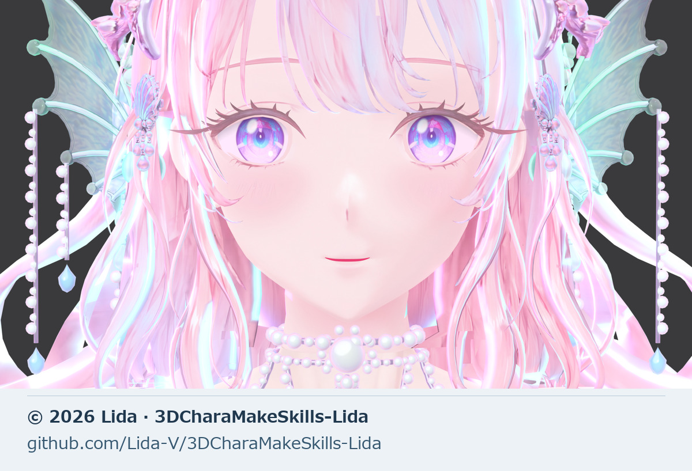
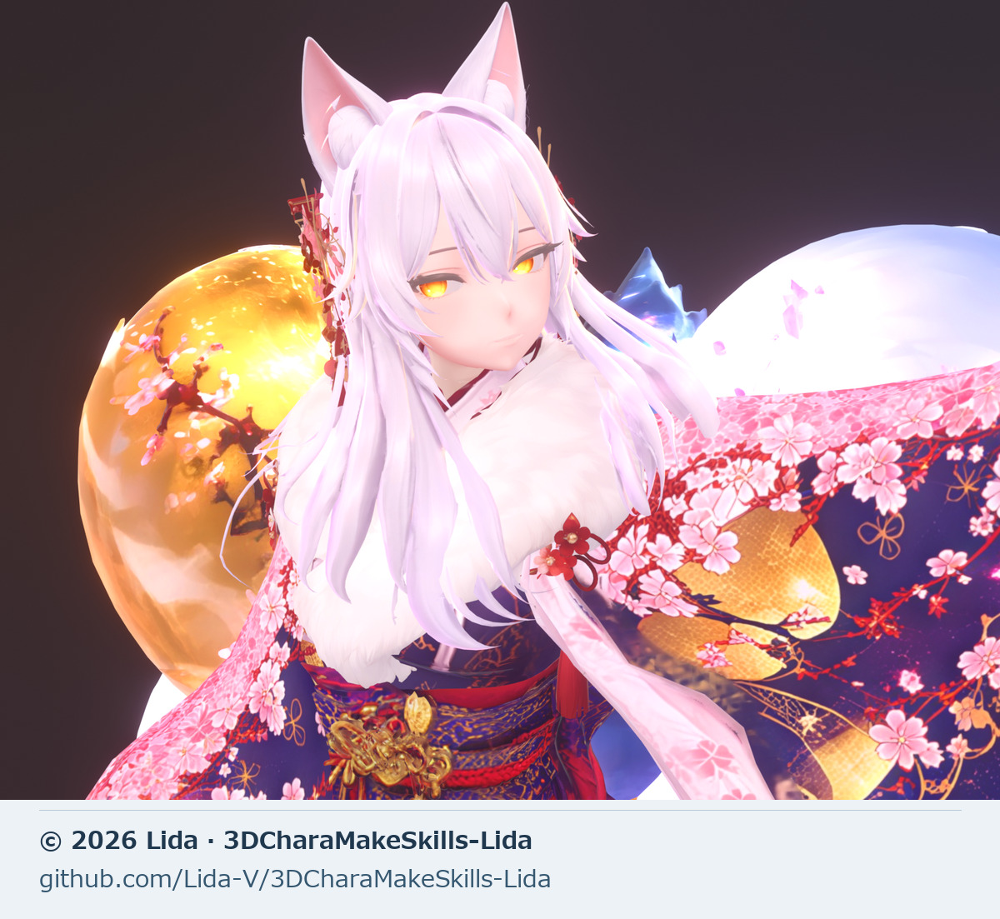

# 3DCharaMakeSkills-Lida

[日本語](README.md) · English

An AI-agent skill for creating 3D characters from reference illustrations (Japanese and English, **version 1.13.0**). It covers preparing materials, 3D generation, corrections to shape, face, hands, hair, clothing, and wings, bones and weights, expressions, materials, and VRM export, with requests for the AI and diagrams.

**The workflow assumes a base generated by a 3D generation service such as Tripo and finished in Blender or a similar application. Commercial use is permitted.**

## What is included

| Item | Count | Contents |
| --- | --- | --- |
| Skill | 1 | `lida-avatar-workflow`. Start from [SKILL.en.md](skills/lida-avatar-workflow/SKILL.en.md) and read only the chapters the current stage needs |
| Stage chapters | 39 | See the table below. Every chapter is in Japanese and English |
| Diagrams | 30 pairs | Original schematics (PNG and SVG). [Diagram index](skills/lida-avatar-workflow/references/en/diagram-index.md) |
| Tools | 12 | Scripts for measuring, checking, and fitting, run in background Blender |
| Reference model | 1 | A finished VRM 1.0, bundled in the official ZIP under its own terms |

### Chapters by stage

| Area | What it covers | Chapters |
| --- | --- | --- |
| Planning | Quality proposal, order of stages, completion criteria per stage | [Production plan](skills/lida-avatar-workflow/references/en/production-plan.md), [quality goals](skills/lida-avatar-workflow/references/en/quality-goals.md), [process index](skills/lida-avatar-workflow/references/en/process-index.md) |
| Preparing materials | Reference images, three-view sheets, expression sheets | [Input materials](skills/lida-avatar-workflow/references/en/input-materials.md), [three-view sheets](skills/lida-avatar-workflow/references/en/multiangle-threeview.md), [expression sheets](skills/lida-avatar-workflow/references/en/expression-sheets.md) |
| Generation and first skeleton | Receiving generated results, an FBX within 150 MB, Tripo auto-rig | [Auto-rig](skills/lida-avatar-workflow/references/en/tripo-autorig.md), [feedback from a new-model production](skills/lida-avatar-workflow/references/en/generation-feedback.md) |
| Correcting shape | What to move and how far, repairing tears and gaps, completing hidden parts | [Adjustment methods](skills/lida-avatar-workflow/references/en/adjustment-methods.md), [repair and completion](skills/lida-avatar-workflow/references/en/mesh-repair-completion.md), [skirts and hidden parts](skills/lida-avatar-workflow/references/en/skirt-hidden-modeling.md) |
| Face, eyes, expressions | Eyeballs and gaze, rebuilding flat-plate eyes, mouth shapes, expression keys, winks | [Eyes](skills/lida-avatar-workflow/references/en/eye-modeling.md), [mouth shapes](skills/lida-avatar-workflow/references/en/mouth-shapes.md), [expression adjustment](skills/lida-avatar-workflow/references/en/expression-adjustment.md), [winks](skills/lida-avatar-workflow/references/en/wink-closure.md) |
| Hands | Palm and finger shape, re-placing joints, rolls, and weights, checking grips | [Building the hand](skills/lida-avatar-workflow/references/en/hand-shape.md), [hand joints from the shape](skills/lida-avatar-workflow/references/en/hand-rig.md) |
| Hair | Strand shape, roots and tips, texture and gloss, sway | [Hair](skills/lida-avatar-workflow/references/en/hair-workflow.md), [secondary motion](skills/lida-avatar-workflow/references/en/secondary-motion.md) |
| Clothing and accessories | Fitting crowns and armlets to the body, silver and gem materials, hair or cloth passing through | [Fitting accessories](skills/lida-avatar-workflow/references/en/accessory-fit.md), [accessory materials](skills/lida-avatar-workflow/references/en/accessory-materials.md), [penetration check](skills/lida-avatar-workflow/references/en/penetration-check.md) |
| Wings | Support body, feather rows, roots, opening and flex, feather names | [Wings](skills/lida-avatar-workflow/references/en/wing-workflow.md), [feather layout and terms](skills/lida-avatar-workflow/references/en/wing-feather-terms.md) |
| Joints and weights | Topology and weights where the body bends, knee lines | [Mesh and weights](skills/lida-avatar-workflow/references/en/mesh-weight.md), [knee edge placement](skills/lida-avatar-workflow/references/en/knee-edge-placement.md) |
| Look and export | Color, shading, and outlines that change with the destination; choosing between the two shaders | [Cross-engine look](skills/lida-avatar-workflow/references/en/cross-engine-look.md), [shader setup](skills/lida-avatar-workflow/references/en/shader-setup.md) |
| Checks | Script checks, separating numbers from appearance | [Checks for what is easy to miss](skills/lida-avatar-workflow/references/en/automated-checks.md), [mechanical versus visual review](skills/lida-avatar-workflow/references/en/mechanical-visual-review.md), [bundled tools](skills/lida-avatar-workflow/references/en/model-tools.md) |
| Asking the AI | First instructions, requests with images, recording trial and error | [AI instructions](skills/lida-avatar-workflow/references/en/ai-instructions.md), [visual handoff](skills/lida-avatar-workflow/references/en/visual-handoff.md), [trial and error](skills/lida-avatar-workflow/references/en/trial-and-error.md) |
| Examples and indexes | Lessons from recent productions, list of diagrams, how to read the reference model | [Recent production lessons](skills/lida-avatar-workflow/references/en/recent-production-lessons.md), [diagram index](skills/lida-avatar-workflow/references/en/diagram-index.md), [reference model](skills/lida-avatar-workflow/references/en/model-reference.md), [design note](skills/lida-avatar-workflow/references/en/lida-design.md) |
| Terms | Attribution for outputs, published works, and redistribution | [Usage and attribution](skills/lida-avatar-workflow/references/en/usage-and-attribution.md) |

### Bundled tools

All run in background Blender (or plain Python) and never save the input file. Results are written as JSON.

| Tool | What it does | Guide |
| --- | --- | --- |
| `lida_model_tools.py` | Checks of mesh, UVs, weights, and keys; before/after comparison; weight normalization on a copy; rig and humanoid-map audit | [Bundled tools](skills/lida-avatar-workflow/references/en/model-tools.md) |
| `lida_file_check.py` | Format and size of an FBX before upload | [Bundled tools](skills/lida-avatar-workflow/references/en/model-tools.md) |
| `lida_hand_rig.py` | Hand proportions; re-placing finger joints, rolls, and weights; grip checks; before/after comparison; bone map from the rig; one-launch run | [Hand joints from the shape](skills/lida-avatar-workflow/references/en/hand-rig.md) |
| `lida_accessory_fit.py`, `lida_accessory_fit_panel.py` | Measuring the gap between crowns, armlets, or chokers and the body; fitting that keeps the shape (the panel is optional) | [Fitting accessories](skills/lida-avatar-workflow/references/en/accessory-fit.md) |
| `lida_penetration_check.py` | Lists every place hair or cloth passes through, proposes a repair, compares before and after | [Penetration check](skills/lida-avatar-workflow/references/en/penetration-check.md) |
| `lida_vrm_check.py` | Missing settings in an exported VRM (materials, spring bones, look-at, expressions, images) | [Checks for what is easy to miss](skills/lida-avatar-workflow/references/en/automated-checks.md) |
| `lida_rigid_group_check.py` | Whether hard ornaments such as a gem and its setting split when bent | same |
| `lida_shape_key_sweep.py` | Expression keys breaking at intermediate values and in combinations | same |
| `lida_evidence_manifest.py` | Which saved version each review image or video was made from | same |
| `lida_reference_check.py` | What is still read before intermediate files are cleaned up | same |
| `ensure_attribution.py` | Writes attribution into a published app or skill | [Usage and attribution](skills/lida-avatar-workflow/references/en/usage-and-attribution.md) |

A model that passes the mechanical checks but looks or moves unnaturally is still not accepted. These tools do not build eyes, wings, or other shapes automatically.

## Production examples

Blender renders of models made with this workflow. Each started from a generated base and was refined in shape, expressions, weights, and materials.

### Lida

| Full body, clothing, and wings | Face, hair, and accessories |
| --- | --- |
|  |  |

[Watch the 10-second turntable and expression preview](https://github.com/Lida-V/3DCharaMakeSkills-Lida/releases/download/v1.2.2/lida-model-turntable-attributed.mp4). The left view rotates the full model; the right shows a smile, surprise, the “aa” mouth shape, and a blink. There is no audio.

**[Watch the 18-second diverse motion, expression, hand, wing, and hair-sway showcase](https://github.com/Lida-V/3DCharaMakeSkills-Lida/releases/download/v1.11.0/lida-motion-showcase-attributed.mp4)**. Synchronized full-body, bust-up, and right-hand close-up (toon and palmar clay) views show greeting waves, four-finger waves, grip and fist, peace and wink, pointing, thumb-opposition pinches, flower pose and bow, and wrist flexion with cuff tracking. There is no audio.

### Mermaid (in production)

| Full body, tail, fins, and long hair | Face, eyes, and ornaments |
| --- | --- |
|  |  |

The chapters and tools for fitting accessories, checking hair penetration, re-placing hand joints, and rebuilding flat-plate eyes were added from this production's records.

### Nine-tailed fox (in production)



The previews use Blender / EEVEE and each production model's toon materials, and include versions still in production. They show refined production results, not the output of one generation or a guarantee of identical results. See [preview conditions](media/README.en.md).

The original diagrams retain their Japanese labels. English captions, numbered descriptions, and legends accompany them in the English guides. Diagrams and previews retain visible Lida/source attribution in the margins. What is distributed is the previews and the production know-how; no rights to these models' data or character designs are granted.

## Install and start

1. Download and extract the **[official complete Skills ZIP](https://github.com/Lida-V/3DCharaMakeSkills-Lida/releases/download/v1.13.0/3DCharaMakeSkills-Lida-1.13.0.zip)**, which includes the reference model and its terms. GitHub Code → Download ZIP and automatic Source code ZIPs are maintenance sources without the model binary. Use the complete Release ZIP for normal installation.
2. Copy the entire `skills/lida-avatar-workflow` folder to your agent's skill location, including references, assets, scripts, LICENSE, and NOTICE. Do not copy only `SKILL.md`.
3. Ask the agent to load the skill. English requests route to [SKILL.en.md](skills/lida-avatar-workflow/SKILL.en.md) and the [English reference index](skills/lida-avatar-workflow/references/en/README.md). You do not need Python or the shader merely to read the workflow.

> Load lida-avatar-workflow and respond in English. Before operating on the model, propose a short production plan covering materials, recommended quality, dependencies, stage goals, and deliverables. Include diagnostics for mesh repair, penetration, material corrections, hand movement, and eyes. State which material properties may change. This request is an introduction check only; do not run services or process model files yet.

Where supported, invoke `$lida-avatar-workflow`. If loading fails, check the folder location, duplicate skill installations, and missing references or assets. See [updating an installed copy](UPDATING.en.md).

## Read first

- [Production plan](skills/lida-avatar-workflow/references/en/production-plan.md): plan the five diagnostics and corrections, the range of material changes, the order of stages, and reasons for holding items.
- [Quality goals](skills/lida-avatar-workflow/references/en/quality-goals.md): the intended result and each stage's completion criteria.
- [Process index](skills/lida-avatar-workflow/references/en/process-index.md): pick only the material for the part in hand.

Use example dimensions and settings as evidence from a particular production, not universal defaults. Lida's design preferences are separated into a [short design note](skills/lida-avatar-workflow/references/en/lida-design.md).

## Completed reference model included in the Skills

**[Download the complete Skills ZIP, including the reference model](https://github.com/Lida-V/3DCharaMakeSkills-Lida/releases/download/v1.13.0/3DCharaMakeSkills-Lida-1.13.0.zip)**. The official ready-to-use ZIP contains the China Wafuku r35 VRM 1.0 model. Copy the entire extracted skill folder to install the model together with the skill; no separate model download is needed.

The model is a production-reference component of the Skills. Inspect relationships among face, hands, joints, sleeves, materials, expressions, and secondary motion. Use the [observation guide and AI request](skills/lida-avatar-workflow/references/en/model-reference.md) to inspect only the relevant parts.

**Redistribution of the model and sale of modified versions are prohibited. Users must not redistribute the complete ZIP containing the model.** The [model-specific terms](model-reference/china-wafuku/MODEL-TERMS.en.md) apply. Individual documentation, diagram, and code licenses are unchanged; those materials can still be redistributed under their applicable licenses after excluding the model. Selling a different, independently created model after studying the reference is not prohibited. Exported VRM triangles are not original editing topology; Unity/UE appearance and motion are not guaranteed.

## Production assumptions

**The image-to-model workflow assumes a 3D generation service such as Tripo. Commercial use is permitted.** Prepare reference illustrations, generate a base model and any needed part or expression references, then refine them in Blender or another suitable modeling application.

For a new animated humanoid, first check the neutral form and joint topology, then use **an FBX within 150 MB → Tripo auto-rig with the VRM 1.0 skeleton → preservation checks → rig and weight adjustment**. A skeleton convention is one step toward a finished VRM; expressions, materials, look direction, secondary motion, metadata, and target behavior still need their own checks. Reuse a good existing rig where appropriate.

Applications, generation services, API credentials, input illustrations, and source editing models are not bundled. The completed r35 reference model is included in the official ready-to-use ZIP. Another generation service can be used when its inputs and outputs meet the project requirements. Repairing an existing model does not require regenerating it.

## Use the CLI and visual review together

The pack contains `audit`, `snapshot`, `compare`, `normalize-copy`, and read-only `rig-audit` helpers. A separate standard-library tool checks an upload FBX's extension, identifying header, actual byte count, and SHA. It does not contact Tripo or validate the complete FBX scene.

CLI success covers only the command's stated scope. **Mechanical results, reference-matched images, intermediate motion, saved-file reproduction, and target-application behavior are assessed separately.** A numerically improved model that looks worse is not adopted. The [tool guide](skills/lida-avatar-workflow/references/en/model-tools.md) lists commands, limits, exit codes, and tested conditions.

These tools do not bundle the complete production add-on, its panels, automatic eye/wing modeling, or every original simulation handler. Processing requires an explicitly authorized model task; reading the skill does not install software or alter a project.

## Usage and attribution

The bundled reference model has the model-specific terms above. A complete ZIP containing it must not be redistributed by users; documentation and code retain their individual permissions when separated from the model.

Commercial and noncommercial use are permitted, including commissioned models, model sales, and commercial apps or derivative skills. Requirements from generation services and third-party assets remain separate.

| Use | Attribution |
| --- | --- |
| Read the workflow to create a model, image, or video | No credit is required on that output merely for using this workflow |
| Publish an app or new skill incorporating or adapting the materials | Keep the source name, Lida, original URL, and a description of use/modifications in a readable README, About, or NOTICE |
| Redistribute the materials themselves | Retain the applicable LICENSE and NOTICE |

See the [usage guide](skills/lida-avatar-workflow/references/en/usage-and-attribution.md), [English explanation of distribution scope](LICENSE-POLICY.en.md), and informational translations of [LICENSE](LICENSE.en.md) and [NOTICE](NOTICE.en.md). Original Japanese [LICENSE](LICENSE) and [NOTICE](NOTICE.md) are retained. The Blender helper `lida_model_tools.py` is GPL-3.0-or-later; do not add the documentation license's conditions to that code.

The attribution helper can create new English notice blocks with `--language en`; existing Japanese or English entries are preserved. It is unnecessary when only making a model output. The materials do not grant rights to Lida's character design, avatar data, or third-party works.

## Optional shaders

Two shaders are distributed in separate repositories. Neither is required to use the workflow.

| Shader | Look | Supports |
| --- | --- | --- |
| [LidaAngelToon](https://github.com/Lida-V/LidaAngelToon) | Soft two-step toon shading, with presets for skin, face, hair, cloth, metal, gems, and more | Blender, Unity, UE |
| [LidaAuroraToon](https://github.com/Lida-V/LidaAuroraToon) | Nacre iridescence, flowing aurora light, translucency that grows where the surface is thin, and a glow on hair-lock outlines. The mermaid and nine-tailed fox previews above use it | Blender (EEVEE) only |

[LidaAngelToon](https://github.com/Lida-V/LidaAngelToon) is distributed separately. Choose Blender, Unity, or Unreal packages from the [published 0.2.1 release](https://github.com/Lida-V/LidaAngelToon/releases/tag/v0.2.1). It is not required to use the workflow.

The documented test environments are Blender 5.2.1 LTS / EEVEE, Unity 6000.6.0f1 / URP 17.6, and UE 5.8 on Windows. Check [setup and limitations](skills/lida-avatar-workflow/references/en/shader-setup.md), including the production Blender material versus the generic add-on, the UE lighting limits, and the absence of automatic VRM conversion. Local or test-only shader features are not represented as published features.

LidaAuroraToon was checked in Blender 5.3 / EEVEE. It does not support Cycles, VRM, Unity, or UE: an exported VRM uses MToon and this look does not carry over. Usage and the list of inputs are in the [shader README](https://github.com/Lida-V/LidaAuroraToon).

## Distribution and maintenance

The official ready-to-use Skills ZIP contains documentation, diagrams, previews, the skill, helper code, and the r35 production-reference model with its own terms. It excludes source editing files, other models, credentials, reference dance FBX files, renamed copies, and converted reference motions. Use test motion for which you have the necessary rights.

Reading users need not run the validation tools. Maintainers can follow [updating](UPDATING.en.md), [contributing](CONTRIBUTING.en.md), and the [change history (Japanese)](CHANGELOG.md):

```sh
python scripts/validate.py
python -m unittest discover -s tests
python scripts/build_package.py
```

The package validator checks links, allowed contents, image hashes, language coverage, and the recorded source version for each translation. It cannot prove translation accuracy or visual quality. ZIP building audits the completed archive and does not publish a release or change repository visibility.
