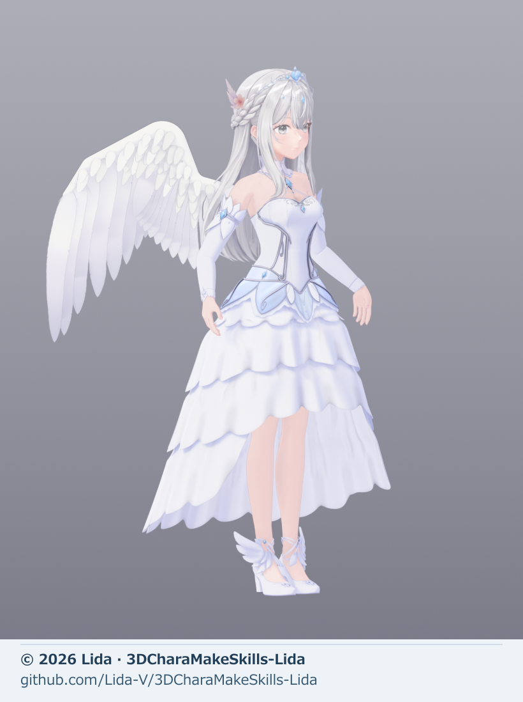
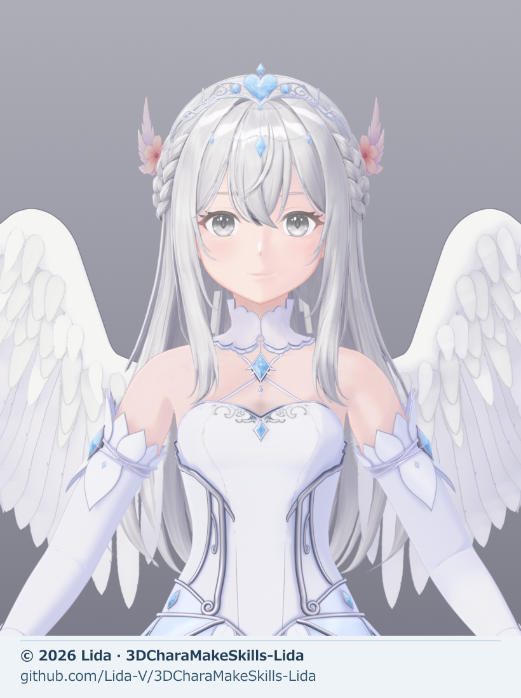
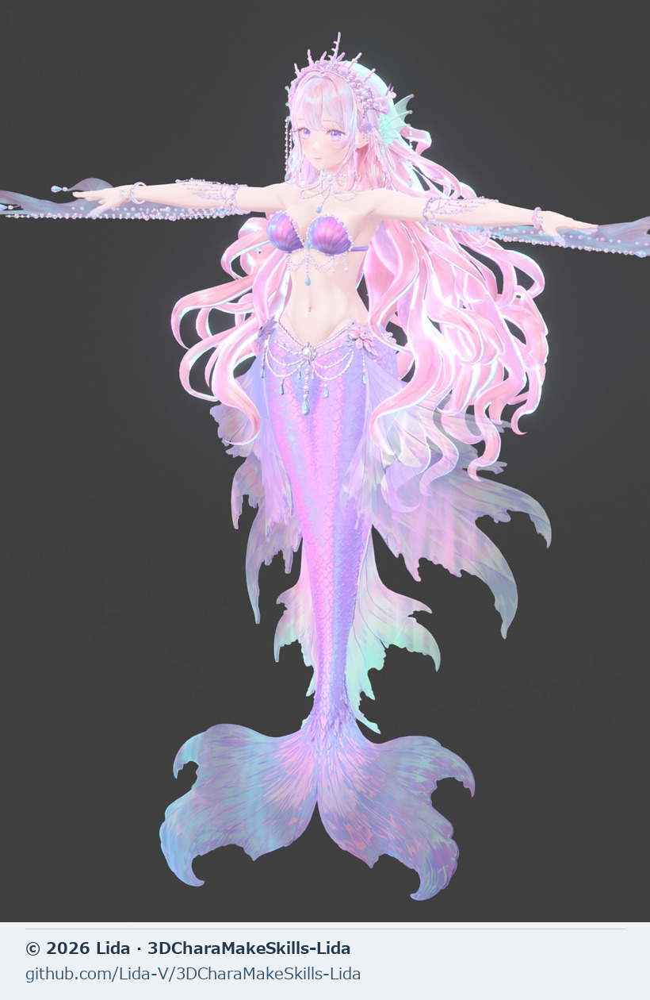
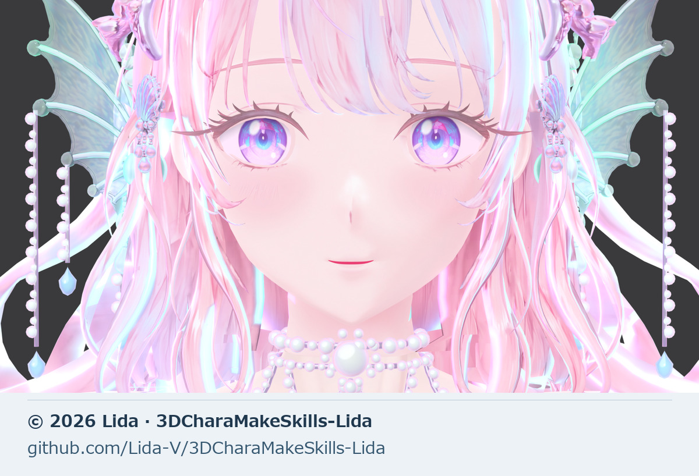
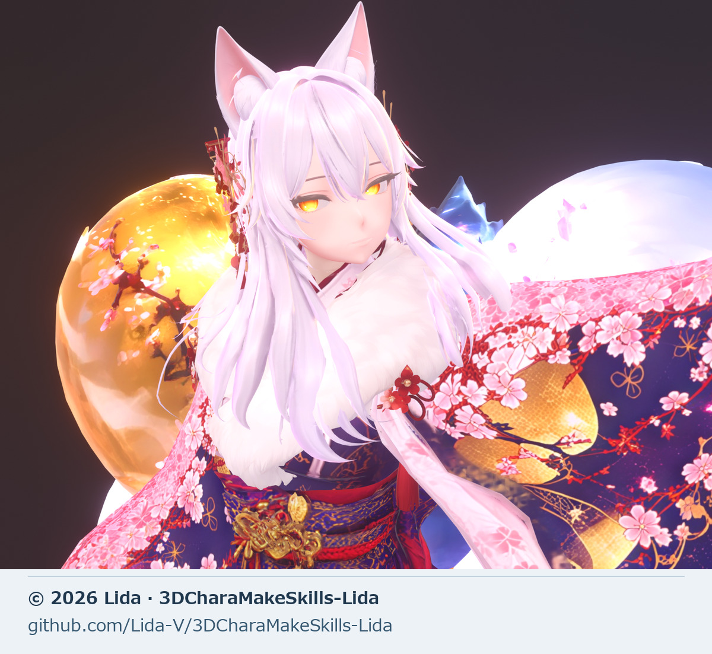
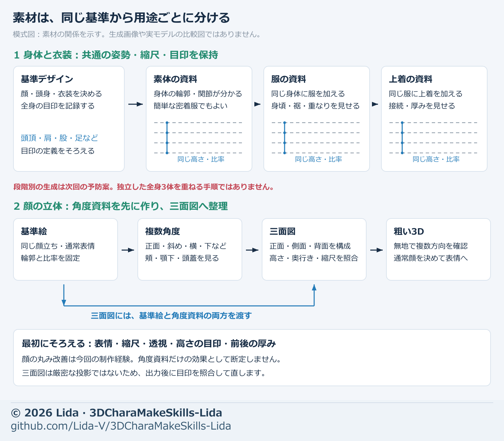
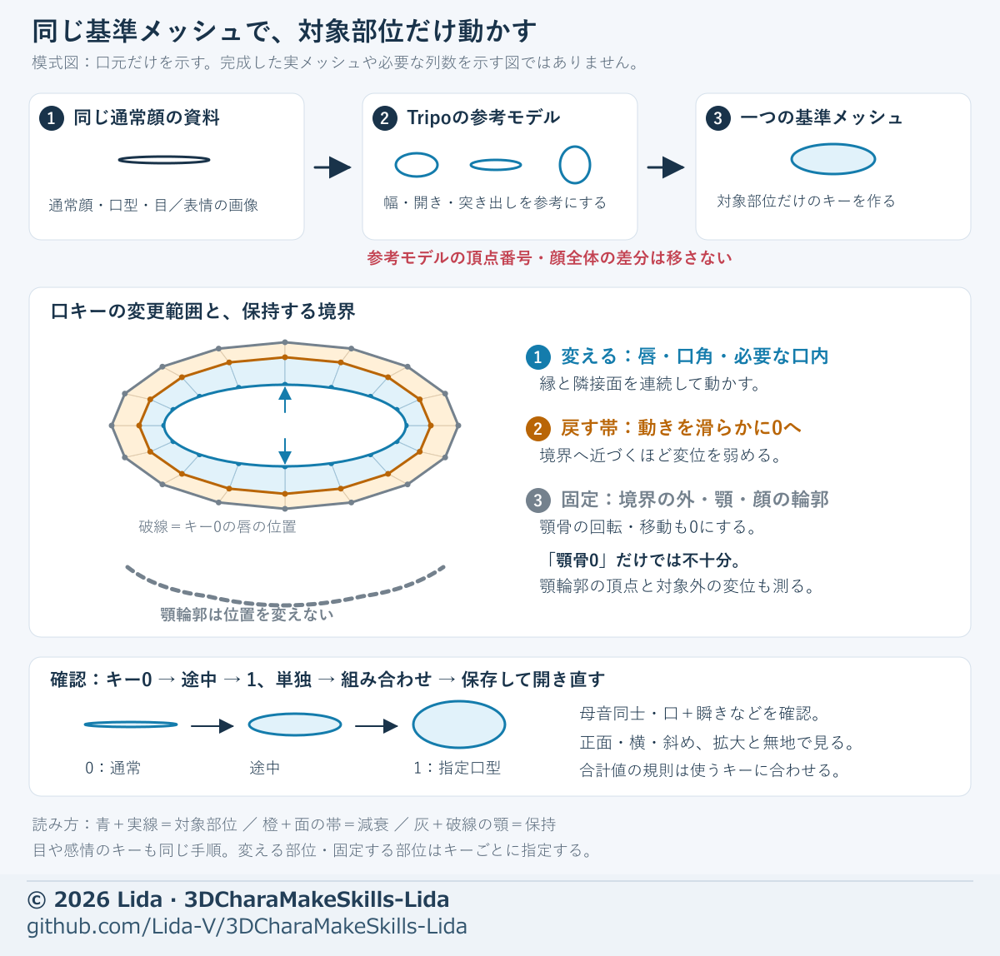

# 3DCharaMakeSkills-Lida

日本語 · [English](README.en.md)

画像から3Dキャラクターを作るための、AIエージェント用スキルです（日本語・英語、配布用1.13.0）。素材の用意、3D生成、形・顔・手・髪・衣装・翼の修正、骨とウェイト、表情、材質、VRMの出力までを、AIへ頼む文と図つきでまとめています。

**Tripoなどの3Dモデル生成サービスでベースを作り、Blenderなどで仕上げる制作手順です。商用利用も可能です。**

## 収録内容

| 収録物 | 数 | 内容 |
| --- | --- | --- |
| スキル | 1 | `lida-avatar-workflow`。入口の [SKILL.md](skills/lida-avatar-workflow/SKILL.md) から、今の工程に要る章だけを読む |
| 工程の章 | 39 | 下の表のとおり。全章が日本語と英語 |
| 図解 | 30組 | 自作の模式図（PNG・SVG）。[図解索引](skills/lida-avatar-workflow/references/diagram-index.md) |
| ツール | 12本 | Blenderの背景実行で使う、測定・検査・合わせ込みのスクリプト |
| 参照モデル | 1体 | 完成したVRM 1.0。公式ZIPに同梱（専用条件） |

### 工程ごとの章

| 分野 | 分かること | 章 |
| --- | --- | --- |
| 計画と進め方 | 品質の提案、工程の順番、各工程の終了条件 | [制作計画](skills/lida-avatar-workflow/references/production-plan.md)・[品質とゴール](skills/lida-avatar-workflow/references/quality-goals.md)・[工程索引](skills/lida-avatar-workflow/references/process-index.md) |
| 素材を用意する | 基準画像、三面図、表情シート | [入力素材](skills/lida-avatar-workflow/references/input-materials.md)・[三面図](skills/lida-avatar-workflow/references/multiangle-threeview.md)・[表情シート](skills/lida-avatar-workflow/references/expression-sheets.md) |
| 生成と最初の骨 | 生成結果の受け取り、150MB以内のFBX、Tripoのオートリグ | [オートリグ](skills/lida-avatar-workflow/references/tripo-autorig.md)・[生成からの実践フィードバック](skills/lida-avatar-workflow/references/generation-feedback.md) |
| 形を直す | 何をどれだけ動かすか、破れ・欠けの修復、見えない部分の補完 | [調整方法](skills/lida-avatar-workflow/references/adjustment-methods.md)・[修復と補完](skills/lida-avatar-workflow/references/mesh-repair-completion.md)・[スカートと隠れる部分](skills/lida-avatar-workflow/references/skirt-hidden-modeling.md) |
| 顔・目・表情 | 眼球と視線、平らな目の作り直し、口型、表情キー、ウインク | [眼球](skills/lida-avatar-workflow/references/eye-modeling.md)・[口型](skills/lida-avatar-workflow/references/mouth-shapes.md)・[表情の調整](skills/lida-avatar-workflow/references/expression-adjustment.md)・[ウインク](skills/lida-avatar-workflow/references/wink-closure.md) |
| 手 | 掌と指の形、関節・ロール・ウェイトの置き直し、握りの検査 | [手を作る](skills/lida-avatar-workflow/references/hand-shape.md)・[手の関節を形から置く](skills/lida-avatar-workflow/references/hand-rig.md) |
| 髪 | 毛束の形、根元と毛先、質感と艶、揺れ | [髪を作る](skills/lida-avatar-workflow/references/hair-workflow.md)・[二次揺れ](skills/lida-avatar-workflow/references/secondary-motion.md) |
| 衣装・飾り | 冠や腕輪を体へ合わせる、銀や宝石の材質、髪や布の貫通 | [飾りを合わせる](skills/lida-avatar-workflow/references/accessory-fit.md)・[装飾の材質](skills/lida-avatar-workflow/references/accessory-materials.md)・[貫通の検査](skills/lida-avatar-workflow/references/penetration-check.md) |
| 翼 | 支持体、羽の列、根元、開閉としなり、羽の名称 | [翼を作る](skills/lida-avatar-workflow/references/wing-workflow.md)・[羽の配置と用語](skills/lida-avatar-workflow/references/wing-feather-terms.md) |
| 関節とウェイト | 曲がる所の網目とウェイト、膝の線 | [メッシュとウェイト](skills/lida-avatar-workflow/references/mesh-weight.md)・[膝の線](skills/lida-avatar-workflow/references/knee-edge-placement.md) |
| 見た目と出力 | 使用先で変わる色・影・輪郭、2つのシェーダーの使い分け | [使用先の見た目](skills/lida-avatar-workflow/references/cross-engine-look.md)・[シェーダー](skills/lida-avatar-workflow/references/shader-setup.md) |
| 検査と確認 | スクリプトでの検査、数値と見た目の分け方 | [見落としやすい所の検査](skills/lida-avatar-workflow/references/automated-checks.md)・[機械検査と見た目](skills/lida-avatar-workflow/references/mechanical-visual-review.md)・[同梱ツール](skills/lida-avatar-workflow/references/model-tools.md) |
| AIへの頼み方 | 初回の指示、画像つきの依頼、試行錯誤の残し方 | [AIへの指示](skills/lida-avatar-workflow/references/ai-instructions.md)・[画像つきの依頼](skills/lida-avatar-workflow/references/visual-handoff.md)・[試行錯誤](skills/lida-avatar-workflow/references/trial-and-error.md) |
| 実例と索引 | 最近の制作で分かったこと、図の一覧、参照モデルの見方 | [最近の制作の知見](skills/lida-avatar-workflow/references/recent-production-lessons.md)・[図解索引](skills/lida-avatar-workflow/references/diagram-index.md)・[参照モデル](skills/lida-avatar-workflow/references/model-reference.md)・[あとがき](skills/lida-avatar-workflow/references/lida-design.md) |
| 利用条件 | 成果物・公開物・再配布での出典の扱い | [利用区分と出典](skills/lida-avatar-workflow/references/usage-and-attribution.md) |

### 同梱ツール

どれもBlenderの背景実行（または通常のPython）で動かし、入力のファイルを保存しません。結果はJSONで出ます。

| ツール | 働き | 説明 |
| --- | --- | --- |
| `lida_model_tools.py` | 網目・UV・ウェイト・キーの検査、修正前後の比較、写しへのウェイト正規化、骨と人型の対応の検査 | [同梱ツール](skills/lida-avatar-workflow/references/model-tools.md) |
| `lida_file_check.py` | 送るFBXの形式と容量の確認 | [同梱ツール](skills/lida-avatar-workflow/references/model-tools.md) |
| `lida_hand_rig.py` | 手の比の測定、指の関節・ロール・ウェイトの置き直し、握りの検査、前後の比較、骨の対応表の作成、一括実行 | [手の関節を形から置く](skills/lida-avatar-workflow/references/hand-rig.md) |
| `lida_accessory_fit.py`・`lida_accessory_fit_panel.py` | 冠・腕輪・首飾りと体のすき間の測定、形を保った合わせ込み（パネルは任意） | [飾りを合わせる](skills/lida-avatar-workflow/references/accessory-fit.md) |
| `lida_penetration_check.py` | 髪・布の貫通を全部挙げる、直し方の提案、前後の比較 | [貫通の検査](skills/lida-avatar-workflow/references/penetration-check.md) |
| `lida_vrm_check.py` | 書き出したVRMの設定の抜け（材質・揺れ・視線・表情・画像） | [見落としやすい所の検査](skills/lida-avatar-workflow/references/automated-checks.md) |
| `lida_rigid_group_check.py` | 宝石と台のような固い飾りが、曲げても割れないか | 同上 |
| `lida_shape_key_sweep.py` | 表情キーの途中の値と組み合わせでの崩れ | 同上 |
| `lida_evidence_manifest.py` | 確認用の画像・動画が、どの保存版から作られたか | 同上 |
| `lida_reference_check.py` | 途中ファイルを整理する前に、まだ読まれている物を挙げる | 同上 |
| `ensure_attribution.py` | 公開するアプリやSkillsへ出典を書く | [利用区分と出典](skills/lida-avatar-workflow/references/usage-and-attribution.md) |

機械検査が通っても、画像や動作で不自然なら未達として扱います。眼球・翼などの形を自動で作るツールではありません。

## 制作例

このスキルの手順で作ったモデルを、Blenderで描画した画像です。生成したベースから、形・表情・ウェイト・材質を調整しています。

### リダ

| 全身・衣装・翼 | 顔・髪・装飾 |
| --- | --- |
|  |  |

**[10秒動画：全身の回転と表情を見る](https://github.com/Lida-V/3DCharaMakeSkills-Lida/releases/download/v1.2.2/lida-model-turntable-attributed.mp4)** — 左は全身の1周、右は笑顔・驚き・口型「あ」・瞬き。音声なし。

**[18秒動画：多様な動作・表情・手指・翼・髪揺れを見る](https://github.com/Lida-V/3DCharaMakeSkills-Lida/releases/download/v1.11.0/lida-motion-showcase-attributed.mp4)** — 全身・バストアップ・右手アップ（トゥーン／掌側粘土）の同期4画面で、片手ウェーブ挨拶・4指順送りウェーブ・握り拳・ピース＆ウインク・指差し・親指の対向つまみ・お花ポーズ＆お辞儀・手首屈伸と袖口追従を確認。音声なし。

### 人魚（制作途中）

| 全身・尾・ひれ・長い髪 | 顔・眼球・飾り |
| --- | --- |
|  |  |

飾りを体へ合わせる・髪の貫通の検査・手の関節の置き直し・平らな目の作り直しの章とツールは、この制作の記録から足しました。

### 九尾の狐（制作途中）



表示はBlender／EEVEEと制作モデル内のトゥーン材質です。制作途中の版も含みます。[画像・動画の内容と表示条件](media/README.md)を確認できます。

図解と紹介画像・動画には、画像だけで共有された時も出所を確認できるよう、余白へLida名と配布元URLを表示しています。本文やモデルの見える範囲は遮っていません。配布するのは紹介画像と制作ノウハウで、これらのモデルデータやキャラクターデザインの利用許可は含みません。

## 入手して使う

1. **[公式のSkills一式ZIP](https://github.com/Lida-V/3DCharaMakeSkills-Lida/releases/download/v1.13.0/3DCharaMakeSkills-Lida-1.13.0.zip)**を取得して展開します。参照モデル・専用条件も含まれています。GitHubのCode → Download ZIPと自動生成のSource code ZIPは保守用ソースで、モデル本体を含みません。通常の導入には上記の完成ZIPを使ってください。
2. `skills/lida-avatar-workflow` を、参照文書・画像・LICENSE・NOTICE・補助スクリプトを含め、エージェントのスキル保存先へ丸ごとコピーします。`SKILL.md`だけにしないでください。
3. スキルを読み込ませ、次の導入確認を依頼します。読むだけの利用者にPythonやシェーダーの導入は必要ありません。

> lida-avatar-workflowを読み、モデル制作を始める前に、必要な素材・推奨品質・工程順・各終了条件を短い制作計画にしてください。メッシュ、貫通、材質、手指の動き、眼球の5項目の診断予定と、材質の変更可能範囲も示してください。今回は導入確認だけで、実サービスやモデル処理の実行はまだ不要です。

名前付き指定が使える環境では `$lida-avatar-workflow` と指定できます。読み込めない時は、保存先・同名スキルの重複・参照文書や画像の欠落を確認してください。[利用者向け更新手順](UPDATING.md#利用者の更新)も用意しています。

## 最初に読む

- [最初の制作計画](skills/lida-avatar-workflow/references/production-plan.md)：必要な5項目の診断・補正を計画し、材質の変更範囲、工程順と保留理由を整理する。
- [品質と工程ゴール](skills/lida-avatar-workflow/references/quality-goals.md)：初回の完成像と各工程の終了条件。
- [工程索引](skills/lida-avatar-workflow/references/process-index.md)：今扱う部位の資料だけ選ぶ。

作例の寸法・本数は他モデルの既定値にしません。確認範囲と既知制限も読み、外観の好みは[短いあとがき](skills/lida-avatar-workflow/references/lida-design.md)へ分けます。

## 制作の前提

基準となるイラストを用意し、Tripoなどのサービスでベースモデルや口型・表情の参考モデルを生成してから、Blenderなどで形状・メッシュ・骨・スキンウェイト・表情を調整します。新規の動く人型では、通常形と関節の網目を整え、**150MB以内のFBX → TripoのVRM 1.0オートリグ → 骨・ウェイトの調整**を挟みます。骨格の導入と完成VRMの出力は別工程です。既存の良いリグは再利用します。

実制作には、利用する3D生成サービス、モデリングソフト、必要な画像素材を別途用意してください。本パックにサービスやソフト本体は同梱しません。別の生成サービスを使う場合も、必要な角度・同一性・出力形式がそろうかを確認します。既存モデルの修正だけなら、改めて生成する必要はありません。

## Skillsに含まれる完成参照モデル

**[参照モデルを含むSkills一式をダウンロード](https://github.com/Lida-V/3DCharaMakeSkills-Lida/releases/download/v1.13.0/3DCharaMakeSkills-Lida-1.13.0.zip)** — 公式の完成ZIPに、制作例「チャイナ和服新キャラ r35」のVRM 1.0を収録しています。展開後のスキルフォルダを丸ごと導入すると、参照モデルも一緒に配置されます。別ダウンロードは不要です。

このモデルはSkillsの制作参照資料です。顔・手指・関節・袖・材質・表情・揺れの関係を実物で学べます。[何を見るか・AIへの依頼例](skills/lida-avatar-workflow/references/model-reference.md)から必要な部位だけを参照してください。

**モデル本体の再配布・改変による販売は禁止です。モデルを含む一式ZIPも利用者が再配布しないでください。** [モデル専用条件](model-reference/china-wafuku/MODEL-TERMS.md)を適用します。文書・図解・コードの個別条件は維持し、モデルを除いた資料・コードは各LICENSEに従って再配布できます。参照して独自に作った別モデルの販売は禁止しません。VRM三角面は元の編集用網目ではなく、Unity/UEの外観・動作は保証しません。

## 参考図解

**素材をそろえて3D生成へ進む流れ**。自作模式図です。身体・服・上着の段階別生成は次回向けの予防案で、制作で確認した成功例とは分けています。[素材準備の説明](skills/lida-avatar-workflow/references/input-materials.md)



**生成した口型を、共通の顔へ反映する考え方**。Tripoの参考モデルを使い、顎と顔の輪郭を固定して口周辺だけを調整します。自作模式図であり、完成モデルの比較画像ではありません。[口型制作の説明](skills/lida-avatar-workflow/references/mouth-shapes.md)



## 利用と出典表記

**Skillsの文書・図解・手順・補助コードは商用・非商用を問わず利用できます。** 同梱参照モデルは上記のモデル専用条件です。 モデルの販売・受託制作、商用の画像・動画、商用アプリやSkillsへの組込みも制限しません。商用の場合も、下記の出典保持条件は同じです。利用する生成サービス・入力素材・第三者モデルの利用条件は、それぞれ確認してください。

| 利用方法 | 出典の扱い |
| --- | --- |
| 読んで手順を使い、モデル・画像・動画を制作 | その成果物へのクレジットは不要 |
| 本資料を組み込み・改変したアプリや新Skillsを公開 | README・About・NOTICE等へ参照元名・Lida・URL・利用／改変内容を記載 |
| 本資料自体を転載・改変・再配布 | LICENSEとNOTICEを保持 |

方法を参考にした公開アプリやSkillsについても、AIの制作手順では出典を書きます。[利用区分・コピペ例・出典作成ツール](skills/lida-avatar-workflow/references/usage-and-attribution.md)、[正式な利用条件](LICENSE)、[出典情報](NOTICE.md)を確認してください。キャラクターや第三者素材の利用許可とは別です。

## シェーダーは必要な場合だけ取得

シェーダーは2つを別のリポジトリで配布しています。どちらも、Skillsでモデルを作るための必須依存ではありません。

| シェーダー | 表現 | 対応 |
| --- | --- | --- |
| [LidaAngelToon](https://github.com/Lida-V/LidaAngelToon) | やわらかい2段の影のトゥーン。肌・顔・髪・布・金属・宝石などのプリセット | Blender・Unity・UE |
| [LidaAuroraToon](https://github.com/Lida-V/LidaAuroraToon) | 真珠層の虹色、流れるオーロラの光、薄い所ほど透ける表現、髪の輪郭の光。上の人魚と九尾の狐の画像はこの材質 | Blender（EEVEE）だけ |

LidaAngelToon は公開リポジトリで別配布しています。[Release 0.2.1からBlender・Unity・UEの導入用ZIPを選ぶ](https://github.com/Lida-V/LidaAngelToon/releases/tag/v0.2.1)ことができます。Skillsでモデルを作るための必須依存ではありません。

確認済み環境はBlender 5.2.1 LTS／EEVEE、Unity 6000.6.0f1／URP 17.6、UE 5.8（Windows）です。シェーダーREADMEではリダ実モデルの3環境の表示例を確認できます。Blenderの制作基準材質と配布アドオンの違い、UEの落ち影などの制限、VRM自動変換が含まれないことは[取得・導入・対応範囲](skills/lida-avatar-workflow/references/shader-setup.md)を参照し、各ファイルのLICENSEも確認してください。

LidaAuroraToon は Blender 5.3／EEVEE で確認しています。Cycles・VRM・Unity・UE には対応していません。VRMへ出すと材質はMToonになり、この見え方は持って行けません。使い方と入力の一覧は[シェーダーのREADME](https://github.com/Lida-V/LidaAuroraToon)にあります。

## 同梱範囲

公式の通常ZIPに、文書・自作図解・スキル・補助コードと、制作参照モデルr35・モデル専用条件を同梱します。Blender本体、生成サービス、接続ツール、APIキー、編集原本や他のモデルは同梱しません。
**参考ダンスFBX、改名コピー、変換した参考モーションも配布しません。** 動作確認には、自分で利用権を持つ動きを用意してください。

## 保守と検査

利用者は検査を実行せず読んで使えます。改変・再配布する人は[更新手順](UPDATING.md)、[変更履歴](CHANGELOG.md)、[配布範囲と権利条件](LICENSE-POLICY.md)を確認します。

```sh
python scripts/validate.py
python -m unittest discover -s tests
python scripts/build_package.py
```

GitHub Actionsでも検査とZIP作成を行います。自動検査に加え、追加資料の出所・画像内文字・権利を目視で確認してください。ZIP作成は公開範囲変更や公開リリースを行いません。
