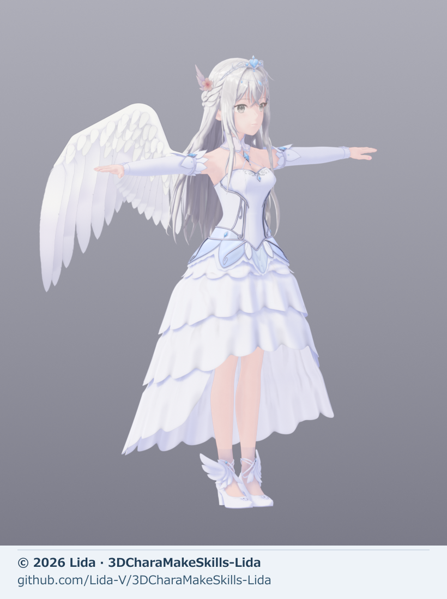
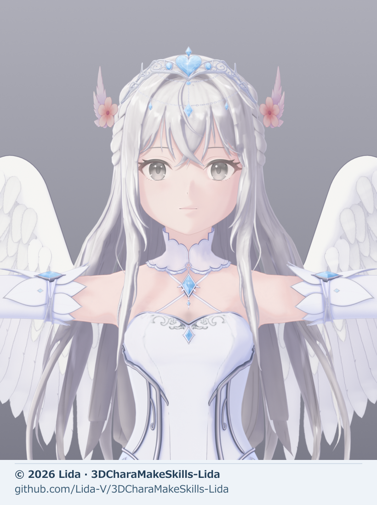
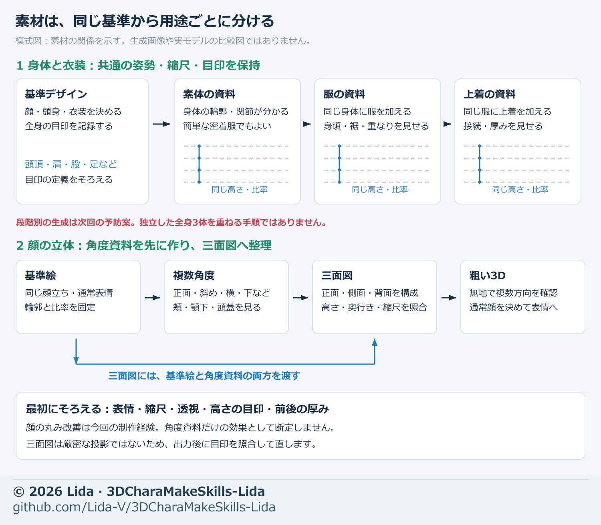
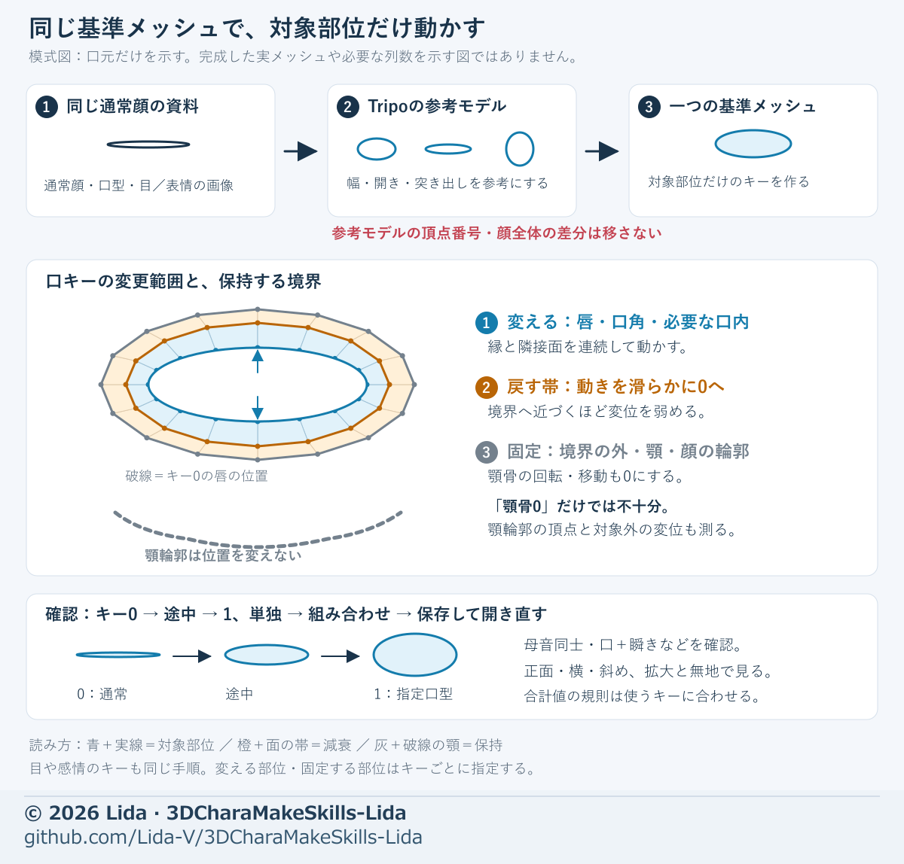

# 3DCharaMakeSkills-Lida

画像から3Dキャラクターを作るときの、素材・調整方法・AIへの指示をまとめた **配布版1.0.2** です。初心者向けに「素材→順番→具体調整→つまずき」を整理し、13枚の自作図解と実モデルの表示例を収録しています。リポジトリは現在Privateです。

## 実際の制作例

リダの3DモデルをBlenderで描画した画像です。生成したベースから、顔・髪・衣装・装飾・翼の形状、表情、ウェイト、材質を調整して仕上げた作例です。

| 全身・衣装・翼 | 顔・髪・装飾 |
| --- | --- |
|  |  |

**[10秒動画：全身の回転と表情を見る](https://github.com/Lida-V/3DCharaMakeSkills-Lida/releases/download/v1.0.2/lida-model-turntable.mp4)** — 左は全身の1周、右は笑顔・驚き・口型「あ」・瞬き。音声なし。

表示はBlender 5.2.1 LTS／EEVEEと制作モデル内のトゥーン材質です。[画像・動画の内容と表示条件](media/README.md)を確認できます。

**Tripoなどの3Dモデル生成サービスの利用を前提とした制作手順です。商用利用も可能です。**

## 制作の前提

基準となるイラストを用意し、Tripoなどのサービスでベースモデルや口型・表情の参考モデルを生成してから、Blenderなどで形状・メッシュ・骨・スキンウェイト・表情を調整します。流れは **画像の準備 → 3D生成 → モデリングと動きの修正 → 材質と出力の確認** です。

実制作には、利用する3D生成サービス、モデリングソフト、必要な画像素材を別途用意してください。本パックにサービスやソフト本体は同梱しません。別の生成サービスを使う場合も、必要な角度・同一性・出力形式がそろうかを確認します。既存モデルの修正だけなら、改めて生成する必要はありません。

## 入手して使う

1. このリポジトリの **Code → Download ZIP** で取得して展開します。配布ZIPを受け取った場合も展開します。
2. `skills/lida-avatar-workflow` を、参照文書・画像・LICENSE・NOTICE・補助スクリプトを含め、エージェントのスキル保存先へ丸ごとコピーします。`SKILL.md`だけにしないでください。
3. スキルを読み込ませ、次の導入確認を依頼します。読むだけの利用者にPythonやシェーダーの導入は必要ありません。

> lida-avatar-workflowを読み、モデル制作を始める前に、必要な素材・推奨する品質・最初の工程のゴールを短く提案してください。実サービスの実行はまだ不要です。

名前付き指定が使える環境では `$lida-avatar-workflow` と指定できます。読み込めない時は、保存先・同名スキルの重複・参照文書や画像の欠落を確認してください。[利用者向け更新手順](UPDATING.md#利用者の更新)も用意しています。

## 最初に読む

- [品質と工程ゴール](skills/lida-avatar-workflow/references/quality-goals.md)：初回の完成像と各工程の終了条件。
- [工程索引](skills/lida-avatar-workflow/references/process-index.md)：今扱う部位の資料だけ選ぶ。
- [図解索引](skills/lida-avatar-workflow/references/diagram-index.md)：素材、網目、表情、手、髪、衣装、翼、統合を画像で確認。
- [画像付きの依頼](skills/lida-avatar-workflow/references/visual-handoff.md)：変更部と固定部、比較・採否をAIへ渡す。

作例の寸法・本数は他モデルの既定値にしません。確認範囲と既知制限も読み、外観の好みは[短いあとがき](skills/lida-avatar-workflow/references/lida-design.md)へ分けます。

## 参考図解

**素材をそろえて3D生成へ進む流れ**。自作模式図です。身体・服・上着の段階別生成は次回向けの予防案で、制作で確認した成功例とは分けています。[素材準備の説明](skills/lida-avatar-workflow/references/input-materials.md)



**生成した口型を、共通の顔へ反映する考え方**。Tripoの参考モデルを使い、顎と顔の輪郭を固定して口周辺だけを調整します。自作模式図であり、完成モデルの比較画像ではありません。[口型制作の説明](skills/lida-avatar-workflow/references/mouth-shapes.md)



## 利用と出典表記

**本パックは商用・非商用を問わず利用できます。** モデルの販売・受託制作、商用の画像・動画、商用アプリやSkillsへの組込みも制限しません。商用の場合も、下記の出典保持条件は同じです。利用する生成サービス・入力素材・第三者モデルの利用条件は、それぞれ確認してください。

| 利用方法 | 出典の扱い |
| --- | --- |
| 読んで手順を使い、モデル・画像・動画を制作 | その成果物へのクレジットは不要 |
| 本資料を組み込み・改変したアプリや新Skillsを公開 | README・About・NOTICE等へ参照元名・Lida・URL・利用／改変内容を記載 |
| 本資料自体を転載・改変・再配布 | LICENSEとNOTICEを保持 |

方法を参考にした公開アプリやSkillsについても、AIの制作手順では出典を書きます。[利用区分・コピペ例・出典作成ツール](skills/lida-avatar-workflow/references/usage-and-attribution.md)、[正式な利用条件](LICENSE)、[出典情報](NOTICE.md)を確認してください。キャラクターや第三者素材の利用許可とは別です。

## シェーダーは必要な場合だけ取得

トゥーン表現を使いたい場合は、別リポジトリ [LidaAngelToon](https://github.com/Lida-V/LidaAngelToon) を取得します。Skillsでモデルを作るための必須依存ではありません。
Blender版0.1.0と、Unity／UEへの移植状況を分けて案内します。[取得・導入・対応範囲](skills/lida-avatar-workflow/references/shader-setup.md)とシェーダー側のLICENSEを確認してください。

## 同梱範囲

文書・自作図解・スキル・補助コードを配布します。Blender本体、生成サービス、接続ツール、APIキー、モデル本体、受領原本は同梱しません。
**参考ダンスFBX、改名コピー、変換した参考モーションも配布しません。** 動作確認には、自分で利用権を持つ動きを用意してください。

## 保守と検査

利用者は検査を実行せず読んで使えます。改変・再配布する人は[更新手順](UPDATING.md)、[変更履歴](CHANGELOG.md)、[配布範囲と権利条件](LICENSE-POLICY.md)を確認します。

```sh
python scripts/validate.py
python -m unittest discover -s tests
python scripts/build_package.py
```

GitHub Actionsでも検査とZIP作成を行います。自動検査に加え、追加資料の出所・画像内文字・権利を目視で確認してください。ZIP作成は公開範囲変更や公開リリースを行いません。
