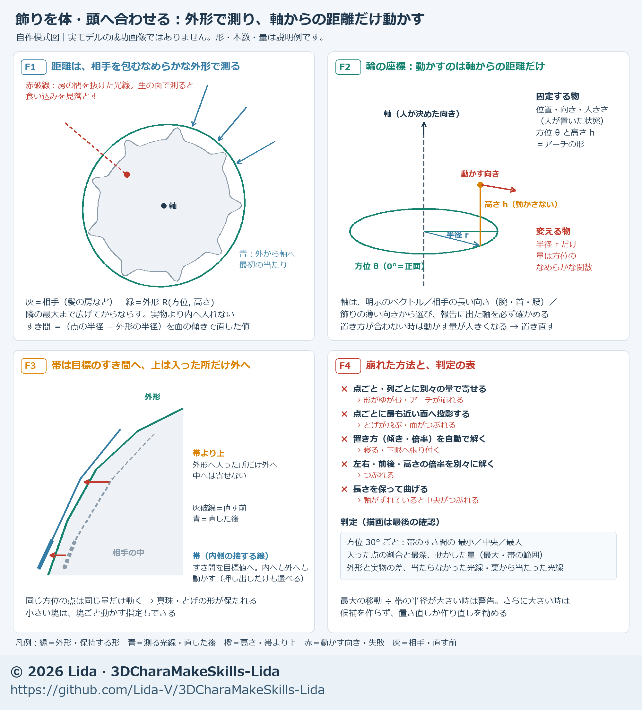

# 飾りを体・頭へ合わせる

[日本語](accessory-fit.md) · [English](en/accessory-fit.md)

[工程索引](process-index.md) · [図解索引](diagram-index.md) · [同梱ツール](model-tools.md)

**冠・腕輪・手首飾り・首飾りなど、輪や弧の形をした飾りを、置いた場所のまま体・頭へ沿わせる方法です。** 別々に生成した飾りは、置いただけでは頭や腕へ食い込んだり浮いたりします。ここでは「どこで測るか」「何を固定し、何を動かすか」「何で判定するか」を決め、同梱の [lida_accessory_fit.py](../scripts/lida_accessory_fit.py) で測定と合わせ込みを行います。



図は自作の模式図です（[SVG](../assets/accessory-ring-fit.svg)）。F1〜F4 は下の各節に対応します。形・本数・量は説明例で、実モデルの結果ではありません。

## 使う場面と、使わない場面

| 状況 | 行うこと |
| --- | --- |
| 飾りの位置・向き・大きさは決まった。食い込みや浮きだけ直したい | `measure` で測り、`fit` で合わせた候補を作る |
| 飾りが合っているかを、描画の前に数値で知りたい | `measure` だけを使う |
| 飾りの置き方そのものが合っていない（輪が腕を囲んでいない、大きさが大きく違う） | このツールでは直さない。人が置き直すか、相手に沿う形を作り直す |
| 反射・宝石・輪郭など見え方の問題 | [装飾の材質補正](accessory-materials.md) |
| 飾りの面の欠け・穴・誤接続 | [メッシュ修復と補完](mesh-repair-completion.md) |
| 動いた時の追従・揺れ | [メッシュと重み](mesh-weight.md)、[二次揺れと出力](secondary-motion.md) |

## 考え方

### F1　距離は、相手を包むなめらかな外形で測る

髪の房や衣装のひだのような生の面へ光線を当てると、房の間を抜けたり、裏の面を拾ったりして、食い込みを見落とします。相手を包むなめらかな外形を先に作り、すき間はすべてその外形に対して数えます。

- 輪の軸のまわりの方位と、軸に沿った高さの格子で、外から軸へ向けて光線を出し、最初に当たった所（いちばん外側）を半径として記録する。
- 光線の間にある出っ張りを落とさないよう、隣の格子の最大まで広げてからならす。ならした後も、広げた値より内へは入れない。外形は実物を包む側へ寄る。
- 光線は飾りの帯の少し外（`--reach-mm`）から始める。遠くの胴や広がった髪を拾わないためです。
- すき間は「点の半径 − 外形の半径」を、外形の面の傾きで割った値。頭の上のように面が軸へ倒れている所でも、面に垂直な距離に近い値になる。

### F2　動かすのは、輪の軸からの距離だけ

飾りの点を、輪の座標（軸・方位 θ・軸方向の高さ h・軸からの距離 r）で表します。直しで変えるのは r だけです。θ と h は変えないので、アーチの高さや飾りの並びは保たれます。

位置・向き・大きさは、人が決めた状態をそのまま使います。自動で解くと、頭に沿って大きく寝たり、探索範囲の端へ張り付いたりしました。置き方を変える必要がある時は、ツールの外で人が決めます。

### F3　帯は目標のすき間へ、帯より上は入った所だけ外へ

- **帯**（内側の接する線）：方位ごとに、いちばん近い 5% の点が目標のすき間（`--gap-mm`）になるよう、r を動かす。量は方位のなめらかな関数で、同じ方位の点は同じ量だけ動く。真珠やとげの形は崩れにくい。
- **帯より上**：外形へ入った所だけ外へ出す（`--floor-mm` まで）。中へは寄せない。とげや飾りを相手へ倒さないためです。
- 緩く付ける飾りは `--push-only` で、帯を中へ寄せない。
- 真珠のような小さい塊は `--rigid-islands-mm` で、塊ごと同じ向きへ動かせる。

### F4　崩れた方法

次の方法は、実際の制作で形を崩しました。同じ直しを繰り返さないための記録です。

| 方法 | 起きたこと |
| --- | --- |
| 列ごと・点ごとに別々の量で寄せる | 列の境で段になり、アーチがゆがんだ |
| 点ごとに最も近い面へ投影する（シュリンクラップ的な処理） | 真上に近いとげで向きが決まらず、とげが飛んだ |
| 置き方（傾き・倍率・位置）を自動で解く | 傾きが大きく寝た。制限を付けると倍率や傾きが範囲の端へ張り付いた |
| 左右・前後・高さの倍率を別々に解く | 飾りがつぶれた |
| 基準点を固定して拡大だけを解く | 基準点が合わず、額へ下がって大きな押し出しになった |
| 帯の長さを保って相手の輪郭へ曲げる | 輪の軸が相手の中心から外れていて、中央がつぶれた |
| 生の面への光線で食い込みを数える | 房の間を抜けて、食い込みを見落とした |
| 描画だけで合っているかを判断する | 一部の向きだけ見て、浮きや食い込みを見落とした |

## 用意するもの

- Blender と、検査する保存済みの blend。飾りと相手は別の物体にしておく。
- 飾りの物体名と、相手の物体名（頭と髪、体など。複数可）。名前は推測せず、ファイルを読んで確かめる。
- 輪の軸。明示のベクトルがいちばん確実です。
- 新しく作る JSON の保存先。`fit` では新しい blend の保存先も。
- [工程のゴール](quality-goals.md)：どの飾りを、どのすき間まで、何を保って直すか。

数値の計算は numpy を使います。Blender には同梱されています。API キー、外部サービス、ネットワーク接続は使いません。

## AI が行う順序

1. 入力版・飾り・相手・軸・出力先を確かめる。
2. `measure` を実行し、JSON の `frame`（使った軸と中心）、`outline`（外形の作り方の検査値）、方位ごとの表、`warnings` を読む。
3. 軸や中心が飾りの輪と合っていなければ、明示して測り直す。置き方が合っていない時は、ここで止めて人へ伝える。
4. `fit` で候補を作る。元の物体は残り、合わせたコピーが追加される。入力の blend は保存されない。
5. `after` の表と `move` を読む。警告があれば理由を確かめる。
6. 元と候補を一方ずつ表示し、正面・横・斜め・上から寄りで描画して形を確かめる。数値・描画・未確認を分けて報告する。

## 実行例

パスと名前は自分のファイルへ置き換えます。`--` より後ろがこのツールの引数です。

```sh
blender --background --factory-startup --disable-autoexec --python-exit-code 1 --python lida_accessory_fit.py -- measure --input model.blend --accessory Tiara --partners Head Hair --axis 0 0.26 0.97 --band-axial 0.3 --report tiara-before.json
blender --background --factory-startup --disable-autoexec --python-exit-code 1 --python lida_accessory_fit.py -- fit --input model.blend --accessory Tiara --partners Head Hair --axis 0 0.26 0.97 --band-axial 0.3 --report tiara-fit.json --output-blend tiara-candidate.blend
blender --background --factory-startup --disable-autoexec --python-exit-code 1 --python lida_accessory_fit.py -- fit --input model.blend --accessory Bracelet_L --partners Body --axis-from partner --report bracelet-fit.json --output-blend bracelet-candidate.blend
```

既存の JSON・blend は出力先にできません。終了コードは 0＝完了、2＝警告つきで完了、または断った（候補なし）、1＝入力・実行エラーです。引数の不足など使い方の誤りも 2 で止まり、JSON は作られません。今回作られた JSON の `status` で区別します。

候補の blend には元の飾りと合わせたコピー（既定の名前は `元の名前_fit`）の両方が入ります。`--hide-source` を付けると、候補の中で元の飾りを非表示にします。

## 軸と中心

| 指定 | 向いている物 | 注意 |
| --- | --- | --- |
| `--axis X Y Z` | 冠・髪飾りなど、人が向きを決めた物 | いちばん確実。傾けた冠は、傾けた上向きを渡す |
| `--axis-from partner` | 腕輪・手首飾り・足首飾り | 飾りの近くの相手の点の、いちばん長い向き。胴に近い所では胴の向きを拾うことがある |
| `--axis-from accessory` | 薄い輪 | 飾りがいちばん薄い向き。垂れ飾りが付くと外れる |
| `--center X Y Z` | 中心を決めてある時 | 軸の通る点 |
| `--center-from accessory`（既定） | 多くの輪・弧 | 飾りの内側の点へ円を当てはめる |
| `--center-from partner` | 腕・首など断面が丸い相手 | 相手の外形の重心へ寄せる |

`--front` は方位 0° の向きです（既定は −Y）。表の方位はこの向きから数えます。使った軸・中心・その出どころは、必ず JSON の `frame` に出ます。自動で決めた時は、その値が飾りの輪と合っているかを確かめてください。

## 主なオプション

| オプション | 既定 | 意味 |
| --- | --- | --- |
| `--gap-mm` | 1.2 | 帯の目標のすき間 |
| `--floor-mm` | 0.4 | 帯より上の点を外へ出す下限 |
| `--band-axial` | 1.0 | 各方位で、軸方向の何割を帯とみなすか。冠のように下の縁だけが接する物は 0.3 など |
| `--band-side` | low | 帯が軸のどちら側にあるか（low＝軸の根元側、high＝先側） |
| `--band-depth-mm` | 帯の半径の 3% | 接する線の厚み |
| `--push-only` | 切 | 帯を中へ寄せない |
| `--rigid-islands-mm` | 0（切） | この大きさ以下のつながった塊を、塊ごと動かす |
| `--reach-mm` | 40 | 光線を帯のどれだけ外から始めるか |
| `--backfaces` | keep | skip にすると、裏から当たった面を通り抜ける。光線が相手の中から始まる時に使う |
| `--grid-theta` / `--grid-height` | 180 / 64 | 外形の格子の細かさ |
| `--inside-tolerance-mm` | 0.5 | これより深く入った点を「入った点」と数える |
| `--stretch-warning` / `--stretch-limit` | 0.15 / 0.5 | 最大の移動 ÷ 帯の半径。前者で警告、後者で候補を作らない |
| `--sectors` | 72 | 帯の動きを解く方位の分割数（12 以上）。細かくすると方位ごとの差に細かく従う |
| `--copy-name`（`fit`） | 元の名前 + `_fit` | 合わせたコピーの名前 |

長さは mm で渡します。シーンの単位の設定から換算します。既定値は作例の条件で、全モデルの品質条件ではありません。

## 判定の表の読み方

| JSON の場所 | 見ること |
| --- | --- |
| `frame` | 使った軸・中心・その出どころ、閉じた輪か開いた弧か、帯の半径 |
| `outline.miss_ratio` | 当たらなかった光線の割合。冠のように相手より上へ出る物では大きくて正常。半分を超えると警告 |
| `outline.first_hit_backface_ratio` | 最初に裏から当たった光線の割合。大きい時は、光線が相手の中から始まったか、相手の面の向きが乱れている |
| `outline.real_points_outside_outline_mm` | 外形と実物の差。相手の点が外形の外へどれだけ出ているか。細い房の先で数 mm 出ることがある |
| `before` / `after` の `per_azimuth_band` | 方位 30° ごとの、帯のすき間の最小・中央・最大。最小が負なら、その方位で食い込んでいる。中央が大きい方位は浮いている |
| `all_points_inside_ratio` / `deepest_mm` | 全部の点のうち、許容より深く入った割合と、最深 |
| `move` | 動かした量（最大・中央）、帯の動きの範囲、押し出しの最大、軸方向の変化（0 のはず）、最大の移動 ÷ 帯の半径 |
| `warnings` | 残った食い込み、大きい伸び、外形の疑い、断った理由 |
| `unverified` | このツールが確かめていないこと |

帯の最小は、いちばん近い 5% を目標へ合わせるので、目標より少し小さくなります。帯の中央が数 mm 空くのは、帯の面のでこぼこの分です。表の値が良くても、形が崩れていないことは描画で確かめます。

## 警告と、断る場合

- **大きい伸び**：最大の移動が帯の半径の 15% を超えると警告します。飾りは形を保つより伸ばされています。描画で確かめ、気になる時は置き直すか、相手に沿う形を作り直します。
- **断る**：50% を超えると候補を作りません。輪が相手を囲んでいない、軸や中心が違う、大きさが大きく違う、のいずれかです。置き方は人が決めます。
- **外形の疑い**：裏から当たった光線が多い時は `--reach-mm` を小さくするか、`--backfaces skip` を試し、結果を比べます。髪のように面の向きが乱れた相手では、skip は房を落とすことがあります。

## 飾りごとの始め方

| 飾り | 軸 | 帯 | 補足 |
| --- | --- | --- | --- |
| 冠・ティアラ（前だけの弧） | 明示。傾けた上向き | `--band-axial 0.3` 前後 | 相手は頭と髪。後ろの輪は別に扱う |
| 腕輪・手首飾り・足首飾り | `--axis-from partner` か明示 | 全体（既定） | 緩く付けるなら `--push-only` |
| 首飾り | 明示（首の向き） | 全体、または上の縁 | 相手は首と体。胸へ垂れる部分は帯にしない |
| 腰飾り・ベルト | 明示（上向き） | 全体 | 相手は体と下の衣装 |
| 垂れ飾りの付いた輪 | 明示 | 全体 | 垂れ飾りが中心の推定を外すことがある。`frame.center` を確かめる |

これは始め方の目安です。実際の軸・帯・すき間は、飾りの形と置き方に合わせて決めます。

## AI への依頼文の例

> 【入力版】の【飾りの物体名】を、置いた位置・向き・大きさのまま【相手の物体名】へ合わせてください。同梱の `lida_accessory_fit.py` を使い、軸は【明示のベクトル／相手の向き】です。まず `measure` で方位ごとのすき間と食い込みを報告し、軸と中心が輪に合っているかを確かめてください。次に `fit` で候補を作り、帯の目標のすき間は【1.2 mm】、【下の縁の 3 割】を帯とします。アーチの高さと飾りの並びは変えず、点ごとの投影や自動の置き直しは行わないでください。警告や断りが出た時は、無理に合わせず理由を報告してください。最後に、元と候補を別々に表示した正面・横・斜め・上からの寄りの描画で形を確かめ、数値・描画・未確認を分けて報告してください。入力の blend は上書きしないでください。

置き方を変えたい時は、依頼を分けます。

> 【飾り】の位置は私が Blender で決めました。この位置・向き・大きさは変えないでください。残る食い込みと浮きだけを、輪の軸からの距離の直しで合わせてください。

## パネルから使う（任意）

[lida_accessory_fit_panel.py](../scripts/lida_accessory_fit_panel.py) は、同じ処理を 3D ビューのサイドバーから呼ぶための任意のスクリプトです。導入はしません。そのセッションだけ登録します。

```sh
blender model.blend --python lida_accessory_fit_panel.py
```

1. `lida_accessory_fit.py` と同じフォルダに置いたまま起動する（Blender のテキストエディターから実行してもよい）。
2. 相手のメッシュを選び、最後に飾りを選ぶ（飾りがアクティブ）。
3. サイドバーの「Lida Fit」タブで軸とすき間を決め、「Measure gap」「Fit a copy」を押す。
4. 「Fit a copy」は合わせたコピーを追加し、元をビューで非表示にする。取り消し（Undo）で戻せる。JSON はテキストブロック `lida_accessory_fit_report` に入る。

パネルは blend ファイルも設定も保存しません。保存するかどうかは人が決めます。常に使うアドオンとして導入する場合は、2 つのファイルを同じフォルダに置く必要があり、導入の可否は制作者が判断します。

## 確認済みの範囲

**Blender 5.3.0 の背景実行**で、実際の制作の保存済みファイルを読むだけで、`measure`・`fit`・置き方が合わない飾りを断る場合を確かめました。入力のファイルは変わりません。

通常の Python では、解析的な楕円の筒を相手にした 11 件のテスト（配布元リポジトリの `tests/test_accessory_fit.py`）で、外形が実物を包むこと、軸方向と方位が変わらないこと、開いた弧の判定、押し出しだけ、塊ごとの移動、警告と断り、既存出力の保護を確かめています。パネルは背景実行で、登録・測定・コピーの追加・レポートの保存を確かめました。画面での操作は確かめていません。

確かめていないこと：ほかの Blender 版、モディファイアやポーズを適用した形、シェイプキーのある飾り（今は拒否します）、合わせた後のテクスチャの伸びと法線、ほかの飾りとの接触、動作中の追従、書き出し後と使用先での見え方。

## 利用条件

2 つのスクリプトは **GPL-3.0-or-later** です。適用範囲はファイル冒頭と[同梱 GPL 本文](../scripts/LICENSE-GPL-3.0-or-later.txt)を確認します。文書・図解の条件とは分けます。モデル・画像・動画を制作するだけなら、その成果物へのクレジットは不要です。詳しくは[利用区分](usage-and-attribution.md)へ。
