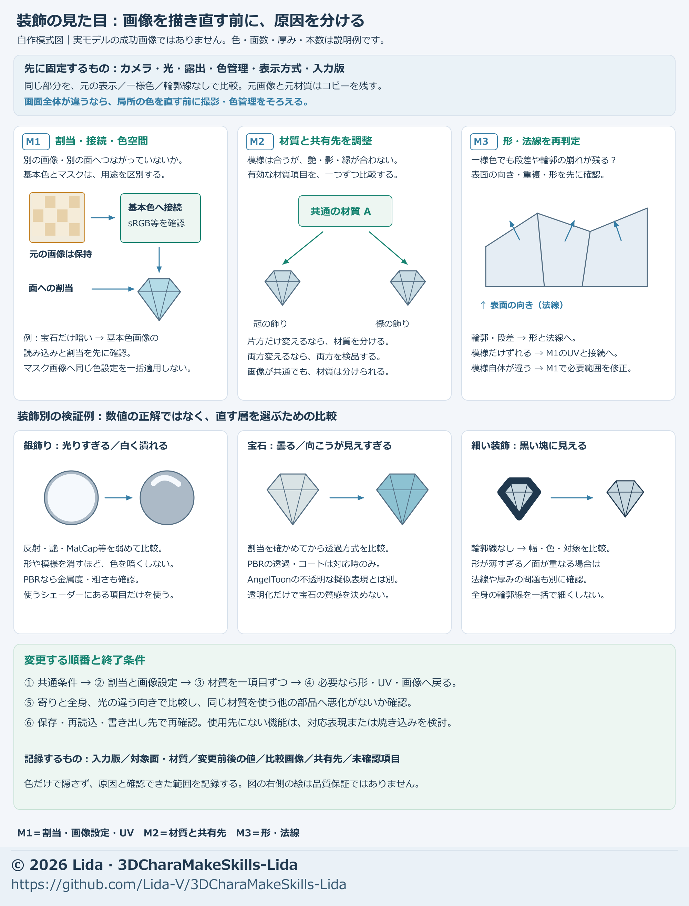

# アクセサリー・装飾の材質を直す

[工程索引](process-index.md) · [使用先の外観差](cross-engine-look.md) · [UV・画像・材質の対応](adjustment-methods.md#uv画像材質を一組で渡す)

銀飾り・冠・宝石・金具の「光りすぎる・白い・黒くつぶれる」を、最初から画像へ描き直すと、別の角度や使用先で崩れることがあります。**取り込みと割当を確認し、材質・画像・形と法線のどこが原因かを分けます。** 画像も材質への入力なので、完全な二択ではありません。

## 開始時のゴールと用意するもの

| 項目 | 決めて渡す内容 |
| --- | --- |
| ゴール | 指定の距離で装飾の色・形・細部を読める状態。原画の色と、動く艶のどちらを合わせるかも示す |
| 入力 | 基準モデルと材質・画像の版、原画の拡大、症状が出る角度、使用先とシェーダーの版 |
| 変更と固定 | 修正対象の部品・材質。元画像の画素、UV、形・キー・骨・重み、対象外を保持するか |
| 比較 | 同じカメラ・姿勢・解像度・光・固定露出。全身の実用距離と装飾の拡大 |
| 終了 | 原因を説明でき、指定の見え方を保存後と使用先で確認できる。未対応機能は残件にする |
| 提出 | 前後画像、部品と材質の対応表、変更値・接続・割当、保持結果、未確認範囲 |

症状の出ない角度も一つ用意します。原本は保持し、診断用コピーで入力を外したり差し替えたりします。

## 図で修正先を選ぶ

[SVGで拡大](../assets/material-repair-selection.svg)。M1〜M3は修正先の分類で、必ず番号順に直す指示ではありません。最初に共通の入力・表示条件を確認します。図の色・値は実モデルの測定結果でも、全装飾へ使う設定でもありません。

| 症状・確認結果 | 先に検証する修正先 | その場でしないこと |
| --- | --- | --- |
| 一部だけ違う色、別エンジンだけ白い | **M1** 面の材質割当、参照画像、色空間・圧縮を先に確認。材質色の乗算やプリセットなら**M2**へ | 誤った取り込みを元画像の塗り直しで相殺しない |
| 光や視点で白飛び・艶の強さが変わる | **M2** 反射・艶・MatCap、明部の圧縮。共通の露出も確認 | 全金属の基本色や金属度を一律変更しない |
| 宝石が曇る、透けすぎる、重なりで消える | **M2** 対応する透過・コート・粗さ、描画方式と順序 | 全シェーダーが透過・屈折を再現できると扱わない |
| 細い鎖や銀線が黒い塊になる | **M2** 輪郭の幅・色・対象範囲。線を一時無効にして比較 | 画像へ明るい線を描く前に、輪郭が原因か調べる |
| 模様や暗さが表面の同じ位置へ貼り付く | **M1** 基本色、AO、影色、マスクを個別に確認 | 描き影とAO、材質の影を一括で明るくしない |
| シルエット、厚み、面の向きや接続が不自然 | **M3** 実形状、面向き、平滑化・カスタム法線 | 艶や模様で穴・潰れ・接続不良を隠さない |

全体が同時に明暗変化する場合は、[光・色管理・露出の診断](cross-engine-look.md#調整する順番)へ戻ります。欠け・誤接続・不足する体積は[メッシュの修正と補完](mesh-repair-completion.md)へ進みます。

## 最初に：どの面が何を使うかを確認する

1. **対象を特定する。** 部品を単独表示し、材質スロットごとの色分けなどで、見えている面への割当を確認する。「銀材質」という名前だけで判断しない。
2. **対応表を作る。** 部品／面の範囲 → 材質 → 画像・マスクとUV層 → 使用先の材質を一行につなぐ。共有先は名前の一致だけで決めず、実際に同じ材質データを参照する部品を一覧にする。
3. **画像の役割を確認する。** 通常のsRGB基本色画像と、linearとして読む数値マスクを区別する。画像の実際の役割と元の色空間へ合わせ、法線画像との誤判定や圧縮も調べる。
4. **値を読み直す。** 設定を変更したら保存し、取り込み後の値を確認する。再インポートやプリセット生成で戻るなら、その設定元も修正対象にする。

リダの宝石では、色画像が法線マップと自動判定され、sRGBが無効になっていました。圧縮設定を先に直してからsRGBを設定し、読み戻して色が戻ることを確認しました。**この例は画像の画素修正ではありません。**

## M2：画像を保ったまま材質を調整する

### 原因を一つずつ外す

1. 基準画像を撮り、対象の基本色・AO・影・法線入力・艶・MatCap・輪郭の接続と値を記録する。
2. 診断用コピーで疑う要素を一つだけ無効化し、同条件で撮る。例えば鎖なら輪郭、銀の白飛びなら艶や加算MatCapを先に比較する。
3. 元へ戻して次の要素を試す。複数を同時に切った結果だけでは原因を特定しない。透明な宝石は、背景と重なる面も確認する。
4. 原因の項目だけを少数案で変更する。元・控えめ・強めなどを並べ、正面で改善しても斜めや全身で細部が失われる案は採らない。

### シェーダーにある項目で直す

| 実装 | 使える項目と調整の見方 |
| --- | --- |
| PBR系 | 反射の強さ・粗さ・金属度、対応する透過やコート。粗さは反射の広がり、金属度は表面の性質に関わるため、明るさを合わせる目的だけで全体へ固定値を入れない |
| AngelToon | `Spec Strength`で艶の強さ、`Spec Size`で広さ、`Spec Soft`で境界を比較。現実装ではSizeは1に近いほど狭い。加算/乗算MatCapとその強さ、`Highlight Knee`による明部圧縮、輪郭の幅・色も別項目として扱う |
| 対応しない機能 | 透過・コート・屈折などの入力がなければ、同名の値を探して模倣しない。対応する表現を選び、必要なら出力用画像への焼き込みを別工程にする |

AngelToonの艶やMatCapはPBRの金属度・粗さの置換値ではありません。MatCapは視点で変わる表現なので複数角度で見ます。**MatCap画像そのものを作り直した場合は、画像修正として記録**してください。入力と機能は[AngelToonの仕様](https://github.com/Lida-V/LidaAngelToon/blob/main/docs/SPEC.ja.md)も確認します。

### 共有材質への波及を防ぐ

- 変更前に、同じ材質を使う冠・鎖・腰飾りなどを並べる。共有先も良くなるなら、そのまま共通調整できる。
- 対象だけ別の調整が必要な場合に、材質の複製か対応する局所マスクを選ぶ。複製しただけでは割当は変わらないため、対象の面を新材質へ割り当て、元の面を再確認する。
- マスクを新しく作った場合は、その画像も変更物に含める。材質を細かく分ける場合は、使用先の材質数・描画負荷の条件も確認する。

### 次の修正で迷わないための比較記録

| 記録 | 例となる書き方 |
| --- | --- |
| 基準 | 冠と腰飾りが同じ銀材質を共有。斜めの光で冠の細部だけ白く消える |
| 切り分け | 艶だけ無効にすると細部が戻る。輪郭だけ無効にしても白さは変わらない |
| 候補 | 画像を保持し、艶の強さだけを弱めた案。実際の項目名と前後値を残す |
| 共有先 | 腰飾りまで暗くなったため共通変更は不採用。冠の対象面だけ複製材質へ割り当てる |
| 判定 | 全身と斜めの拡大、別方向の光で比較。保存後と使用先の結果は別欄にする |

これは記録の型です。実施していない試験や採用を、この例から実績として転記しません。

## M1・M3：画像と形・法線を切り分ける

診断用コピーで、基本色の画像を単色へ一時差し替えます。透明度が必要なら元のアルファを保ち、AO・影色・艶も別々に切り替えてください。基本色だけ外して残った暗さを、すぐ形の問題と決めません。

| 比較で分かったこと | 次に行うこと |
| --- | --- |
| 特定の画像を外した時だけ症状が消える | 画像の模様・描き影・UV対応を確認。必要な画像やマスクだけ別出力で局所補正し、原本と変更範囲外の画素を保持する |
| 単色でも同じ位置が折れる・くぼむ | 法線表示、面向き、平滑化を確認し、必要なら法線入力・カスタム法線を外して実形状と比較する |
| 法線設定を外しても輪郭や断面が崩れる | 接続と体積を修正する。材質だけの補正として報告せず、UV・重み・キーなどの再確認へ切り替える |
| 使用先だけ症状が出る | 取り込み時の法線・材質・画像、対応機能と描画順を基準環境と照合する |

確認後は診断用の単色や無効化を戻します。画像修正が必要な場合も、使用先の制限への対応と、原画の模様自体の修正を分けて残してください。

## 実制作から分かった調整と限界

| 例 | 実際に行ったこと | 確認範囲・限界 |
| --- | --- | --- |
| 銀飾りが強く光る | 材質を複製し、反射を弱め粗さを上げた。画像・UV・形などを保持して同条件比較 | Blender EEVEE候補の保存読込まで。他の使用先の再現を同時に保証しない |
| 細い鎖や銀線が暗い塊に見える | 輪郭の色・幅を調整し、一部の小さい装飾を輪郭の対象から外した | 世界寸法の線幅は、距離が変わると画面上の太さも変わる |
| 宝石がすりガラス状に見える | 追加の材質補正で透過を下げ、コートの色味などを調整した | 先に基本色画像へ面や白線を追加した作業とは別。コートの色味はglTF/MToonへそのまま移らない |

これらは今回の制作例です。反射・粗さ・線幅の数値、全装飾への同じ処理、全エンジンでの同一結果を既定にしません。

## 保存・使用先と終了判定

1. **保持を確認する。** 材質だけの修正なら元画像の内容ハッシュ、UV・形・キー・骨・重み、対象外の材質を照合する。意図した材質複製・面割当の変更は別に記録する。
2. **変更を再現できる形で残す。** 材質名だけでなく、前後の値、画像参照、ノード接続、共有先と面への割当を保存する。[補助ツールのsnapshot](model-tools.md#レポートで分かる範囲)は材質ノード内部や外部画像の内容を比較しないため、別途記録が必要。
3. **用途の見え方で確認する。** 固定した基準条件に加え、必要な別方向の光・正面/斜め/横・全身と拡大・必要動作で見る。全身の冠や鎖が塊にならないこと、視点で宝石が消えないことを確認する。
4. **保存後と使用先で確かめる。** 新しく読み込み、画像欠落・旧プリセットへの復帰・輪郭・透明な面の重なりを見る。出力で再現しない機能は、別材質や焼き込みが必要かと未確認範囲を残す。

終了報告は「原因／直した層／保持結果／保存後／使用先／残件」を短く一組にします。局所の見栄えが良くなったことを、全身や全使用先の合格へ広げません。

## AIへの初回指示例

銀飾りと鎖：

> 添付の装飾を、指定の全身距離でも銀の形と細部が読める状態へ整えてください。開始時に入力版・比較条件・終了条件を示し、部品→面の材質→画像・マスク→共有先を対応させてください。取り込みと色管理を確認後、輪郭・艶・MatCapを一つずつ外して原因を特定し、使用シェーダーにある項目だけ少数案で比較。元画像・UV・形・キー・重み・対象外は保持。局所の材質分離が必要なら面への再割当と共有先への波及も確認してください。前後の全身と拡大・複数角度、変更値と接続、保存読込・指定使用先の結果と残件を提出してください。

宝石の曇りや色違い：

> 添付の基準色を保ち、宝石の曇りと白っぽさの原因を分けてください。最初に基本色画像の誤った法線判定・色空間・圧縮・材質割当を確認。その後に透過・コート・艶・描画方式を単独比較し、単色への一時差し替えも使って画像と形・法線を切り分けてください。原本を保持し、材質だけで直る場合は画像を描き直さないでください。入力にない機能は再現できると扱わず、必要な画像修正は別出力の範囲を示してください。同じ光・露出の前後、複数角度と背景、保存後と使用先の結果、保持項目・残件を報告してください。

© 2026 Lida · 出典：[3DCharaMakeSkills-Lida](https://github.com/Lida-V/3DCharaMakeSkills-Lida)
