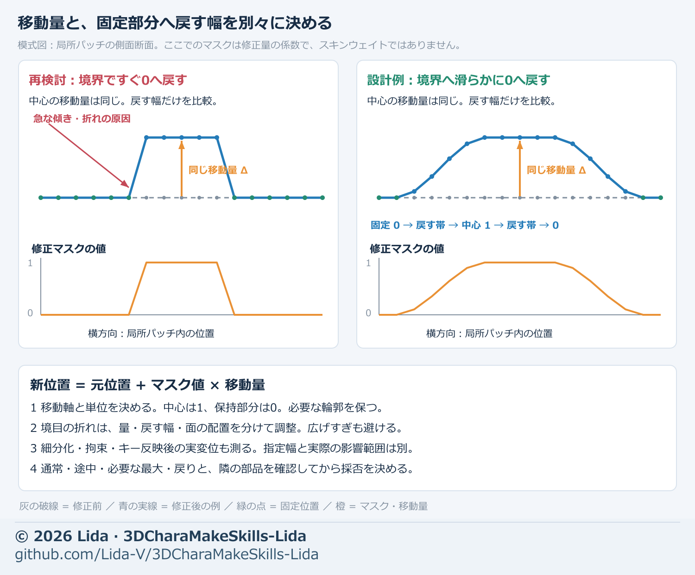

# 何を、どれだけ、どの範囲で調整するか

[工程索引](process-index.md) · [AIへの指示](ai-instructions.md)

修正は、原因を分けてから、変更量・基準軸・固定範囲を決めます。元の良い形へ戻れる複製で、同じカメラ・姿勢・照明の比較を作ってください。

## 最初の6手順

1. 症状が出る部位・向き・動作と、入力版を固定する。
2. 形・接続・骨・ウェイト・法線・画像・表示を切り分ける。
3. 単位、移動軸、倍率の中心、形の目印を記録する。
4. 問題部の量と範囲を変え、固定境界へ滑らかに0へ戻す。
5. 関連する服・飾り・支持面・補正キーも対応を合わせる。
6. 通常・途中・必要な最大・戻りを比較し、保存後の保持結果と残件を記録する。

## 症状に合う調整を選ぶ

| 症状 | 実際に触るもの | 同時に見ること |
| --- | --- | --- |
| 通常形の段・くぼみ | 頂点の位置、面の流れ、接続 | 周囲の曲率、輪郭、固定境界 |
| 動くと裂ける・潰れる | 骨の中心と軸、ウェイトの境、網目 | 途中姿勢、内外の厚み、服や飾り |
| 毛先が枝分かれする | 根元からの接続、一本の中心線、幅と厚みの絞り | 根元と流れ。枝先だけ削って済ませない |
| 髪に板状の突出 | 内外の面順序、必要な点の前後位置 | 隣の毛束と輪郭。平滑化だけでは順序を直せない |
| 暗線・模様・影が不自然 | 形、法線、基本色、描き込み影、表示用の辺 | 一様色・法線マップなし等で原因を分ける |
| 飾りが浮く・管が潰れる | 部品単位の移動・回転、帯端の曲率、管の断面 | 太さと接続。各点を最近傍面へ押すだけにしない |

## 髪のまだらをAOから診断する

AOは奥まった所の暗さを表す値です。採用形、問題の拡大画像、基本色・影・AO・法線・艶を分けて表示できるコピーを用意します。

1. 同じカメラ・光で、各要素を一つずつ外して比べる。画像だけで綺麗なら、解像度を上げる前に陰影を調べる。
2. 粗い網目に焼いた頂点AOが影の境目をまだらに動かす場合は、対象部品だけをならし、暗さを残す割合も別に調整する。弱・中・強を同条件で比べ、毛束の深さを残す。
3. 共有材質の係数を変えると他の髪にも波及するため、対象部品の頂点属性や局所マスクへ限定する。表示用と書出し用へ同じ補正を一度だけ適用する。
4. 表情と正面・横・上の光で再確認し、対象外の形・画像・陰影の保持も調べる。

リダの前髪では、AOを8回ならし、暗さを35%残す案を選びました。回数と割合は今回の作例で、他モデルの既定値ではありません。平滑化だけでは大きい斑が残ったため、暗さも別に調整しています。

AOが0＝暗い、1＝遮蔽なしの値なら、`新AO = 1 - (1 - ならしたAO) × 残す暗さ`で強さを分けられます。残す暗さ0はAOの暗さなし、1はならした値のまま。値の意味が違うシェーダーでは、先に範囲と明暗の向きを確認します。

初回指示例：「基本色・AO・影・法線・艶を一つずつ外して原因を特定し、【部品】だけの平滑化と暗さを比較してください。共有する他部品を保持し、表情と光の向きを変えた図、出力後の比較も提示してください。」

## 量と境界の決め方

橙は修正マスク、青は修正後の位置、緑は固定点です。ここでのマスクはスキンウェイトではありません。移動量と戻す幅を別々に試し、評価後の実変位を確認します。

局所移動は `新位置 = 元位置 + マスク値 × 移動量`。中心を1、保持部を0にして間をなだらかにつなぎます。境界に折れが出たら、量・戻す幅・元の面密度を分けて確認します。

まず食い込みや段の幅を測り、弱い案と必要量を比較します。消えた案から量を減らして境目を探し、動作で必要な余裕を確かめます。

リダの髪の作例では、0.7mmで板が残り、0.8mmで消え、1.0mmを選びました。これはその部位の作例値で、他の髪の推奨値ではありません。毛束の合流線など別の残件もあり、髪全体の完成を意味しません。

細分化や補間で影響がマスクの外へ広がることがあります。設定した幅と、評価後に実際に動いた範囲を両方測ってください。

拡大縮小は `新位置 = 中心 + 倍率 × (元位置 − 中心)`。倍率だけでなく中心を指定し、顎・首・飾りへの影響を見る。頭身は、頭頂と顎など同じ目印の定義で測り、髪込みの高さと頭蓋の大きさを混ぜません。

## 依存する部品も直す

髪の模様・欠け・板状突出は[原因の切り分け図](../assets/hair-cause-isolation.png)で確認します。一様色、網目、断面を順に調べ、基本色・接続・面の順序を混同しません。

- 同じ網目で基準形を変える場合は、必要なキーにも変位を反映し、意図した相対変形を保つ。
- 網目を作り直した場合は、旧頂点番号でキーや重みを流用せず、対応を再構築する。
- 表示する布と非表示支持面は、対応した位置と変位を確認し、必要な拘束を設定し直す。
- 描き込み影は最終形状の後に元画像から作り、修正のたびに重ねて暗くしない。

布の総交差数が減っても、別の段へ新しい貫通を移した可能性があります。[スカートと補完](skirt-hidden-modeling.md)で部品ごとの悪化を確認します。口と目は[表情の調整](expression-adjustment.md)へ進んでください。

## UV・画像・材質を一組で渡す

UVは「画像のどこを各面へ貼るか」の対応です。**画像だけ渡しても、そのモデルへの貼り方は含まれません。** 形と基本追従が固まった部位について、次の対応をそろえます。

| 渡すもの | 対応表に残すこと |
| --- | --- |
| UVを持つメッシュ | 入力版、部品名、使うUV層、意図する重複・左右反転 |
| 材質と面の割当 | どの面がどの材質を使い、どの画像・UV層を参照するか |
| 対応する画像 | ファイル名・役割（基本色、AOなど）・寸法、保存済みか、使用先で必要な設定 |

1. **貼り方を先に確認する。** 格子で伸び・反転・継ぎ目を見てから、実画像で模様の方向と位置、線の太さを普段の距離と必要な動作で比較する。意図した重複UVは件数だけで直さない。
2. **再配置の必要を判断する。** 既存UVが使えるなら保持する。UVを動かす場合は画像との対応も変わるため、必要な部位だけ画像の移し替え・再焼き込みを行う。画像解像度の変更だけで対応は直らない。
3. **元画像と出力先を分ける。** 新しい形に対応するAOなどは必要な範囲だけ作り直し、元画像へ補正を重ねない。原本を保持したコピーで、対象外のUV・材質・画像が変わっていないか確認する。
4. **保存して読み直す。** 画像を保存し、外部参照は渡すファイルへ含めるか、制作形式が対応する埋込みを使う。新しく読み込んだモデルで画像の欠落・違うUV層・材質の誤割当を確認する。使用先へ出力する場合は、そこでの色・透け・継ぎ目を別に比較する。

初回指示例：「【部品】のUVを持つメッシュ・画像・材質割当の対応表を作り、格子と実材質で確認してください。必要がなければ既存UVを全体再配置せず、変更部だけ画像を移し替えて元画像を保持してください。保存後の新規読込と使用先で確認し、未確認の範囲を報告してください。」

## 追加した髪のUVと焼き込み

既存画像の同じUV領域を使う部品は、表示では流用できても、部品別のAOなどを同じ画像へ焼くと元の内容と衝突します。上の[対応表と保存確認](#uv画像材質を一組で渡す)を使い、焼き込み先の共有を先に調べます。

衝突する場合だけ、出力用コピーで追加部品の材質・UV・画像を分離します。原本と既存の髪を保持し、毛の向き、継ぎ目、出力後の陰影を確認します。網目や形を変更したら、旧い形に対応するAOを無検証で使い回しません。

初回指示例：「追加部品のUV重複を調べ、焼き込みが衝突する場合は出力用コピーで材質・UV・画像を分離してください。既存画像を保持し、読み戻した毛の向きと継ぎ目を比較してください。」

## 補正か、作り直しか

局所の位置や陰影なら保持範囲を決めて補正します。頭蓋や頬の体積、関節の位置・長さ、毛束の接続が基準と違う場合は、同じ係数の修正を続けず構造を再診断します。

次回へは「症状→原因→軸と単位→量と範囲→固定部分→関連部品→比較結果と残件」を残します。[試行錯誤の記録](trial-and-error.md)へ後から追加した条件を統合し、一回で採用できる保証とは書かないでください。
