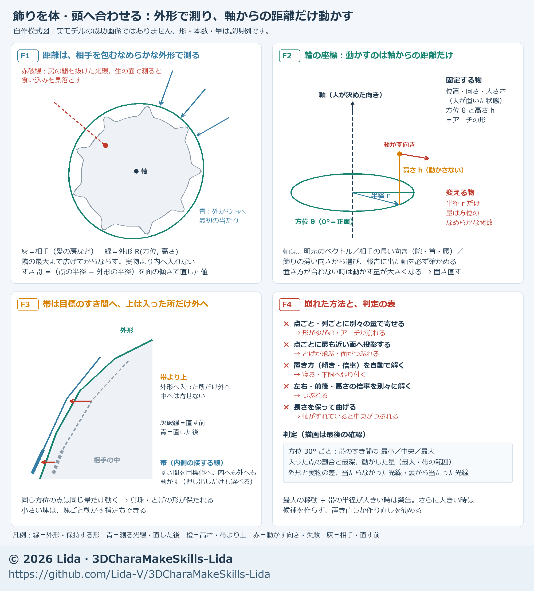

# Fitting accessories to the body and head

[日本語](../accessory-fit.md) · [English](accessory-fit.md)

[Process index](process-index.md) · [Diagram index](diagram-index.md) · [Bundled tools](model-tools.md)

**This is the method for making a ring- or arc-shaped accessory (tiara, armlet, wrist ornament, choker and similar) follow the body or head where it was placed.** Separately generated accessories cut into the head or arm, or float, when they are merely placed. This chapter fixes where to measure, what to keep, what to move and how to judge, and uses the bundled [lida_accessory_fit.py](../../scripts/lida_accessory_fit.py) for measurement and fitting.



The figure is an original schematic ([SVG](../../assets/accessory-ring-fit.svg)); its labels are Japanese. F1–F4 match the sections below: F1 measure against a smooth enclosing outline (green) instead of raw tufts (grey; the red dashed ray slips between tufts), F2 ring coordinates where only the radius changes, F3 the band goes to the target gap while the part above is only pushed out, F4 methods that broke the shape and the judgement table. Shapes, counts and amounts are illustrative, not results from a real model.

## When to use it, and when not

| Situation | What to do |
| --- | --- |
| Position, direction and size are decided; only penetration and floating remain | Measure with `measure`, create a fitted candidate with `fit` |
| You want numbers before rendering | Use `measure` only |
| The placement itself does not match (the ring does not surround the arm, the size is far off) | Not a job for this tool. A person re-places it, or a piece that follows the partner is modelled |
| Reflection, gems, outlines and other look problems | [Accessory material corrections](accessory-materials.md) |
| Missing faces, holes or wrong connections in the accessory | [Mesh repair and completion](mesh-repair-completion.md) |
| Following and swaying in motion | [Mesh and weights](mesh-weight.md), [Secondary motion and output](secondary-motion.md) |

## Principles

### F1 Measure against a smooth outline that encloses the partner

Rays cast at raw faces such as hair tufts or cloth folds slip between tufts or pick up back faces, so penetration is missed. Build a smooth outline that encloses the partner first, and count every gap against it.

- On a grid of azimuth around the ring axis and height along it, cast rays from outside toward the axis and record the first hit (the outermost surface) as a radius.
- Widen each cell to the largest neighbour so that features between rays are not lost, then smooth. The smoothed value never goes below the widened one, so the outline errs toward enclosing the real surface.
- Rays start slightly outside the accessory band (`--reach-mm`), so a distant torso or widely spread hair is not picked up.
- A gap is "point radius − outline radius" divided by the slope of the outline surface. Where the surface leans toward the axis, as on top of a head, the value stays close to the distance perpendicular to the surface.

### F2 Move only the distance from the ring axis

Accessory points are expressed in ring coordinates: axis, azimuth θ, height h along the axis and distance r from the axis. The correction changes r only. θ and h stay, so arch heights and the order of ornaments are kept.

Position, direction and size are used exactly as a person decided them. Solving them automatically laid the piece far back along the head or pinned values to the ends of their search ranges. When the placement has to change, a person decides it outside the tool.

### F3 The band goes to the target gap; the part above is only pushed out

- **Band** (the inner contact line): per azimuth, r moves so that the closest 5% of points reach the target gap (`--gap-mm`). The amount is a smooth function of azimuth, and points at the same azimuth move by the same amount, so pearls and spikes tend to keep their shape.
- **Above the band**: only what has entered the outline is pushed out (up to `--floor-mm`). Nothing is pulled in, so spikes and ornaments are not tipped toward the partner.
- For a loosely worn accessory, `--push-only` never pulls the band inward.
- Small pieces such as pearls can move as whole pieces with `--rigid-islands-mm`.

### F4 Methods that broke the shape

The following methods damaged the shape in real production. They are recorded so the same correction is not repeated.

| Method | What happened |
| --- | --- |
| Pulling each column or point by its own amount | Steps appeared between columns and the arch was distorted |
| Projecting each point onto the nearest face (shrinkwrap-like) | Direction was undefined for near-vertical spikes, which flew off |
| Solving the placement (tilt, scale, position) automatically | The piece lay far back; with limits, scale and tilt stuck to the ends of the ranges |
| Solving left-right, front-back and height scales separately | The accessory was squashed |
| Solving scale only while pinning a reference point | The reference point did not match; the piece dropped toward the forehead and needed a large push |
| Bending along the partner contour while keeping the band length | The ring axis was off the partner's centre and the middle collapsed |
| Counting penetration with rays against raw faces | Rays slipped between tufts and penetration was missed |
| Judging the fit from renders alone | Only some directions were viewed, and floating and penetration were missed |

## What to prepare

- Blender and a saved blend to inspect. The accessory and the partner are separate objects.
- The accessory object name and the partner object names (head and hair, body and so on; several are allowed). Read the file instead of guessing names.
- The ring axis. An explicit vector is the most reliable.
- A path for the new JSON; for `fit`, also a path for the new blend.
- The [stage goal](quality-goals.md): which accessory, to which gap, keeping what.

The numeric part uses numpy, which Blender bundles. No API key, external service or network connection is used.

## Order for an AI agent

1. Confirm the input version, accessory, partners, axis and output paths.
2. Run `measure` and read `frame` (axis and centre used), `outline` (checks of how the outline was built), the per-azimuth table and `warnings` in the JSON.
3. If the axis or centre does not match the accessory's ring, state them explicitly and measure again. If the placement does not match, stop here and tell the person.
4. Create a candidate with `fit`. The source object stays and a fitted copy is added. The input blend is not saved.
5. Read the `after` table and `move`. Check the reason for every warning.
6. Show the source and the candidate one at a time, render close views from the front, side, three-quarter and top, and check the shape. Report numbers, renders and unverified items separately.

## Examples

Replace paths and names with your own. Arguments after `--` belong to this tool.

```sh
blender --background --factory-startup --disable-autoexec --python-exit-code 1 --python lida_accessory_fit.py -- measure --input model.blend --accessory Tiara --partners Head Hair --axis 0 0.26 0.97 --band-axial 0.3 --report tiara-before.json
blender --background --factory-startup --disable-autoexec --python-exit-code 1 --python lida_accessory_fit.py -- fit --input model.blend --accessory Tiara --partners Head Hair --axis 0 0.26 0.97 --band-axial 0.3 --report tiara-fit.json --output-blend tiara-candidate.blend
blender --background --factory-startup --disable-autoexec --python-exit-code 1 --python lida_accessory_fit.py -- fit --input model.blend --accessory Bracelet_L --partners Body --axis-from partner --report bracelet-fit.json --output-blend bracelet-candidate.blend
```

An existing JSON or blend cannot be an output. Exit code 0 means completed, 2 means completed with warnings or refused (no candidate), 1 means an input or execution error. Usage errors such as missing arguments also stop with 2 and write no JSON; tell them apart by the `status` of the JSON created in this run.

The candidate blend contains both the source accessory and the fitted copy (default name `SourceName_fit`). `--hide-source` hides the source inside the candidate.

## Axis and centre

| Option | Suited to | Note |
| --- | --- | --- |
| `--axis X Y Z` | Tiaras, hair ornaments and anything whose direction a person decided | Most reliable. For a tilted tiara pass the tilted up direction |
| `--axis-from partner` | Armlets, wrist and ankle ornaments | Longest direction of the partner points near the accessory. Near the torso it may pick the torso direction |
| `--axis-from accessory` | Thin rings | The direction in which the accessory is thinnest. Hanging parts throw it off |
| `--center X Y Z` | When the centre is already decided | A point the axis passes through |
| `--center-from accessory` (default) | Most rings and arcs | Fits a circle to the accessory's inner points |
| `--center-from partner` | Round partners such as arms and necks | Moves to the centroid of the partner outline |

`--front` is the direction of azimuth 0° (default −Y); table azimuths are counted from it. The axis, centre and their sources always appear in `frame`. When they were chosen automatically, check that they match the accessory's ring.

## Main options

| Option | Default | Meaning |
| --- | --- | --- |
| `--gap-mm` | 1.2 | Target gap of the band |
| `--floor-mm` | 0.4 | Lower bound to which points above the band are pushed out |
| `--band-axial` | 1.0 | Share of the axial extent, per azimuth, that counts as band. About 0.3 for a tiara whose lower edge alone touches |
| `--band-side` | low | Which axial end holds the band (low = base of the axis, high = tip) |
| `--band-depth-mm` | 3% of the band radius | Thickness of the contact line |
| `--push-only` | off | Never pull the band inward |
| `--rigid-islands-mm` | 0 (off) | Connected pieces up to this size move as whole pieces |
| `--reach-mm` | 40 | How far outside the band the rays start |
| `--backfaces` | keep | With skip, faces hit from behind are passed through. Use when rays start inside a partner |
| `--grid-theta` / `--grid-height` | 180 / 64 | Resolution of the outline grid |
| `--inside-tolerance-mm` | 0.5 | Points deeper than this count as inside |
| `--stretch-warning` / `--stretch-limit` | 0.15 / 0.5 | Largest move ÷ band radius. The first warns; beyond the second no candidate is made |

Lengths are given in mm and converted with the scene unit setting. Defaults are the conditions of the worked example, not quality requirements for every model.

## Reading the judgement table

| Place in the JSON | What to look at |
| --- | --- |
| `frame` | Axis, centre and their sources, closed ring or open arc, band radius |
| `outline.miss_ratio` | Share of rays that hit nothing. Large values are normal for a piece that rises above the partner, like a tiara. Above one half it warns |
| `outline.first_hit_backface_ratio` | Share of rays that first hit a face from behind. When large, rays started inside the partner or the partner's normals are mixed |
| `outline.real_points_outside_outline_mm` | Difference between outline and real surface: how far partner points stick out of the outline. Tips of thin tufts can stick out a few mm |
| `per_azimuth_band` in `before` / `after` | Minimum, median and maximum band gap per 30° of azimuth. A negative minimum means penetration at that azimuth; a large median means floating |
| `all_points_inside_ratio` / `deepest_mm` | Share of all points deeper than the tolerance, and the deepest value |
| `move` | Amount moved (maximum, median), range of the band shift, largest outward push, axial change (should be 0), largest move ÷ band radius |
| `warnings` | Remaining penetration, large stretch, doubts about the outline, reason for refusal |
| `unverified` | What this tool did not check |

The band minimum ends slightly below the target because the closest 5% are brought to the target. A median of a few mm reflects the unevenness of the band surface. Even with good numbers, confirm in renders that the shape is intact.

## Warnings and refusal

- **Large stretch**: a warning appears when the largest move exceeds 15% of the band radius. The accessory is being stretched rather than kept. Check the render; if it bothers, re-place the piece or model one that follows the partner.
- **Refusal**: above 50% no candidate is made. The ring does not surround the partner, the axis or centre is wrong, or the size is far off. Placement is a person's decision.
- **Doubtful outline**: when many rays hit from behind, reduce `--reach-mm` or try `--backfaces skip` and compare. With partners whose normals are mixed, such as hair, skip can drop tufts.

## Starting points per accessory

| Accessory | Axis | Band | Note |
| --- | --- | --- | --- |
| Crown or tiara (front arc only) | Explicit; the tilted up direction | About `--band-axial 0.3` | Partners are head and hair. Handle a back ring separately |
| Armlet, wrist or ankle ornament | `--axis-from partner` or explicit | Whole (default) | `--push-only` for a loose fit |
| Choker or necklace | Explicit (neck direction) | Whole, or the upper edge | Partners are neck and body. Parts hanging over the chest are not band |
| Waist ornament or belt | Explicit (up) | Whole | Partners are body and lower garment |
| Ring with hanging ornaments | Explicit | Whole | Hanging parts can throw off the centre estimate. Check `frame.center` |

These are starting points. Decide the real axis, band and gap from the accessory's shape and placement.

## Example requests to an AI

> Fit [accessory object] in [input version] to [partner objects], keeping its placed position, direction and size. Use the bundled `lida_accessory_fit.py` with the axis [explicit vector / partner direction]. First run `measure`, report gaps and penetration per azimuth, and check that the axis and centre match the ring. Then create a candidate with `fit`, with a band target gap of [1.2 mm] and [the lower 30%] as the band. Do not change arch heights or the order of ornaments, and do not use per-point projection or automatic re-placement. If a warning or refusal appears, report the reason instead of forcing a fit. Finally check the shape in close renders from the front, side, three-quarter and top with the source and candidate shown separately, and report numbers, renders and unverified items separately. Do not overwrite the input blend.

Split the request when the placement should change.

> I decided the position of [accessory] in Blender. Do not change this position, direction or size. Fit only the remaining penetration and floating by correcting the distance from the ring axis.

## Using the panel (optional)

[lida_accessory_fit_panel.py](../../scripts/lida_accessory_fit_panel.py) is an optional script that calls the same functions from the 3D Viewport sidebar. Nothing is installed; it registers for the current session only.

```sh
blender model.blend --python lida_accessory_fit_panel.py
```

1. Start it from the folder that also holds `lida_accessory_fit.py` (running it from Blender's Text Editor also works).
2. Select the partner meshes, then the accessory last (the accessory is active).
3. In the "Lida Fit" sidebar tab choose the axis and gap, then press "Measure gap" or "Fit a copy".
4. "Fit a copy" adds the fitted copy and hides the source in the viewport. Undo reverts it. The JSON goes to the text block `lida_accessory_fit_report`.

The panel saves neither the blend file nor preferences; saving is the person's decision. Installing it as a permanent add-on requires both files in one folder, and whether to install is the creator's decision.

## Verified scope

On 2026-11-15 it was run with **Blender 5.3.0 in background mode**, reading saved files of a separate new character production without modifying them. The input file SHA was identical before and after each run. The numbers are observations from that example, not targets for other models.

| Accessory | Input | Result |
| --- | --- | --- |
| Tiara (front arc, axis tilted 15° back from up, lower 30% as band) | Just after a person set the position. 39% of points deeper than the tolerance, deepest 22 mm | 0% inside. Band minimum 0.4–0.7 mm, median 4.1–8.8 mm. Largest move 28 mm (31% of the band radius), with the stretch warning. In close renders from five directions the shape was nearly the same as the result of a hand-written dedicated script |
| The same tiara as fitted by the dedicated script | `measure` only | Band minimum −4.2 to −0.2 mm, median 2.3–7.4 mm, 1.1% inside |
| Wrist ornament (closed ring, axis from the partner) | As placed. Gap 1.1–4.8 mm | 0.9–3.4 mm. Largest move 3 mm |
| A test copy of that wrist ornament, shrunk so it cut into the arm | 39% inside, deepest 5.6 mm | 0% inside, band 0.9 / 1.4 / 3.0 mm (minimum / median / maximum). Pearl rows and the flower shape checked in renders |
| Armlet (the ring did not surround the arm; it lay on top of it) | — | The largest move would be 445% of the band radius; refused and reported as a placement problem |

In ordinary Python, 11 tests (`tests/test_accessory_fit.py` in the source repository) against an analytic elliptic cylinder check that the outline encloses the real surface, that axial position and azimuth do not change, open-arc detection, push-only, rigid pieces, warnings and refusal, and protection of existing outputs. The panel was checked in background mode for registration, measuring, adding the copy and storing the report. On-screen operation was not checked.

Not verified: other Blender versions, shapes with modifiers or poses applied, accessories with shape keys (currently rejected), texture stretch and normals after fitting, contact with other accessories, following in motion, and appearance after export and in the target application.

## Terms of use

Both scripts are **GPL-3.0-or-later**. Check the scope in each file header and the [bundled GPL text](../../scripts/LICENSE-GPL-3.0-or-later.txt). They are separate from the terms of documents and diagrams. Creating models, images or videos requires no credit on those results. See [usage categories](usage-and-attribution.md).
