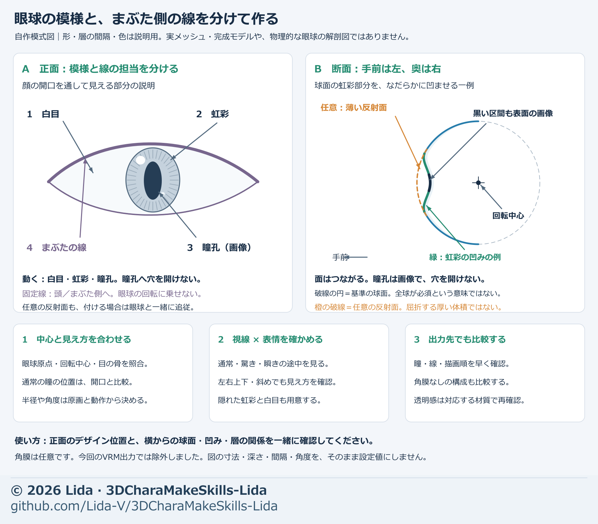

# Build eyeballs, pupils, and gaze

[日本語 / Japanese](../eye-modeling.md)

Build spherical geometry, image design, lids, and rotation centers together. Go beyond the neutral front view: prepare areas newly revealed by surprise, intermediate blinks, and gaze changes.

See [expression adjustment](expression-adjustment.md) for closure bands and fixed brows, [visual handoff](visual-handoff.md) for saved-file/export comparisons, and [Lida's design](lida-design.md) for appearance preferences.

## Inputs and the first goal

In the [initial production plan](production-plan.md), diagnose whether the existing eyes meet the use case. Include necessary modeling, image completion, and gaze corrections without waiting for a separate instruction for each. Preserve a sufficient existing setup; rebuilding all eyes is unnecessary. For a smiling one-eye closure, use [wink closure](wink-closure.md).

- Accepted neutral face and enlarged eyes; matching front, oblique, side, and, when needed, low views.
- Eye design images distinguishing iris, pupil, sclera, highlights, and lid lines; mark what must remain.
- Face mesh; inner/outer corner and upper/lower lid landmarks; current UVs, materials, expressions, and eye bones.
- Destination, viewing distance, required gaze range, wide-eye expressions such as surprise, and export format.

Use [quality proposals and stage goals](quality-goals.md) at the start of production. An example target is “a conversational face close-up that preserves neutral design, supports left/right/up/down gaze, blink, and surprise, and keeps the pupils visible in the destination.” An eyeball radius or adding a cornea is not itself a quality target.

At the start of work, briefly define input version, changed/fixed targets, comparisons, completion criteria, and candidate deliverables. Record neutral-face acceptance separately from gaze, expression, and export acceptance.

| Stage | Goal | Check before continuing |
| --- | --- | --- |
| Opening and spherical surface | Preserve the artwork's eye shape and place rotatable geometry inside | Front/side/oblique views, both corners, distance from sphere to lids |
| Eye images | Preserve accepted design and continue hidden areas | Neutral, surprise, all gaze directions, painted image coverage |
| Layers and materials | Separate moving iris from fixed lines and provide required translucency | Line following, with/without cornea, matched color/reflection comparisons |
| Gaze and expressions | Align centers, directions, and input ranges | Neutral gaze, intermediate blink, expression combinations |
| Save/export | Understand saved-file, reimport, and destination differences | Missing images, gaze axes, draw order, disappearing pupils |

The shared Japanese diagram explains structure, not an actual mesh or finished image. Dimensions, indentation, and layer spacing are illustrative. It does not require a complete sphere.

## 1. Align opening, spherical surface, and rotation center

Project both eye corners and upper/lower lids into front view and compare opening width, height, and tilt with the artwork. In side view, inspect projection of the sphere and eye depth. For a model with flat eye images, distinguish the image plane from lid skin before making the opening and inner walls.

Choose center and radius from more than the front-facing iris position: **clearance to the opening rim must not become narrow on only one side.** Do not hide profile problems or inner-corner holes by pushing everything forward or uniformly shrinking the sphere. Test locally while fixing good existing openings, brows, face contour, and other expressions.

Align eyeball origin, rotation center, and eye-bone center. A partial-sphere setup needs enough surface that its edge and the head interior remain hidden throughout the required gaze range. A complete sphere still needs separate checks for unnecessary rear faces and contact with other parts.

## 2. Prepare iris, pupil, and sclera for the full moving range

- **Sclera:** the bright region following the sphere. Check image coverage, including inner-corner color and shadow.
- **Iris:** the colored pattern around the pupil. Compare reference aspect ratio, boundary, tones, and highlights on the actual UVs.
- **Pupil:** represented by an image in this production. A black appearance is not an instruction to cut a hole in the eyeball.

Surprise and gaze reveal areas normally under the lid. Preserve existing visible pixels, extend iris and sclera in separate regions, and check seams. The hidden upper iris is an estimate; do not present it as a verified change to the accepted artwork.

A good standalone image can still make the pupil look narrow or hide a highlight because of UV aspect ratio or the lid opening. Accept only after front/oblique and normal-distance checks. A top-lid line painted into the eyeball image moves with gaze, so separate it in the next stage.

## 3. Adjust iris indentation and optional cornea

This production started from a sphere, recessed only the iris center, and blended into the sclera. The recess moved in depth while preserving front-projected design positions. It is one way to make an anime-style translucent appearance, not a required shape for every character.

Separate **recess depth, width, and return width to the sclera**. If the profile looks like a sudden step or thin plate, check transition width and sectional curvature as well as depth. Compare while preserving front iris position, UVs, rotation center, and lid clearance.

The cornea is optional. A Blender prototype placed a thin transparent reflective surface only over the iris; it was not a thick refractive volume. Adjust reflection strength, roughness, and mask extent separately. Compare with no cornea to ensure original iris color/highlights do not change too much.

If the destination cannot reproduce it, compare image-based or supported-material alternatives. In this production's VRM output, the cornea appeared as a white disk, so **the cornea was excluded and the eye image supplied the visible iris/pupil**. Do not describe the working model with cornea and the export model as identical setups.

## 4. Separate eyelid lines from eyeball rotation

Rotate iris and sclera with the eyeball. Where needed, place lid-rim lines, lash marks, and inner-corner color in layers/materials fixed to the head or lids. This production used a thin color-plus-alpha layer and, for surprise, a key corresponding to the lid rim.

For added layers, inspect both ends and intermediate points, front/back, floating above the face, and sinking into the eye. An edge short in front projection can be a long chord across the outer-corner curvature and penetrate the sphere. Choose subdivisions from actual 3D edge length and curvature, not image spacing alone.

A purely darkening multiply layer cannot reproduce bright colors or white dots in the original image. Compare the combined fixed-line/eyeball neutral view with the source appearance. See [expression adjustment](expression-adjustment.md) for lid closure and outward fading of deformation.

## 5. Distinguish neutral gaze from causes of a cross-eyed appearance

Even with forward-facing bones, pupils/irises placed toward the nose within the openings can look cross-eyed. In the same front projection, measure opening center, iris center, pupil center, and nasal/temporal sclera widths separately. Compare ratios to opening width against the artwork.

Separate **opening shape, eye-bone reference direction, eyeball placement, and image position** before correcting. Here, bones/openings were not the cause; the painted pupils were too far inward. Candidates rotated eye geometry, iris recess, and cornea outward together about the sphere center.

Moving only UVs misaligns image, recess, and cornea. Changing bone reference direction also changes gaze-control reference. Choose the smallest suitable change for the actual structure. Equal angles on both sides leave existing asymmetry, so check each side in front and oblique views.

After changing neutral direction, remeasure remaining inward/outward gaze. This production reflected that difference in export gaze settings. Do not copy example angles to other models or silently reduce range without checking appearance.

## 6. Check combinations, saved files, and destination

1. Compare neutral, intermediate/closed blink, left/right wink, surprise, and other used expressions in matched images.
2. With front/oblique/side/low views and gaze-expression combinations, inspect sclera leakage, unpainted regions, inner walls, and penetration.
3. State addition rules for blink plus smile, surprise plus blink, etc. Separate combinations suppressed by real inputs from unrestricted additive tests.
4. Record face intersections, ray-visible findings, and issues noticeable at normal distance separately. Excluding transparent cornea from visibility rays is separate from checking its physical contact.
5. Reset every key and gaze, then compare preservation of face contour, brows, mouth, excluded geometry, UVs, materials, and bones.
6. Save a separately named candidate, reopen it, and inspect image/layer/bone references. Reimport exports and compare gaze center/axes, expressions, draw order, and cornea treatment.
7. Reimport is not destination completion. Inspect close-ups and motion in the actual app and name unverified environments.

Keep exposed interiors at test-range limits and tiny gaps as open items. A finite set of poses/directions does not establish safety for every view/expression.

## Put repeated failures into the next first request

| Failure | Initial condition for next time |
| --- | --- |
| Upper iris cuts off in surprise | Prepare normally hidden iris/sclera for required expression/gaze ranges |
| Lines rotate with eyeball and leave the lids | Color-code moving eye patterns and head/lid-fixed lines first |
| Reflection turns gray eyes blue or adds light dots | Separate reflection strength/roughness and compare without cornea under identical light |
| Iris looks like a plate or step from the side | Check return-section shape and width as well as indentation depth |
| Changing bone direction leaves cross-eyed appearance | Measure opening/iris/pupil positions and sclera ratios to isolate the cause |
| Exported cornea turns white and hides the pupil | Test output early on one representative eye, including a no-cornea setup |

## First integrated request

> Build eyeballs, pupils, and gaze from the attached neutral face and eye design. First state the intended result from destination, distance, gaze range, and required expressions. Separate opening, sphere/rotation center, iris/pupil/sclera, and head/lid-fixed lines; preserve existing visible design, face contour, brows, and mouth. Treat pupils as images unless specified otherwise. Offer cornea as optional and compare it in the destination early. Complete hidden iris/sclera and inspect front/oblique/side/low views, intermediate blink, surprise, and gaze combinations. Diagnose bones, opening, and image position before adjusting neutral gaze; do not automatically apply fixed angles. Preserve the original and deliver candidates, matched comparisons, preservation results, save/reload, destination verification scope, and open items.

## Production history and tool limits

The [bundled helper](model-tools.md) supports itemized comparisons of mesh, UVs, weights, key values, and saved versions. It does not automatically judge eyeball centers, artwork fidelity, lid contact, or natural gaze; use the comparisons above.

The production made a new face opening, eyeballs, and lids, then added iris indentation, image completion, optional cornea, and fixed-line layers after expressions. Neutral gaze comparison later led to output gaze settings and cornea exclusion. Do not inherit old-face checks or cornea-prototype acceptance as validation of the new face/export.

This chapter organizes verified methods for reuse. Existing production scripts depend on specific meshes, images, and mappings. The bundled tool neither generates eyeballs automatically nor automatically approves artwork fidelity. The AI and creator must build the required shape and judge its appearance.
