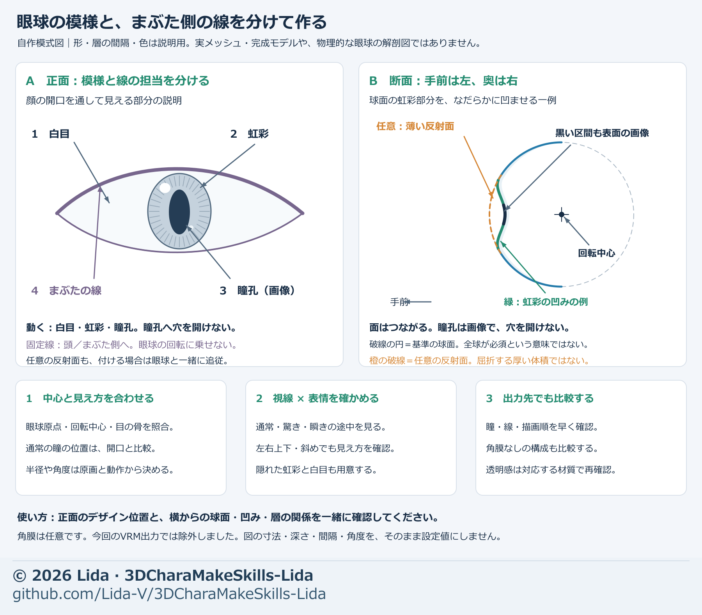
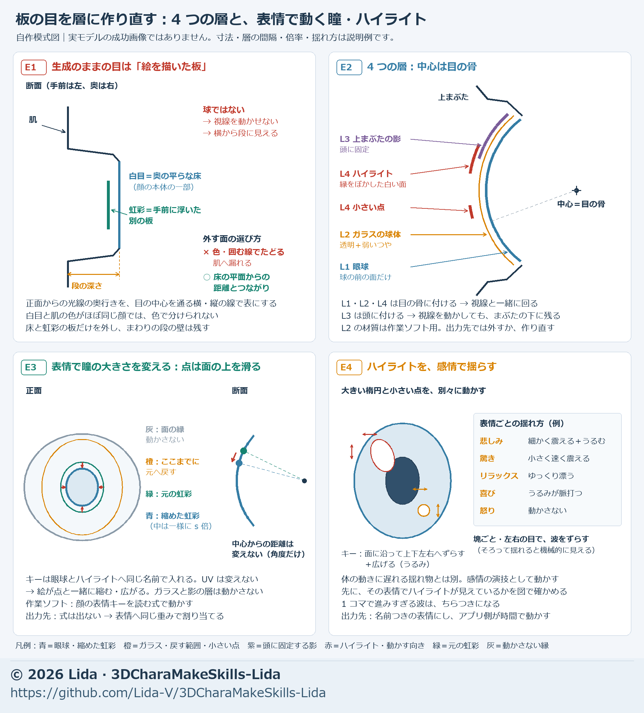

# Build eyeballs, pupils, and gaze

[日本語 / Japanese](../eye-modeling.md)

Build spherical geometry, image design, lids, and rotation centers together. Go beyond the neutral front view: prepare areas newly revealed by surprise, intermediate blinks, and gaze changes.

See [expression adjustment](expression-adjustment.md) for closure bands and fixed brows, [visual handoff](visual-handoff.md) for saved-file/export comparisons, and [Lida's design](lida-design.md) for appearance preferences.

## Inputs and the first goal

In the [initial production plan](production-plan.md), diagnose whether the existing eyes meet the use case. Include necessary modeling, image completion, and gaze corrections without waiting for a separate instruction for each. Preserve a sufficient existing setup; rebuilding all eyes is unnecessary. For a smiling one-eye closure, use [wink closure](wink-closure.md).

If the generated eyes are flat plates, start from the rebuild in section 7. Iris size by expression and trembling highlights are sections 8 and 9.

- Accepted neutral face and enlarged eyes; matching front, oblique, side, and, when needed, low views.
- Eye design images distinguishing iris, pupil, sclera, highlights, and lid lines; mark what must remain.
- Face mesh; inner/outer corner and upper/lower lid landmarks; current UVs, materials, expressions, and eye bones.
- Destination, viewing distance, required gaze range, wide-eye expressions such as surprise, and export format.

Use [quality proposals and stage goals](quality-goals.md) at the start of production. An example target is “a conversational face close-up that preserves neutral design, supports left/right/up/down gaze, blink, and surprise, and keeps the pupils visible in the destination.” An eyeball radius or adding a cornea is not itself a quality target.

At the start of work, briefly define input version, changed/fixed targets, comparisons, completion criteria, and candidate deliverables. Record neutral-face acceptance separately from gaze, expression, and export acceptance.

| Stage | Goal | Check before continuing |
| --- | --- | --- |
| Opening and spherical surface | Preserve the artwork's eye shape and place rotatable geometry inside | Front/side/oblique views, both corners, distance from sphere to lids |
| Eye images | Preserve accepted design and continue hidden areas | Neutral, surprise, all gaze directions, painted image coverage |
| Layers and materials | Separate moving iris from fixed lines and provide required translucency | Line following, with/without cornea, matched color/reflection comparisons |
| Gaze and expressions | Align centers, directions, and input ranges | Neutral gaze, intermediate blink, expression combinations |
| Save/export | Understand saved-file, reimport, and destination differences | Missing images, gaze axes, draw order, disappearing pupils |
| Eye performance (optional) | Iris size changes with expression and highlights tremble with emotion | Highlight visibility in each expression, intermediate values, how the destination animates it |

The shared Japanese diagram explains structure, not an actual mesh or finished image. Dimensions, indentation, and layer spacing are illustrative. It does not require a complete sphere.

## 1. Align opening, spherical surface, and rotation center

Project both eye corners and upper/lower lids into front view and compare opening width, height, and tilt with the artwork. In side view, inspect projection of the sphere and eye depth. For a model with flat eye images, distinguish the image plane from lid skin before making the opening and inner walls.

Choose center and radius from more than the front-facing iris position: **clearance to the opening rim must not become narrow on only one side.** Do not hide profile problems or inner-corner holes by pushing everything forward or uniformly shrinking the sphere. Test locally while fixing good existing openings, brows, face contour, and other expressions.

Align eyeball origin, rotation center, and eye-bone center. A partial-sphere setup needs enough surface that its edge and the head interior remain hidden throughout the required gaze range. A complete sphere still needs separate checks for unnecessary rear faces and contact with other parts.

## 2. Prepare iris, pupil, and sclera for the full moving range

- **Sclera:** the bright region following the sphere. Check image coverage, including inner-corner color and shadow.
- **Iris:** the colored pattern around the pupil. Compare reference aspect ratio, boundary, tones, and highlights on the actual UVs.
- **Pupil:** represented by an image in this production. A black appearance is not an instruction to cut a hole in the eyeball.

Surprise and gaze reveal areas normally under the lid. Preserve existing visible pixels, extend iris and sclera in separate regions, and check seams. The hidden upper iris is an estimate; do not present it as a verified change to the accepted artwork.

A good standalone image can still make the pupil look narrow or hide a highlight because of UV aspect ratio or the lid opening. Accept only after front/oblique and normal-distance checks. A top-lid line painted into the eyeball image moves with gaze, so separate it in the next stage.

## 3. Adjust iris indentation and optional cornea

This production started from a sphere, recessed only the iris center, and blended into the sclera. The recess moved in depth while preserving front-projected design positions. It is one way to make an anime-style translucent appearance, not a required shape for every character.

Separate **recess depth, width, and return width to the sclera**. If the profile looks like a sudden step or thin plate, check transition width and sectional curvature as well as depth. Compare while preserving front iris position, UVs, rotation center, and lid clearance.

The cornea is optional. A Blender prototype placed a thin transparent reflective surface only over the iris; it was not a thick refractive volume. Adjust reflection strength, roughness, and mask extent separately. Compare with no cornea to ensure original iris color/highlights do not change too much.

If the destination cannot reproduce it, compare image-based or supported-material alternatives. In this production's VRM output, the cornea appeared as a white disk, so **the cornea was excluded and the eye image supplied the visible iris/pupil**. Do not describe the working model with cornea and the export model as identical setups.

## 4. Separate eyelid lines from eyeball rotation

Rotate iris and sclera with the eyeball. Where needed, place lid-rim lines, lash marks, and inner-corner color in layers/materials fixed to the head or lids. This production used a thin color-plus-alpha layer and, for surprise, a key corresponding to the lid rim.

For added layers, inspect both ends and intermediate points, front/back, floating above the face, and sinking into the eye. An edge short in front projection can be a long chord across the outer-corner curvature and penetrate the sphere. Choose subdivisions from actual 3D edge length and curvature, not image spacing alone.

A purely darkening multiply layer cannot reproduce bright colors or white dots in the original image. Compare the combined fixed-line/eyeball neutral view with the source appearance. See [expression adjustment](expression-adjustment.md) for lid closure and outward fading of deformation.

## 5. Distinguish neutral gaze from causes of a cross-eyed appearance

Even with forward-facing bones, pupils/irises placed toward the nose within the openings can look cross-eyed. In the same front projection, measure opening center, iris center, pupil center, and nasal/temporal sclera widths separately. Compare ratios to opening width against the artwork.

Separate **opening shape, eye-bone reference direction, eyeball placement, and image position** before correcting. Here, bones/openings were not the cause; the painted pupils were too far inward. Candidates rotated eye geometry, iris recess, and cornea outward together about the sphere center.

Moving only UVs misaligns image, recess, and cornea. Changing bone reference direction also changes gaze-control reference. Choose the smallest suitable change for the actual structure. Equal angles on both sides leave existing asymmetry, so check each side in front and oblique views.

After changing neutral direction, remeasure remaining inward/outward gaze. This production reflected that difference in export gaze settings. Do not copy example angles to other models or silently reduce range without checking appearance.

## 6. Check combinations, saved files, and destination

1. Compare neutral, intermediate/closed blink, left/right wink, surprise, and other used expressions in matched images.
2. With front/oblique/side/low views and gaze-expression combinations, inspect sclera leakage, unpainted regions, inner walls, and penetration.
3. State addition rules for blink plus smile, surprise plus blink, etc. Separate combinations suppressed by real inputs from unrestricted additive tests.
4. Record face intersections, ray-visible findings, and issues noticeable at normal distance separately. Excluding transparent cornea from visibility rays is separate from checking its physical contact.
5. Reset every key and gaze, then compare preservation of face contour, brows, mouth, excluded geometry, UVs, materials, and bones.
6. Save a separately named candidate, reopen it, and inspect image/layer/bone references. Reimport exports and compare gaze center/axes, expressions, draw order, and cornea treatment.
7. Reimport is not destination completion. Inspect close-ups and motion in the actual app and name unverified environments.

Keep exposed interiors at test-range limits and tiny gaps as open items. A finite set of poses/directions does not establish safety for every view/expression.

## 7. Rebuild a generated "flat plate" eye into four layers

A generated face may have eyes that are painted plates. The sclera is a flat floor several millimetres behind the skin and belongs to the face mesh; the iris is a separate plate floating in front of it. Because there is no sphere, gaze cannot move and the eye reads as a step from the side. In that case remove the plates and rebuild the eye as the four layers below. Sections 1–6 (center, image, fixed lines, checks) still apply.

The shared Japanese diagram is an original schematic, not a real mesh or finished image. Dimensions, layer spacing, scale factors, and tremble patterns are illustrative. E1 = section of the generated plate eye (skin, flat sclera floor in blue, floating iris plate in green, step depth in orange); E2 = the four layers around the eye-bone center (L1 blue, L2 orange dashed, L3 purple, L4 red); E3 = iris scaling, front and section (green dashed = original iris, blue = scaled iris, orange dashed = where it returns to the original, gray = fixed boundary); E4 = highlight clusters moved separately and example tremble per expression.

**Confirm that it is a plate eye**: cast rays from the front along a horizontal and a vertical line through the eye center and tabulate the hit depth. A step of several millimetres from skin to floor, plus an iris that is not connected to the face, means a plate eye.

**Select the faces to remove by step depth**: on a face whose sclera and skin are almost the same color, color cannot separate them. Flood-filling the region enclosed by dark lines, and walking faces by color, both leaked into the skin through a gap in the lower-lid line. Seed from the face behind the iris, walk only front-facing faces to fit the floor plane, then select by distance from that plane and connectivity. Remove only the floor and the iris plate; keep the surrounding step walls.

| Layer | Construction | Attached to |
| --- | --- | --- |
| L1 Eyeball | Front part of a sphere only. The sphere passes slightly behind the floor; its center is the eye bone. Project the eye image from the front | Eye bone |
| L2 Glass sphere | Same center, slightly larger radius. Transparent with a weak gloss | Eye bone |
| L3 Upper-lid shadow | A dark band fading downward from the lid line, placed at a radius between L2 and L4 | Head |
| L4 Highlights | The outermost white surface: a large ellipse and a small dot. Opacity falls toward the edge | Eye bone |

- **Eye image**: rendering the faces to be removed from the front, as they are, keeps the neutral look unchanged. When image generation repairs missing parts, write "keep it exactly as it is and repair only these points" and list the points. Asking to "redraw the same pattern cleanly" returned a different, hard-lined style.
- **What to measure when placing it**: match the original iris size and position, and also its orientation (tilt of the long axis). Placed upright, the iris looked tilted inward at the top against upturned eyes. Enter the sclera color as a chosen value; sampling the bright part of the old sclera picked up lid-shadow color.
- **Glass sphere**: keep the gloss weak. A strong gloss reflected the surroundings and hazed the whole eye white. This material is for the authoring software; in the destination, remove it or rebuild it with that engine's material.
- **Highlights**: as separate parts they can later be hidden, reshaped, or fixed to the head. Store the center-to-edge value in both UV and vertex-color alpha so other engines can build the same fade. Being plain white surfaces, they carry over to the destination as they are.
- **Upper-lid shadow**: once the shadow that used to sit under the lid was gone, an iris of the same size looked brighter overall and felt taller. Attach the shadow to the head so it stays under the lid when gaze moves (section 4).
- A clean white sclera can make an existing inward offset of the iris more noticeable. Check with the measurements in section 5.

## 8. Change iris size with expressions

Use this when the performance calls for the iris to shrink in surprise and widen slightly in joy or sorrow. Whether to add it depends on the character and use.

- **Keys**: add "smaller" and "larger" keys, with the same names, to the eyeball and the highlights.
- **Shape**: seen from the eye bone (sphere center), remap the angle from the iris-center direction. Inside the iris scale uniformly by s; outside it return smoothly to the original. Vertices keep their distance from the center and only slide along the surface. UVs stay unchanged, so the image shrinks or widens with the vertices.
- **Range**: take the iris extent from the outline of "non-sclera pixels" in the eye image. Do not move the boundary vertices of the surface; if the boundary does not move, the gap behind the lids does not change.
- **Left unchanged**: the glass sphere and the upper-lid shadow.
- **Driving it**: in the authoring software, drive the two keys with a simple expression that reads the facial expression keys. Such expressions are not exported, so bind these keys to each expression with the same weights.
- **Check**: no flipped faces, no boundary movement, intermediate expression values, and combinations with blink and gaze.

The example factors were surprise 0.74, anger 0.91, relaxed 1.05, joy 1.06, and sorrow 1.07. They are a proposal that had not yet been visually approved, not defaults. Decide them from the reference art and how expressions should read.

This construction scales the whole iris. Shrinking only the pupil requires the pupil to be a separate layer from the iris.

## 9. Make highlights tremble with emotion

This is separate from [secondary motion](secondary-motion.md) that lags behind body movement. It is a performance: for example, highlights in moist eyes trembling finely.

- **Keys**: for each highlight cluster (large ellipse, small dot), create keys that shift it up/down/left/right along the sphere and a key that enlarges it about its own center (moist look).
- **Driving it**: use expressions that read the facial expression keys and time. The example used: sorrow = fine tremble plus moist, surprise = small fast tremble, relaxed = slow drift, joy = slowly pulsing moistness, anger = no motion.
- **Offsets**: offset the wave phase per cluster and per eye. Everything moving in unison looks mechanical.
- **Export**: expressions are not exported. Export the keys as named expressions and let the application animate them over time.

Findings:

- Before adding tremble, confirm in an image that the highlight is visible in that expression. In sorrow the upper lid dropped and hid most of the large ellipse, so the motion of the visible small dot was increased. Joy closes the eye; once fully closed nothing is visible.
- A wave that advances too far per frame becomes flicker. At the example's 24 fps, waves advancing more than about 3 radians per frame were too fine.
- Do not tell clusters apart by vertex count. In the example both clusters had the same count and were separated by extent.
- Tremble amount and speed are a proposal that had not yet been visually approved. Application-side animation was not verified.

## 10. Variations: transparent dome, gap-closing surfaces, eyes that glow in dark scenes

Constructions used in another production. All optional.

- **Indentation and transparent dome**: indent the iris region (section 3) and add a transparent dome slightly wider than the opening, covering out to the sclera and bulging slightly around the iris. It takes the place of the L2 glass sphere.
- **Gap-closing surfaces**: the inside of the head can show through the gap between lid edge and eyeball. Add an inner wall on the head side from the lid edge to the eyeball, and a sclera-colored shell around the sides and back of the eyeball. Seen from straight to the side, the view can cross the head and exit through the other eye's gap, so stand a sclera-colored partition on the nasal side of the eyeball. For the inner-wall color, see the "looks set back from the side" row in the failure table.
- **Eyes that glow in dark scenes**: inside the material, add emission to the iris only, according to scene darkness. Read darkness from the key-light strength and the background brightness. The eye sits in the shadow of bangs and the dome, so do not measure light arriving at the surface. Separate the iris by image saturation and leave the sclera unlit. Expose strength, the brightness where glow begins, and an overall multiplier as adjustable values. This is an authoring-software material; rebuild it in the destination.

## Put repeated failures into the next first request

| Failure | Initial condition for next time |
| --- | --- |
| Upper iris cuts off in surprise | Prepare normally hidden iris/sclera for required expression/gaze ranges |
| Lines rotate with eyeball and leave the lids | Color-code moving eye patterns and head/lid-fixed lines first |
| Reflection turns gray eyes blue or adds light dots | Separate reflection strength/roughness and compare without cornea under identical light |
| Iris looks like a plate or step from the side | Check return-section shape and width as well as indentation depth |
| Changing bone direction leaves cross-eyed appearance | Measure opening/iris/pupil positions and sclera ratios to isolate the cause |
| Exported cornea turns white and hides the pupil | Test output early on one representative eye, including a no-cornea setup |
| Eyeball looks set back when seen from the side | Check the color of the band from the lid edge to the eyeball. Skin color all around reads as a skin wall from the side; use sclera color toward the inner and outer corners and lid color above and below. Whether the eyeball can move forward depends on its clearance from the closed lid |
| Selecting the sclera by color or enclosing lines also selected skin | For a plate eye, select by distance from the floor plane and connectivity. Some faces have sclera and skin of nearly the same color |
| Image generation meant to repair gaps changed the eye's drawing style | Write "keep it exactly as it is and repair only these points." Measure size, position, and orientation from the original part when placing it |
| The glass sphere hazes the whole eye white | Weaken the gloss and compare with no glass under identical light |
| After repairing the eye image the mood changed and the iris looks taller | Restore the upper-lid shadow the original eye had, as a head-fixed layer |
| Highlight tremble is invisible or flickers | First confirm the highlight is visible in that expression. Limit how far the wave advances per frame |

## First integrated request

> Build eyeballs, pupils, and gaze from the attached neutral face and eye design. First state the intended result from destination, distance, gaze range, and required expressions. Separate opening, sphere/rotation center, iris/pupil/sclera, and head/lid-fixed lines; preserve existing visible design, face contour, brows, and mouth. Treat pupils as images unless specified otherwise. Offer cornea as optional and compare it in the destination early. Complete hidden iris/sclera and inspect front/oblique/side/low views, intermediate blink, surprise, and gaze combinations. Diagnose bones, opening, and image position before adjusting neutral gaze; do not automatically apply fixed angles. Preserve the original and deliver candidates, matched comparisons, preservation results, save/reload, destination verification scope, and open items.

When rebuilding a generated flat-plate eye, add the following.

> Check with a front-depth cross-section whether the eye is a painted plate. If it is, select only the sclera floor and the iris plate by step depth and remove them, then rebuild the eye as layers: eyeball (front part of a sphere, centered on the eye bone), glass sphere, upper-lid shadow (fixed to the head), and highlights (separate parts with faded edges). Keep the eye image exactly as it looks now and repair only the missing parts. If iris size should change with expressions or highlights should tremble with emotion, show the proposed factors and tremble patterns in a table and confirm in images that the highlight is visible in each expression. Report separately what works only in the authoring software (glass material, driver expressions) and what carries to the destination (keys, expression bindings).

## Production history and tool limits

The [bundled helper](model-tools.md) supports itemized comparisons of mesh, UVs, weights, key values, and saved versions. It does not automatically judge eyeball centers, artwork fidelity, lid contact, or natural gaze; use the comparisons above.

The production made a new face opening, eyeballs, and lids, then added iris indentation, image completion, optional cornea, and fixed-line layers after expressions. Neutral gaze comparison later led to output gaze settings and cornea exclusion. Do not inherit old-face checks or cornea-prototype acceptance as validation of the new face/export.

This chapter organizes verified methods for reuse. Existing production scripts depend on specific meshes, images, and mappings. The bundled tool neither generates eyeballs automatically nor automatically approves artwork fidelity. The AI and creator must build the required shape and judge its appearance.

Sections 7–10 were added from another production that rebuilt generated flat-plate eyes. Verified scope: still images and per-expression images in the authoring software, key values driven by expressions, and presence of the expressions and morphs after export and reimport. Application-side animation over time, and rebuilding the glass and glow in other engines, were not verified. Scale factors and tremble patterns are proposals that had not yet been visually approved.
