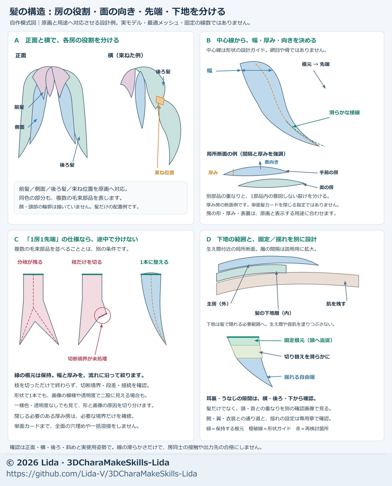

# Making hair: strand shape, attachment, materials, and motion

[Japanese original](../hair-workflow.md)

Work in this order: **establish the overall silhouette → test the structure with a few strands → establish basic following → refine UVs and materials → check secondary motion and movement around nearby parts**. Review the full length from roots to tips and the neighboring strands, instead of repeatedly adjusting only tips or highlights.

This chapter covers the production sequence and practical decisions. See [input materials](input-materials.md) for image preparation, [adjustment methods](adjustment-methods.md) for detailed shading, AO, and UV work, and [secondary motion](secondary-motion.md) for motion and export.

## Goals and materials before starting

Carry forward the intended use, normal viewing distance, required close-ups, movements, and destination from [quality goals and stage goals](quality-goals.md). At each stage, briefly record the input version, editable and fixed regions, comparison conditions, exit criteria, deliverables, and remaining work. Routine stages do not require repeated approval.

> Example starting goal: Preserve the approved hairstyle and the visible area of the face. Refine the full length, thickness, roots, and tips in front, side, back, and oblique views. For an animated use, check head turns and tilts, looking up and down, bending forward, raising arms, and returning to rest for visible protrusions, splits, stretching, and settling. Compare shape in plain shading and wireframe, and materials under the same light and camera. End this stage after saving and reopening. Record destination checks still outstanding separately.

Prepare four sets of material:

- **Shape references:** front, side, and back views of the same hairstyle, plus close-ups of the face framing, braids, and knots. They should show length, parting, face coverage, roots, and front-to-back overlap.
- **Head and whole body:** the approved head, ears, neck, costume, shoulder ornaments, wings, and other nearby parts. Separate hair-only design references from whole-body placement views.
- **Current model:** neutral shape, units, left/right and front/back, bones and reference pose, UVs, images, and materials. Inspect generated models for missing roots and inner surfaces too.
- **Review displays and motion:** plain shading, wireframe, actual materials, and the required head, body, and arm inputs. Include entry, intermediate motion, hold, return, and a stationary interval afterward.

When generating the head from scratch, prepare both [head three-view sheets with and without hair](multiangle-threeview.md). Select hair and roots from the rough head with hair, and the face and skull from the rough head without hair. Match skull size and attachment position; remove unwanted duplicate heads and internal faces.

In contrast, **images used to generate hair alone** should not show a face, mannequin, nose, or jaw outline. This is a separate input method from a head-with-hair image that includes the face. Check that removing the face did not also cut the hair, and establish how hidden roots and inner hair continue. If a head diagram guides placement, distinguish that role from the hair-only generation input.

Lida's hair references specified one tip for each strand intended to end as one strand, with no unwanted branching. This was a project requirement. Do not prohibit intentional branches or flyaway hairs in other designs; mark where each strand ends in the target reference. The three hair views received appearance approval, but it was not confirmed whether the later hair FBX was generated from those images. Image approval is not evidence of successful 3D generation.

## 1. Establish full length and face visibility with a rough shape

**Goal: Match the overall hairstyle and its placement on the head before adding fine strand lines.**

If only images exist, follow [the input-material workflow](input-materials.md) to generate a rough base or reference model with Tripo or a similar service. Inspect unintended fusion between strands and missing roots. Use good existing 3D without requiring regeneration.

Separate design roles such as bangs, face-framing strands, crown, braids, and back hair. This does not require a separate object for every role. Use low-density surfaces or guides and compare these points from matching angles:

| What to inspect | What to adjust |
| --- | --- |
| The window around the face | How far hair covers the forehead, eyes, cheeks, and jaw. Do not conceal misplaced head geometry by covering the face. |
| Overall volume and length | The outline from crown to tips, side thickness, and spread across the back. Do not extend only the tips while thinning the middle. |
| Roots and gathering points | Connections between parting, braids, knots, and long hair. Align the apparent gathering point with where movement begins. |
| Space around the hair | Relationships to chest, shoulders, back, costume, and wings. Inspect both the body with hair hidden and the normal view with hair restored. |

Preserve good existing shapes. Subdivision and painted detail cannot repair a base whose front, side, and back lengths disagree.

## 2. Refine strand flow, cross-sections, and roots

**Goal: Be able to explain each strand's flow from root to tip, its width and thickness, and its overlap with neighbors.**

This is a design schematic. Panel A separates bangs, side hair, back hair, and gathering points; B separates centerline, width, thickness, and surface direction; C illustrates a one-strand/one-tip requirement; D separates the inner layer and fixed roots from moving ends. Green marks preserved roots, orange dashed lines are shape guides, and red marks areas to reconsider. Centerlines are design guides, not actual mesh edges or bones. The strand counts, cross-sections, and thicknesses are neither a ready-made template nor evidence of a successful real model.

1. **Establish a continuous flow first.** Place a centerline through root, middle, and tip. Check side and back views for sudden bends or reversed curves. Removing a branch tip must not also remove the main strand's width or length.
2. **Adjust width and thickness separately.** Inspect width and depth at several positions along the centerline and taper smoothly toward the tip. If a strand looks thin enough from the front but like a board or prism from the side, correct its cross-section, orientation, and continuity in depth.
3. **Keep cross-section rotation continuous.** Rotate sections along the flow without sudden twisting or flipping. Do not average every vertex and round away an already good silhouette.
4. **Define root coverage and front-to-back order.** Inspect from the side which strand is in front, and which roots tuck under crown hair, a braid, or an upper strand. Correcting normals alone will not remove a protruding plate when inner and outer surfaces are in the wrong order.
5. **Distinguish connection types.** Investigate unintended breaks within one strand. Where separate strands intentionally overlap, check root coverage and separation during motion instead of welding everything.

The volumetric strands used in this production differ from hair cards made of thin surfaces with transparent images. Not all hair needs closed tubular cross-sections. For cards, check their thinness at the intended distance, backface display, transparency, and overlap in the destination too.

If using Blender curves, consult the [official Geometry documentation](https://docs.blender.org/manual/en/latest/modeling/curves/properties/geometry.html) for cross-section, taper, and tilt settings. Cross-sections can be open or closed; choose for the software version and intended use.

### Check gaps at the hairline, behind the ears, and at the nape

Use [mesh repair and completion](mesh-repair-completion.md) for adding faces, reconnecting surfaces, and checking new-face attributes. Do not weld all intentionally overlapping strands.

Visible skin does not mean every ear and neck area should be covered. Distinguish **skin intended to remain visible, skin-colored scalp, and missing hair volume**. Locate each issue in true side, rear oblique, downward-looking, and head-turn views. Adjust the scalp image if the problem is only color. An image cannot fill a visible side gap or restore a missing hair silhouette.

Where volume is needed, preserve outer strands, add an inner hair layer, and tuck its upper edge beneath existing roots. Retain ear openings, a natural hairline, and clearance from the collar. Avoid a plate pressed against the neck or a uniform mass hanging below the ear. Adjust growth pattern, flow direction, and lift separately to match the design. Lida's adopted revision retained skin below the earlobe and flowed from behind the ear toward the nape. Its angles and millimeter values are not defaults for other characters.

When the inner layer is built from thin strand cards, check crossings around the ear specifically. If the tip of a front card passes through the earlobe, it can look like a small earring-like fragment. Moving a crossing card's front edge back behind the ear usually looks more natural than lowering its root; lowering every card until none touches the head opens the back of the neck again. Roots that end inside the underside of the back of the head may be treated like ordinary hair roots if they cannot be seen from outside. Check with each part rendered in a distinct flat color, and with close views and head turns in the destination.

## 3. Check topology, bones, and basic following first

**Goal: With secondary motion disabled, roots remain attached during head and neck movement and the required bends are possible.**

- Connect faces along strand length and support bends with several rows. Choose density for the needed curvature and deformation instead of folding one long face. Uniformly adding edges to all hair is unnecessary.
- Color-code fixed bangs, braids, and knots, and the long strands or strands below a knot where bending begins. If motion starts far below the gathering point, the upper part may look like a rigid plate.
- Follow strand flow with bone chains and blend each bend smoothly along the length. Test a few representative strands first for bending position, stretching, flattened cross-sections, and gaps between neighbors. More bones alone cannot fix a mismatched fixed region.
- Fixed means following the chosen parent without added secondary motion. Choose attachment by actual structure and use: crown hair may follow the head, while a neck-hugging inner layer may need matching head and neck weights. Do not automatically assign everything 100% to the head.

Check weight sums and the destination's bone-influence limit. Use the [included tools](model-tools.md) for numeric checks and [mesh and weights](mesh-weight.md) for bend regions and face layout. Successful normalization and natural deformation are separate judgments.

## 4. Separate UVs, strand markings, highlights, and shading

**Goal: Preserve strand volume and achieve readable color, highlights, and seams at the intended viewing distance.**

In the Japanese-labeled diagram, 01 tests a wavy pattern with uniform base color; 02 traces an actual break in wireframe; 03 checks a plate-like protrusion in side cross-section. Blue is the narrow strand surface, orange the main surface, and arrows indicate the example surface front directions. This is a diagnostic schematic, not a before/after result.

Disable shape depressions and protrusions, normals, outlines, images, and AO one at a time to isolate the cause. See [adjustment methods](adjustment-methods.md) for the diagnostic sequence, local correction, and the production AO comparisons.

- **Do not duplicate geometry with paint.** Strong, thick division lines painted over already separate large mesh strands can make the hair look as if it has extra strands. Give broad gradients, fine strand flow, white highlights, and depth darkness separate roles.
- **Do not break continuous color at part boundaries.** For continuous gradients or highlights, use a shared reference or correspondence across boundaries. Independent height references for each part can create rectangular color steps.
- **Separate the whitest highlight core from the fading edges.** Concentrating white at the lower edge and adding a dark line below it can look like a thick drip of paint. Place the white core inside the highlight and compare the upper edge, lower edge, and fine tips as they fade back to strand color. Match the target and check that highlights remain visible at normal distance.
- **Keep UVs and images paired.** Check root-to-tip flow, reversals, and steps at seams with a grid and actual materials. Before baking an added inner layer into an existing image, check for overlapping UVs. Where needed, follow [adjustment methods](adjustment-methods.md) to separate the added hair's materials, UVs, and bake targets.

Lida's fine lines and highlights went through repeated revisions; a version that also softened the lower edge back into strand color was selected. The silver-white, pale lilac, and highlight preferences are recorded separately in [Lida's design notes](lida-design.md), not imposed on every hairstyle. Recheck at final resolution; downscaling does not automatically preserve fine lines or highlights.

## 5. Check fixed parts, motion, and routes around arms, shoulders, and wings

**Goal: Preserve roots and hairstyle without visible protrusions, splits, or sudden jumps during required motion and after stopping.**

Compare the moving region, return strength, damping, angle limits, and collision settings one at a time using [secondary motion](secondary-motion.md). Tune representative strands before the whole hairstyle.

| Motion | Main inspection points |
| --- | --- |
| Head turns, looking up and down | Roots and knots, back hair falling into the back, face-framing hair against chest and collarbones |
| Head tilt, forward bend, body twist | Left/right differences, shoulders and ornaments, tips against waist and costume, gaps or stretching between strands |
| Arms raised, hands behind the head | Arms against long hair, sleeves against fixed braids, shoulder ornaments. Separate fixed-part issues that moving-hair settings cannot repair. |
| Wing opening/closing combined with body movement | Full hair length, root coverage, and externally visible protrusions. Do not alter the hairstyle by separating wings and hair excessively. |
| Entry, intermediate motion, hold, return, and after stopping | Abrupt switches, changing collision partners, persistent oscillation, root drift, and return to the original shape |

Record **which strand or bone chain enters which other part, and when**. Enlarging arm colliders for every chain can push even outer hair away from the normal shape. Restrict changes to affected chains, then recheck the corrected interval, neutral shape, both sides, and other collision partners. Moving all hair backward or uniformly weakening root following must not increase intrusion in other movements.

In VRM 1.0, each `spring` refers to `colliderGroups` under the [official SpringBone specification](https://github.com/vrm-c/vrm-specification/blob/master/specification/VRMC_springBone-1.0/README.md). This does not guarantee continuous collision between complete hair meshes or automatic transfer of custom Blender controls.

Lida's project did not use physical repulsion between wings and hair: hidden overlap was allowed and conspicuous protrusions were corrected. This is a project-specific condition. Define necessary contact and separation requirements for other uses. Do not make zero hidden intersections the only goal or conceal unfinished work by narrowing the required motion range.

Distinguish natural settling from forcing secondary motion to zero at the end of a video. Checks at representative poses do not guarantee every intervening time or arbitrary input. Review problem intervals continuously and record objects and time ranges.

## 6. Match saving, integration, and the destination

**Goal: Associate the reviewed hair shape, materials, bones, and secondary motion with the final saved version and destination.**

Deliver the shape, UVs, images, materials, bone chains and parents, weights, fixed regions, motion settings, colliders, custom controls, and baked animation as one set. If adding hair bones separate from the humanoid skeleton, read back humanoid assignments too; do not let automatic inference introduce incorrect bones.

After changing shape or topology, do not reuse old vertex-index weights, normals, or AO without checking correspondence. Compare integrated real meshes and their dependencies with the input version, save under a new name, and reopen. Follow [visual handoff and saved-version checks](visual-handoff.md).

Distinguish working settings, saved settings, settings rebuilt by script, baked Actions, and settings actually exported. Hair moving in Blender does not prove the same behavior in VRM, Unity, or UE. Check color, transparency, bones, roots, secondary motion, and contact in the destination and hand over untested areas explicitly.

## Move repeated corrections into the first instruction

| What happened | What to include at the start next time |
| --- | --- |
| Removing the face cut the hair and created thin branches | Hair-only inputs contain no face or mannequin. Keep roots and inner hair continuous, and connect each specified strand to one tip. |
| More bones left the upper section looking like a board | Align the knot with where movement begins and test the weight transition from the fixed region on a few strands. |
| Painted lines repeated mesh divisions and highlights looked like drips | Compare strand volume, fine lines, gradients, and highlights separately; separate the white core from the fading upper and lower edges. |
| Skin-color changes were used to hide a real gap | Separate intended skin, scalp color, and missing hair volume in side and oblique views; add volume and hairline coverage only where needed. |
| Avoiding contact damaged the hairstyle or another motion | Identify strand, chain, collision partner, and time. Adjust locally and compare the neutral shape and other required movements again. |

These are observed production failures and improvements. Do not turn a passing intermediate-candidate check into a claim of first-attempt adoption. Consolidate later conditions into the next request. If two consecutive candidates addressing the same cause do not improve practical appearance, return to the structure of connections, cross-sections, fixed regions, and collision setup.

## A short first request for the AI

> Create or revise the attached hairstyle for [use, distance, movements, destination]. I am providing front, side, back, and oblique references, the approved head and body, the current model, and problem images. First state this stage's target, editable and fixed regions, comparison conditions, exit criteria, and deliverables.
>
> Match full length, side thickness, the visible face window, roots, and knots with a rough shape. Check representative strands' centerlines, width, thickness, cross-section orientation, and front-to-back overlap. Hair-only references must contain no face or mannequin, and removing the face must not cut the hair. Keep [specified single-tip strands] continuous from root to one tip without intermediate branches. Intentionally separate strands need not all be welded.
>
> Mark fixed braids and knots and where movement begins. Check basic following with secondary motion disabled first. Isolate shape, connections, normals, images, AO, and outlines; do not duplicate strand divisions in geometry and thick paint. Compare highlight cores, upper and lower fading edges, and overall gradients under matching conditions. Behind the ears and at the nape, retain required visible skin and fill only missing areas.
>
> Tune secondary motion on representative strands. Review required head, body, arm, and wing motion through entry → intermediate → hold → return → after stopping. Record contact by strand/chain, partner, and time, and verify that local improvements do not worsen neutral shape or other motion. Generate images and videos from the saved version. Report correspondence and preservation of shape, UVs, materials, bones, weights, and motion settings. Separate local review, user adoption, whole-body integration, export, destination verification, and remaining work.

Use the [process index](process-index.md) for the next stage and [visual handoff](visual-handoff.md) for image roles and delivery.
