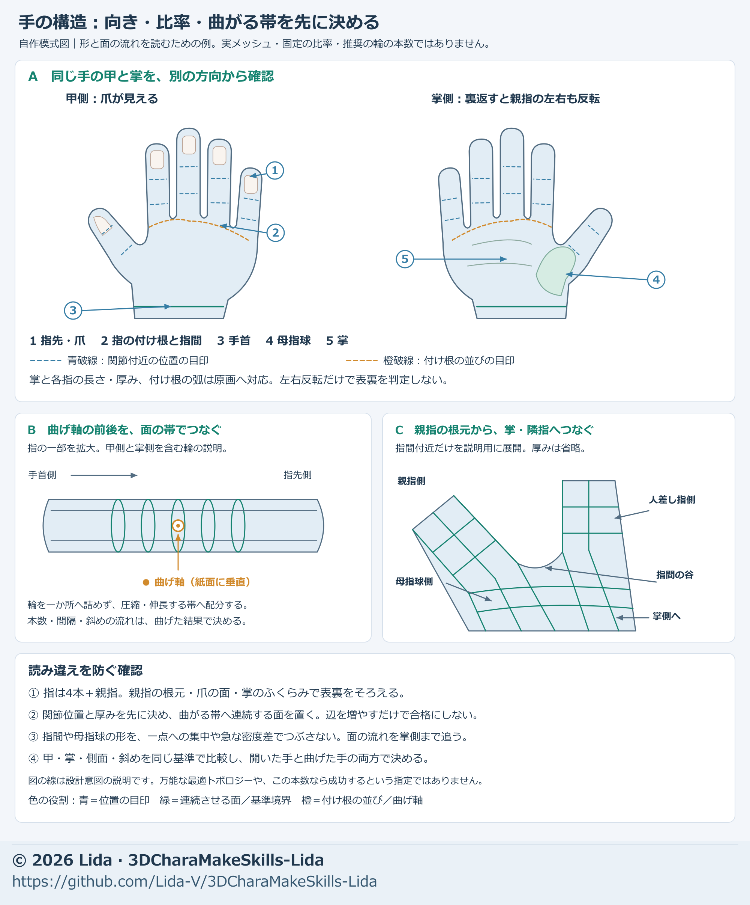
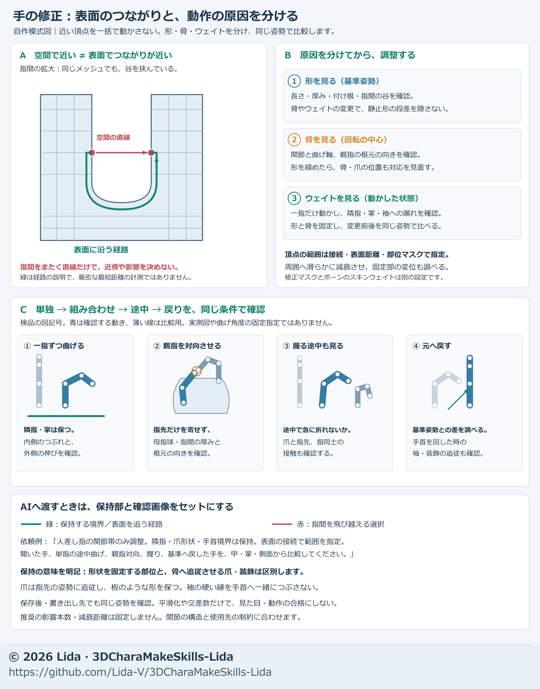

# Build hands: baseline shape, joints, weights, and nails

[日本語 / Japanese](../hand-shape.md)

Proceed in this order: **establish the open hand → align faces and joints → refine weights through motion → fit nails and cuffs → verify saved files and destination**. Separate causes: a step already present in the open hand is a shape issue; a split appearing only in motion may be a weight issue. Subdivision or global smoothing alone is not a general repair.

This chapter covers inputs, goals, baseline shape, topology/joints, weights, nails, shortening, motion, saving, and first requests. See [mesh and weights](mesh-weight.md) for shared topology principles and [adjustment methods](adjustment-methods.md) for separating shape, bones, and normals. Keep hand-specific inspection here.

For finger dents, little-finger cross-sections, and thumb joints and axes, also read [failures and adjustments from another production](generation-feedback.md). Diagnose before applying whole-hand remeshing or uniform smoothing.

## Decide before the stage

For moving avatars, include hand/finger motion diagnosis in the [initial production plan](production-plan.md). Do not mark hands done after checking only the open shape. Test required individual-finger motion, grips, thumb motion, intermediates, and return, then correct problems within the requested scope without waiting for a separate “fix the fingers too.”

Carry over intended use, ordinary distance, hand motions, and destination through [quality goals and goal cards](quality-goals.md). For stills, target the specified pose's appearance; for moving avatars, include required motion and destination reproduction.

> Preserve accepted hand length/slenderness and remove steps in open-hand back, palm, and side views. For motion, check grip, spread, pointing, pinching, and transitions for webbing/thumb-side roundness, nails, and cuffs. State input version and changed/fixed ranges; compare plain, wireframe, and actual materials with the same camera. Finish this stage at save/reload, handing off any unperformed destination check.

This is a starting example. Use established purpose/quality without requesting approval for each routine step. If two consecutive candidates for the same cause fail to improve practical appearance, re-diagnose regional separation, deformation method, and bone/topology correspondence.

## Inputs

- **Shape references:** back, palm, and thumb-side views of the same hand; add fingertip/oblique views as needed, showing wrist, fingertips, webbing, and nails.
- **Model:** accepted neutral shape, units, side/front/back/dorsal orientation, bones, and reference pose. Save the pre-edit state under another name.
- **Matched displays:** plain faces, wireframe, actual materials, and bone overlays. Check that light/outlines do not hide shape.
- **Motion:** required opening, closing, one-finger bends, thumb-to-fingertip movement, etc., including transitions and return.
- **Dependent parts:** nails, cuffs, lace, rings, etc. Keep hand shape, joint table, weight rules, and pose versions together.

For image-based generation, provide clearly separated fingers with readable webbing, thumb side, and thickness. Inspect fused/extra fingers and mixed nail/skin geometry first; decide whether the base can be repaired before adding detail. Do not require regeneration of usable existing hands. For unseen palm/thickness, distinguish the current model from a proposed target. A front drawing alone does not establish hidden form or thumb opposition.

## 1. Establish the open-hand baseline

**Goal: compare the accepted hand design from back, palm, and side, with natural continuity through wrist and fingertips.**

The shared Japanese diagram shows design/check regions. It is neither a successful production mesh, an anatomical dimension table, nor a template requiring the same line count. Map it to actual bones, topology, and motions.

| Region | Initial adjustment/check |
| --- | --- |
| Palm/finger balance | Compare palm length, width, thickness, and individual phalangeal segments, not only total length. Do not compensate for a shorter palm by lengthening one finger segment |
| Finger bases | Mark web valleys and joint centers separately. Match base heights to the artwork instead of automatically aligning them |
| Palm/back volume | Inspect palm relief, thenar bulge, and surfaces descending from back to fingers in side/section views. Avoid plate-like thinness, excessive valleys, and abrupt slopes |
| Thumb/index gap | Check U-shaped opening, rim thickness, and round transition toward the index separately. Widening the gap alone does not fix connection |
| Thumb/wrist | Align thumb direction, base, and nail direction in the chosen reference pose; join thenar volume smoothly to the wrist |

Define measurement endpoints: which wrist line and which web/joint center/fingertip. Overlay endpoints on images to prevent measuring a neighboring fingertip. Example ratios, angles, and millimeters are not universal character standards.

## 2. Match topology to joints

**Goal: explain joint centers/axes, compressing/stretching surfaces, and web connections before posing.**

1. **Overlay joints.** Mark base, middle, and distal joints for index through little finger, and centers/axes from thumb base through its segments. Do not place bones solely from a visible crease or narrowest point.
2. **Place loops around fingers.** Support each side of a joint with several loops connected longitudinally; avoid concentrating the bend on one central line. Reposition existing loops for spacing and add only where needed.
3. **Distribute inside/outside separately.** Check compressed rows for overlap, inversion, or sharp valleys; ensure the outside can remain round rather than stretching one long face. Choose counts/spacing from thickness and required bend.
4. **Connect webbing into the palm.** Do not insert separate finger tubes into a palm without surfaces supporting web opening/closing. Treat the thenar region as continuous with both thumb and palm.
5. **Inspect concentrated connections.** Check poles, abrupt density changes, slender faces, duplicates, and internal faces. Rework connection location/flow if a strongly bending band concentrates deformation at one point. Triangles or poles alone are not failures.

A correctly shaped hand need not be globally remeshed or subdivided. After topology changes, re-establish correspondence for weights, nails, and keys instead of reusing indices. When trying oblique loops, compare bones, faces, and weights together; do not merely cut weight regions diagonally.

Human hands have metacarpals in the palm, two phalanges in the thumb, and three in each other finger. [OpenStax upper-limb bones](https://openstax.org/books/anatomy-and-physiology-2e/pages/8-2-bones-of-the-upper-limb) provides a reference, but anatomical counts do not determine a fictional character's proportions or optimal topology.

VRM 1.0 maps thumbs to `ThumbMetacarpal / ThumbProximal / ThumbDistal` and other fingers to `Proximal / Intermediate / Distal`. Do not assign an `Intermediate` intended for other fingers to the thumb Humanoid mapping. For other versions, verify roles as well as names against the [official VRM specification](https://github.com/vrm-c/vrm-specification/blob/master/specification/VRMC_vrm-1.0/humanoid.md). Destination requirements govern auxiliary bones/controls.

## 3. Refine thumb and webbing weights

**Goal: webbing does not split when neighboring fingers move differently, and index-side roundness/thenar volume remain when the thumb bends.**

First compare weights on identical shape/bones. Separate existing shape steps, misplaced joint centers, and unnatural posing from weight problems.

- **Avoid assigning webbing to one finger outright.** “100% nearest finger” creates jumps between neighbors and torn-looking lines in independent motion. Start from bone-aligned regions and blend into neighboring fingers/palm according to connected skin.
- **Do not measure across the gap indiscriminately.** Spatially close thumb/index vertices are not automatically the same skin region. This production built finger regions with distance along the skin surface and smoothed webbing weights. It is one method, not a mandatory algorithm/width for every mesh.
- **Do not pull too broad a region with the thumb.** Index-side/back-of-hand surfaces following the thumb can look like a flat plate even without measured thickness loss. Reduce thumb influence where appropriate and smoothly return toward hand influence. Do not freeze the thumb's own skin or the whole palm-side U shape.
- **Inspect the thenar root.** Strong thumb-base rotation near the wrist can make the thumb look like a tube growing from the wrist. Overlay bones/pose and distinguish the hand-retained and thumb-following regions.
- **Diagnose pose separately.** Do not tilt only the thumb base dramatically to reach over the fingers. Check segment bends, base movement/orientation, and finger/thumb timing. Better custom posing does not replace repairing a mesh for external motion.

Normalize deform-bone weights to sum 1 and check destination influence limits. Exclude mask groups. The [bundled tool](model-tools.md) helps numerical checks; normalization alone does not create natural deformation.

**Preserving a rule differs from preserving each vertex value.** A rule calculated from coordinates/joints produces different values after shape edits. Record rule changes, value changes, and bone-position changes separately.

## 4. Build nails with the fingertips

**Goal: natural nail contours from back, side, and palm, with no floating or nail bending when fingers bend.**

- Adjust width, root position, extension beyond fingertip, and lateral curvature separately. Extending length alone can look pointed from side/palm.
- In plain and actual materials, inspect skin gaps, sinking, flicker, and outline width. Separate actual nail shape from shader-induced points.
- For a rigid nail, consider rigid following of the distal bone. This production used 100% influence from the corresponding distal bone across each nail; this is not mandatory for every nail style.
- After hand/finger resizing, align nail position, bone correspondence, UVs, and pattern to the same version. Do not replace accepted nails with an old-position version.

Longer nails change contact with other fingers/palm in grips and pinches. Inspect root floating, nail/nail intersections, and externally visible penetration. Record location/visibility of remaining hidden contact; do not approve only a still shape.

## 5. Avoid steps during shortening or local corrections

**Goal: preserve accepted length, width, and U shape, with roundness/tangents continuous from edited to fixed regions.**

The shared Japanese diagram describes causes/preservation, not actual before/after results. Diagnose palm height and inner contour separately. Its fixed bone positions apply to a local correction. Resizing itself first requires new joint locations, matching shape/joints/nails. Define movable fingertips/nails and new joints before resizing, then fix those established ends for subsequent step repair. Do not impose identical fixation on both stages.

1. **Match the faulty display.** Establish whether the step exists open, only bent, and in plain color. Separate normals, connectivity, and actual coordinates.
2. **Inspect beyond the shortening axis.** Shortening palm length while keeping old peak/valley heights steepens slopes. Reassess thickness, sections, and height distribution. Filling a valley must not flatten the thenar region.
3. **Join neighboring displacement.** Moving thumb/U sideways and index longitudinally can create a boundary step. Consider displacement following connected skin instead of interpolating across the gap by Euclidean proximity.
4. **Match position and curvature.** Fix wrist, fingertips, specified U width, excluded fingers/nails. Inspect tangent/curvature in faces next to fixed ends, not just matching endpoint coordinates. Do not substitute a short straight flattening segment.
5. **Restore vertex spacing too.** Surface smoothing can slide points into a narrow dense band and leave shading streaks. Preserve fixed regions/contour while redistributing along the surface, then recheck collapse, stretching, and inversion.
6. **Compare stages before stacking corrections.** Compare original → shortening only → surface adjustment → palm correction in the same orientation to identify when streaks arose. If contour correction is insufficient, rebuild the shortening method.

One example redistributed a contour return of about 2.7 mm compressed into roughly 7 mm over a curve about 20 mm long. These correction/fade distances depend on hand size and are not defaults. That contour correction did not fully resolve later-discovered surface streaks; work continued with surface-following shortening and boundary/point-spacing adjustments.

## 6. Check held poses and intermediate motion

**Goal: no new splits, sharp folds, or conspicuous penetration in required poses/transitions, while retaining prior accepted conditions.**

The shared Japanese diagram illustrates inspection, not acceptance of the entire hand from the depicted poses alone. Map it to both sides and required motions; compare plain, wireframe, and actual materials with the same camera.

| Motion | Inspect |
| --- | --- |
| Open/relaxed hand | Palm valleys, finger-base arc, thumb U, side thickness, wrist/nails |
| Finger spread/one-finger bend | Web splits, unwanted neighboring motion, points at bases |
| Independent base/middle/distal bends | Axes, bend locations, inner collapse, outer roundness, nail folding/floating |
| Grip, pointing, scissors gesture | Wrist-rooted-looking thumb fold, plate-like index side, external nail/finger penetration |
| Pinch/thumb opposition to each finger | Thumb orientation, thenar/web stretching, other fingertip/nail contact |
| Wrist flexion/extension plus grip | Wrist connection, cuff/lace/ornament interference |
| Neutral → intermediate → required maximum → return | Penetration hidden in held poses, sudden transitions, contact order, return to baseline |

Choose angles/motions from the use case and save both everyday-distance and problem close-up views. Inspect motion continuously through intervals flagged in representative frames. For moving avatars, test intended motions/inputs as well as custom grips.

Relate edge-length changes, inverted faces, abrupt weight changes, and contact location/depth to images. Reduced total contact may hide a newly worse finger. Separate intended contact from penetration, visible folds from hidden wrinkles. Do not conceal unmet goals by reducing required motion range.

## 7. Save, integrate, and export the same version

**Goal: the compared hand survives in the final saved version, with reproducible bones, weights, nails, and poses.**

- Deliver shape, joint table, bone reference pose, weight rules/results, nails, and pose/motion versions together. Respect intentional asymmetry rather than forcing mirroring.
- After bone movement, do not merely reconnect to old bones. Update bones, reference pose, and weights from the new joint table; recheck cuffs and control rigs.
- State which corrections the integration hand contains. Do not double-apply old palm corrections or mix old nails into a new version.
- Save under another name, reopen, and inspect with the same pose/camera. Record which saved version produced deliverable images/video and refresh affected comparisons after edits.
- For moving use, reimport actual FBX/VRM/etc. and verify finger bones, reference pose, motion, nails, and materials in the destination. Do not assume source-software volume preservation transfers unchanged.

Record local shape acceptance, user selection, whole-body integration, saved-file reproduction, and destination acceptance separately. A locally selected hand does not validate every contact or external motion. See [visual handoff/integration](visual-handoff.md).

## Lessons from repeated corrections

| Observation | Cause and next first instruction |
| --- | --- |
| Open hand looked good, but bent finger segments looked long | Palm length and joint positions were evaluated separately. Compare open proportions with individual-joint bent segment lengths early |
| Torn lines at webbing/thumb root | Hard single-finger regions caused abrupt weights. Blend using bone-aligned regions and connected skin; test one-finger bends |
| Thumb bend made index side look like a thin plate | The surface followed the thumb, not merely lost thickness. Compare weights alone on identical bones/pose before inflating shape |
| Shorter palm deepened valleys | Heights were compressed into less distance. Adjust length, thickness, and height distribution together |
| U-contour repair left back/side streaks | Surface slip, concentrated boundary bending, and uneven point spacing remained. Compare shape/wireframe by stage and revise shortening |
| Final pose looked good but thumb entered fingers midway | Paths and timing were unchecked. Review grip/open round trips in video and the problem interval |
| Old-position nails entered comparisons | Prototype render differed from final saved version. Align hand/bones/nails and render final comparisons from that file |

These are observed causes/improvements from production, checked through later rebuilds and local selection rather than declaring completion at early local fixes. Diagrams support design/diagnosis; using these methods does not guarantee first-attempt success.

## First request to the AI

> Refine this hand for the specified use, distance, and motions. I am providing the baseline, back/palm/side references, plain/wireframe/actual-material views, bone diagram, and required motions. First state the result for this stage, changed/fixed regions, comparisons, completion criteria, and deliverables.
>
> In the open hand, check palm/finger proportions, thickness, base arc, thenar volume, and thumb–U–index continuity. Diagnose shape, normals, topology, bone position, weights, and pose separately. Overlay bending bands, supporting loops, centers/axes, and compression/stretch sides. Do not uniformly increase line counts.
>
> Blend webbing by connected skin rather than assigning it to one nearby finger. Preserve index-side roundness and thenar volume in thumb bends without freezing the thumb's own skin or whole U shape. If shortening, reassess length/thickness/height distribution, avoid interpolation across gaps, and check fixed-end tangents and point spacing.
>
> Before resizing, define movable fingertip/nail positions and new joints; fix those established ends in later step repair. Preserve wrist connection, fingertips, U width, excluded shape, and nail design designated fixed at that stage. Align shape, joint table, bones, weight rules, and nails to one version. Report rule preservation separately from recalculated values. For both sides, compare required opening/closing, one-finger bends, grips, scissors, pointing, pinching, opposition, and wrist combinations through neutral → intermediate → maximum → return.
>
> Leave matched images/video, change/preservation results, and open items; reopen the final saved file to verify. Keep unverified integration/destination work separate and do not call local improvement whole-body completion.

See [Lida's design](lida-design.md) for character-specific size, slenderness, and nail preferences, and the [process index](process-index.md) for subsequent stages.
