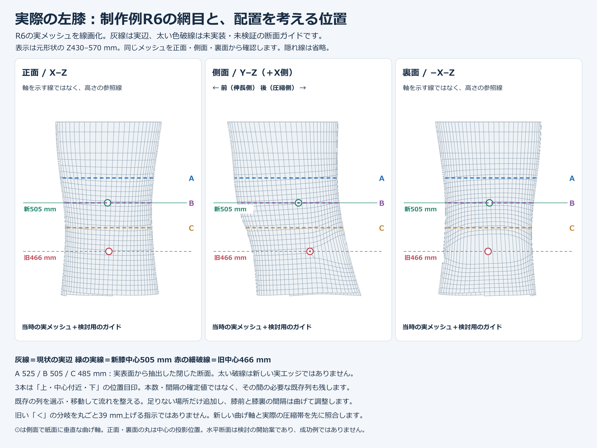
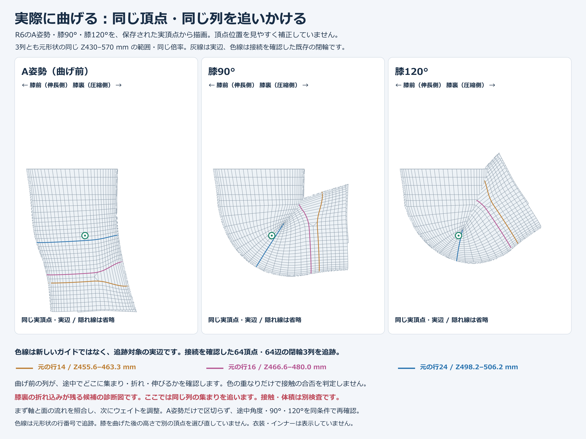

# Where to place knee edge rows

[日本語 / Japanese](../knee-edge-placement.md)

[Process index](process-index.md) · [Mesh and weights](mesh-weight.md)

Align rows around the knee and longitudinal thigh-to-shin edges with the actual bending region. Increasing overall density or concentrating edges at a point is not the goal.

## Read actual edges separately from proposed placement



**Gray lines are actual saved-model edges; thick colored dashed lines are provisional guides. At the time of this image, no topology change to those guides had been implemented.** The green solid line is the new bone center; the thin red dashed line marks the old center height.

A/B/C identify upper, near-center, and lower positions. They mean neither reducing to three rows nor adding exactly three; retain necessary existing rows between them. Heights, counts, and spacing are Lida-example values. Horizontal sections are an initial proposal, not universal placement or proven successful values.

| View | Flow to arrange | Inspect under bending |
| --- | --- | --- |
| Front | Continue transverse rows side to side and longitudinal edges from thigh to shin | Kneecap roundness, side steps/pulling, concentration at a central point |
| Side | Overlay bone center/deformation band; distribute front stretch and rear compression across rows | Agreement between bone and bend location, flat front, rear fold-in |
| Rear | Maintain row continuity and adjust spacing without crowding the compression band | V-shaped valleys, overlapping rows, inversion; density transition concentrated at a sharp fold |

## Beginner operation sequence

1. On a duplicate, establish neutral shape, bone position, and upper/lower fixed boundaries.
2. Overlay joint center and bending axis in front/side/rear views; mark compressing/stretching sides and target band.
3. Select existing closed loops and read spacing/connections. Consider repositioning before adding rows.
4. Use edge slide to adjust positions; add local rows only where insufficient.
5. Inspect neutral surface/fixed boundaries and reevaluate weight rules for the new placement.
6. Compare intermediate motion under identical conditions; tune inside/outside spacing and weights. Verify after save/reload.

In Blender's standard keymap, edge slide is `G` twice and loop cut is `Ctrl+R`. If branches/triangles stop a full-loop operation, first design and rebuild connectivity in the target band. Sliding may change the original surface, so compare silhouettes. Moving rows is not merging points into one point.

## Read the actual bending diagram



Here, **colored lines are actual edges of the included model**, unlike the placement diagram's dashed guides. They track the same vertices/edges rather than selecting different points by deformed height.

Neutral, 90°, and 120° are historical Lida examples. Select the required maximum from the use case and inspect intermediates/return too. Hidden lines and clothing are omitted; the diagram does not measure all internal contact or volume.

**In the earlier comparison, finer topology did not resolve rear-knee folding.** Moving bones can leave branches/weight correspondence designed for the old position. Judge bone improvement separately from topology/weight improvement.

Do not simply translate the entire old patch upward. Preserve the neutral surface and redesign rows, branches, and connections around the new axis. Placement at the provisional guides is not a guaranteed fix.

## Short AI instruction

```text
Preserve the input neutral shape, established bones, and upper/lower fixed boundaries.
Gray lines are actual edges; dashed placement guides are unimplemented; colored bend lines are actual rows.
First illustrate joint center, bend axis, compression/stretch sides, and the actual bending band.
Distinguish existing-row repositioning, connectivity rebuilding, and necessary additions. Explain placement rather than count.
A/B/C are position markers, not exactly three rows, mandatory additions, or concentration at one point.
Compare new topology + the same weight rule, then new topology + adjusted rule, on the same bones.
Check neutral, intermediate, required maximum, return, and both sides in plain/wireframe, with/without clothing.
Show roundness, rear V-folds, inversion/penetration, and fixed regions. Do not report an unresolved issue as success.
```

Words or symbols such as “diagonal,” “diamond,” or “<” do not explain connectivity. Draw actual edge branching and compare using the [visual-handoff format](visual-handoff.md).
