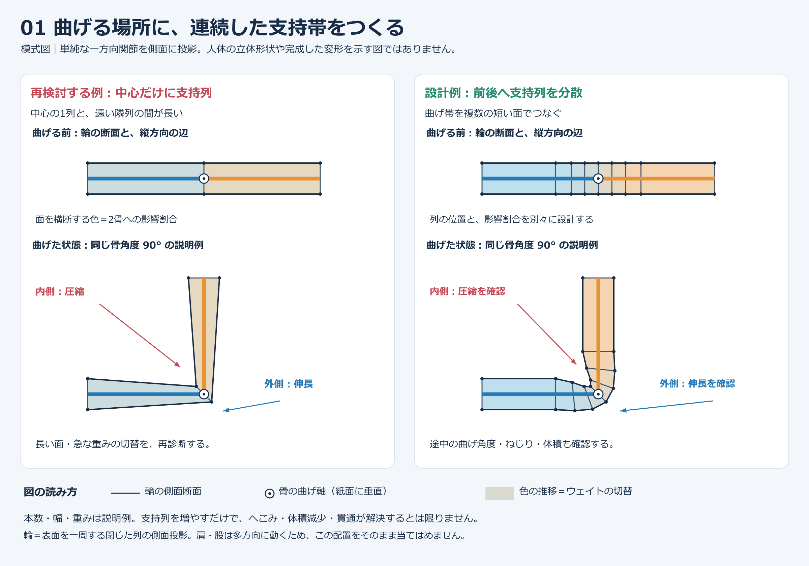
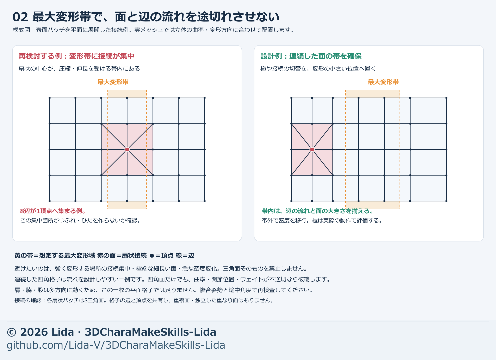

# Deforming meshes and skin weights

[日本語 / Japanese](../mesh-weight.md)

[Process index](process-index.md) · [Knee example](knee-edge-placement.md)

For holes, wrong joins, or missing parts, first define face-addition scope and corresponding boundaries using [mesh repair/completion](mesh-repair-completion.md). Then inspect joints, face flow, and weights here.

For a new moving humanoid with no initial rig, establish neutral shape/joint topology, then use [FBX-based Tripo VRM 1.0 autorig](tripo-autorig.md). Compare returned results with the original before adjusting here. Automatic results are starting values; good existing bones/weights need not be regenerated.

A mesh is the surface's points, edges, and faces; weights determine how much each point follows each bone. Assess natural deformation through topology, bone centers/axes, weights, and skinning method together.

Use the [bundled helper](model-tools.md) for repeated topology/deform-weight numerical inspection. After receiving/changing bones, also use `rig-audit` to check explicit humanoid mapping and mesh references. Weight normalization is separate from improving bone positions, face layout, and natural deformation. Judge with [actual images and intermediate motion after mechanical checks](mechanical-visual-review.md).

## Establish first

- Accepted neutral form, front/side/oblique views of the same body, and matched pre-edit images.
- Units, model-side/front/back, joint centers, bone longitudinal axes, and bending axes.
- Destination reference pose and required bends, twists, both sides, and combined motions.
- Target region, fixed connection loops, and dependencies such as clothes, ornaments, and expression keys.

Use neutral, intermediate, and required maximum poses to show actual compression/stretch sides. Do not infer bones/deformation bands solely from a visible joint crease or narrowest region.

## Check bones and reference pose before topology

**If the bend occurs at the wrong place, inspect bones before repainting weights.** Choose joint positions/axes/motions from body proportions and destination, not example coordinates/counts.

1. **Separate reference and display.** Record saved original's Rest Pose, current displayed pose, and destination-required pose. T-shaped arms do not prove a T Rest Pose. Also perform [saved-version comparisons](visual-handoff.md).
2. **Overlay bones and surface landmarks.** On matched front/side images show joint centers, long axes, bend directions, and kneecap/ankle/shoulder landmarks. Surface landmarks are estimates; do not automatically infer centers from the narrowest section.
3. **Use a small bend to test location.** Inspect intended bend location on both sides and through intermediates. Correct location alone does not establish corrected collapse/thickness.
4. **Apply equivalent motion.** Match hierarchy, local axes, controls, and motion mapping as well as names. For “135 degrees,” define zero pose and rotation axis. Do not mix angles measured from A pose and arms-down.
5. **Update dependencies after bone edits.** Check adjoining endpoints, bone lengths, pose switches, weight rules, and clothing/ornament correspondence. Rebinding to old bones does not establish new centers; verify actual saved coordinates and motion.

Example first request: “Before topology/weight edits, overlay bones and surface landmarks in front/side views and show saved reference/current pose, angle zero, and motion path. If adjusting joints, update related bones/clothes/ornaments and compare matched intermediates and saved-file results.”

## Place loops in the bending region

A loop here is a closed edge row around an arm, leg, or finger. At knees, elbows, and fingers, place transverse loops before/after the joint and connect them longitudinally.



The right side of the shared Japanese diagram adds rows for explanation. **In actual work prioritize placement over count: move existing loops to improve spacing/flow and add only where insufficient.** This comparison does not isolate or prove row-count effects.

| Region | Placement and motion checks |
| --- | --- |
| Inside bend | Distribute compression across rows; inspect crowding, overlap, inversion, sharp valleys |
| Outside bend | Distribute spacing for roundness instead of stretching one long face |
| Shoulder/groin | Connect flow/branches from chest, back, and torso into limbs; inspect multidirectional intermediates |
| Webbing/thenar | Maintain continuity into fingers/palm; test spread, one-finger bends, and grip |

Do not apply a one-direction cylinder diagram directly to shoulder/groin. Oblique loops and diamond connections are alternatives to compare, not symbols whose imitation guarantees repair.

## At shoulders/armpits, diagnose neck-side and upper-arm regions separately

Before inflating neutral shoulders for roundness, show **clavicle-to-neck continuity, upper-arm root, and front/rear armpit connections** from front, side, and oblique. Separate clavicle motion from skin following the upper arm.

- Compare arms-down, A, T, required forward/diagonal/lateral raises, and intermediate twist. Do not finish from one path's maximum alone.
- If a valley exists in neutral, diagnose shape/connectivity; if only in motion, diagnose bones/weights/collapse. Keep plain-skin/wireframe views and appearance with sleeves/ornaments restored.
- For triangular dents/dark lines, inspect every face meeting the junction, not just the conspicuous face. Do not hide inverted slender faces or duplicates with normal settings or outward pushing.
- Compare skin, sleeve, and ornaments at corresponding positions and align intended following/clearance. Do not bulk-transfer weights from a nearby unrelated or rear face.
- Record thinning arms, stationary neck-side flesh, and armpit shelves/walls individually. One improved number/valley is not whole-shoulder visual acceptance.
- A part that crosses the body's centre line, such as a hood, collar, or back panel, splits at the centre when the arms come down if it carries left and right shoulder/upper-arm weights half and half. Listing stretched edges with their rest positions and the weights at both ends finds it. Move the arm and shoulder weights to the chest bone more the nearer a point is to the centre, fading smoothly with the distance from the centre. Do not cut the border along one line.

This order includes lessons from rejected Lida shoulder corrections. Bone moves/local pushes alone did not produce natural continuous surfaces, so reexamine pose-specific faces/connections rather than repeating coefficients. See [hand shape, structure, and motion](hand-shape.md) for finger joints/webbing.

## Refine density and connectivity



Both sides of the shared Japanese diagram contain the same numbers of vertices, edges, and faces, but move the connection concentration. In a quad mesh, a pole is a vertex whose incident edge count differs from the ordinary four.

- Use spacing that represents surface curvature and intermediate silhouettes; gradually coarsen outside the band.
- Try moving poles/density transitions away from sharp folds. Judge necessary branches by location/motion.
- Inspect slender faces, unwanted internal faces, duplicates, holes, and geometric discontinuities.
- Preserve connectivity of skin that moves continuously. Distinguish UV/material seams from geometric cuts.
- Quads simplify flow design, but triangles/poles alone do not fail a mesh.

Uniform automatic remeshing/global subdivision alone does not define deformation-ready flow. Inspect destination triangulation too, including bend differences caused by quad diagonals.

When asked for "retopology", first look at a wireframe view of how many loops sit around each joint and how they run. If the mesh is tidy quads with loops across the joints, the breakage usually comes from bone placement, twist, weights, or the skinning method. Rebuilding the mesh means moving every UV, image, weight, expression key, and secondary-motion mapping again, so when you do not rebuild, show why with views and numbers.

## Align placement and weights

1. Diagram loop positions and bone proportions together, transitioning across a band spanning the joint.
2. Allocate inner folds and outer roundness separately. A wider transition alone is not necessarily better.
3. With oblique loops, do not use only world-space height for a straight weight cutoff.
4. Blend webbing through finger/palm connectivity rather than assigning one nearest finger.
5. Normalize only deform-bone weights to sum 1; exclude mask/normal groups.
6. Apply region-mask cutoffs before smoothing weights across the mesh and restrict smoothing to the intended bone pair; cutting with a step after smoothing leaves a boundary crease, and coarse pruning thresholds (such as `0.01`) can produce visible micro-steps on gentle surfaces when bent, so use a fine quantization threshold.

After topology edits, reevaluate weight rules at corresponding positions. Do not copy weights/expression keys by old indices. Recheck UVs, clothes, ornaments, and support surfaces too.

## Take deep elbow and knee bends with a helper bone that turns halfway

Blending vertices by weight proportions (linear skinning) thins the inside of a deeply bent joint. It remains even with a wide enough transition: it is a limit of the method.

1. **Compare the collapse by numbers.** For the points within a set distance of the joint centre, report a low percentile of "distance to the joint centre (bent ÷ rest)" at 90° and at the maximum the use needs (for example 130°). For parts whose skin sits far from the centre, such as a puffy sleeve, widen the range to the nearest points.
2. **Add the helper bone.** Parent it to the upper bone, put its head at the joint centre, align it with the lower bone, and let it take half of the lower bone's rotation (in Blender a Copy Rotation, local to local, Add, influence 0.5). The VRM Add-on can export this as a rotation constraint of `VRMC_node_constraint`; read the exported file and confirm the number and weight of the constraints.
3. **Move the joint ring onto it.** Along the bone axis, pass the weight smoothly from the upper bone to the helper to the lower bone. A narrow band can leave a small dent inside the bend, so line up candidates with different widths in the same poses with the same measure.
4. **Also check the outside of the bend and the whole body.** Compare with the original whether the front of the knee or elbow stays round, how many edges stretch, and whether other poses got worse.

In Lida's example the ratio at 130° (5th percentile) went from 0.56 to 0.86 at the knee and from 0.48 to 0.87 at the elbow, with bands of ±6.5 cm (knee) and ±8 cm (elbow); ±4.5 cm and ±6 cm left a dent behind the knee. These are example values for one body and mesh. If the destination does not play node constraints, the helper only follows its parent, so check the motion in the destination separately.

### With the tool (`lida_joint_check.py`)

```sh
blender --background --factory-startup --disable-autoexec --python-exit-code 1 --python lida_joint_check.py -- check --input model.blend --rig Armature --mesh Body --joint Shin.L@x Forearm.L@z --angles 90 130 -130 --report joints-before.json --render-dir joints-before-views
blender --background --factory-startup --disable-autoexec --python-exit-code 1 --python lida_joint_check.py -- helpers --input model.blend --rig Armature --mesh Body --joint Shin.L:65 Shin.R:65 Forearm.L:80 Forearm.R:80 --report helpers.json --output-blend model-helpers.blend
```

- `check` turns each named lower bone (the shin for a knee, the forearm for an elbow) by each angle about an axis through the joint centre, and measures the shape as Blender deforms it (constraints and modifiers included). `x`, `y`, and `z` are axes of the rig space; for a T pose, knees bend about `x` and elbows about `z`. Use `local-x` and the like only when the bone rolls are known to be clean; generated rigs can have uneven rolls, and a local axis bent a knee sideways. Confirm the bend direction from `tail_motion` (how the lower bone's tail moved) and the images before reading the numbers.
- Report: `distance_ratio_low` (5th percentile of the distance-to-centre ratio), `distance_ratio_min`, `edges_out` (edges past 1.6x or below 0.5x), and `worst_edges` (their rest positions and the strongest bones at both ends). A ratio below 0.7 or any stretched edge is a warning.
- `helpers` adds the bone `<lower bone>_Helper` (change with `--suffix`) with a Copy Rotation, hands the joint ring weights over, and writes the copy to `--output-blend`. `Bone:width_mm` sets the band per joint. It refuses when a bone of that name exists or a mesh has no Armature modifier pointing to the rig. Measure the copy with `check` and compare it with the original.
- Exit codes: 0 nothing found, 2 warnings or a usage error, 1 an input or execution error. The input is never saved.

## Separate following of nearby skin, clothes, and rigid ornaments

For close-fitting collars, compare weight-transition position/amount on corresponding skin/clothing faces. Both can sum to 1 and meet influence limits yet penetrate when skin moves fully and the clothing only half as much. See [collar diagnosis and adjustment](adjustment-methods.md#for-thin-collar-penetration-compare-motion-relative-to-the-skin).

Skin-face interpolation plus smooth clothing transitions is a candidate for closely fitting deforming regions. Do not apply it uniformly to free cloth, hair, or rigid fittings; inspect fitting shape/connection separately. Regeneration may restore old uniform rules, so record builder/delta-application order and read back saved weights/motion.

## Finish with comparisons

Using the same bones, pose, and camera, compare “original topology + original rule,” “new topology + same rule,” and “new topology + adjusted rule.” Same rule means the same method reevaluated from positions or other inputs.

Inspect neutral → intermediate → required maximum → return in plain, wireframe, and actual materials. Save both unclothed internal checks and normal clothed-distance views. Compare volume-preservation settings as separate conditions; do not assume they transfer to the destination.

In Lida's earlier knee comparison, subdivision and oblique layouts did not resolve rear-knee collapse. Neither density nor structure guarantees success; judge alongside the [actual-knee diagram cautions](knee-edge-placement.md).
