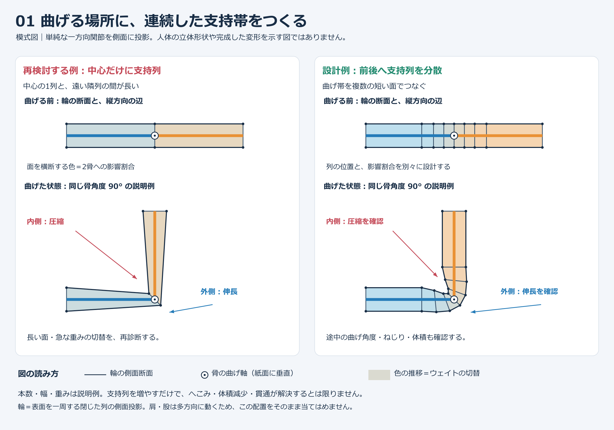
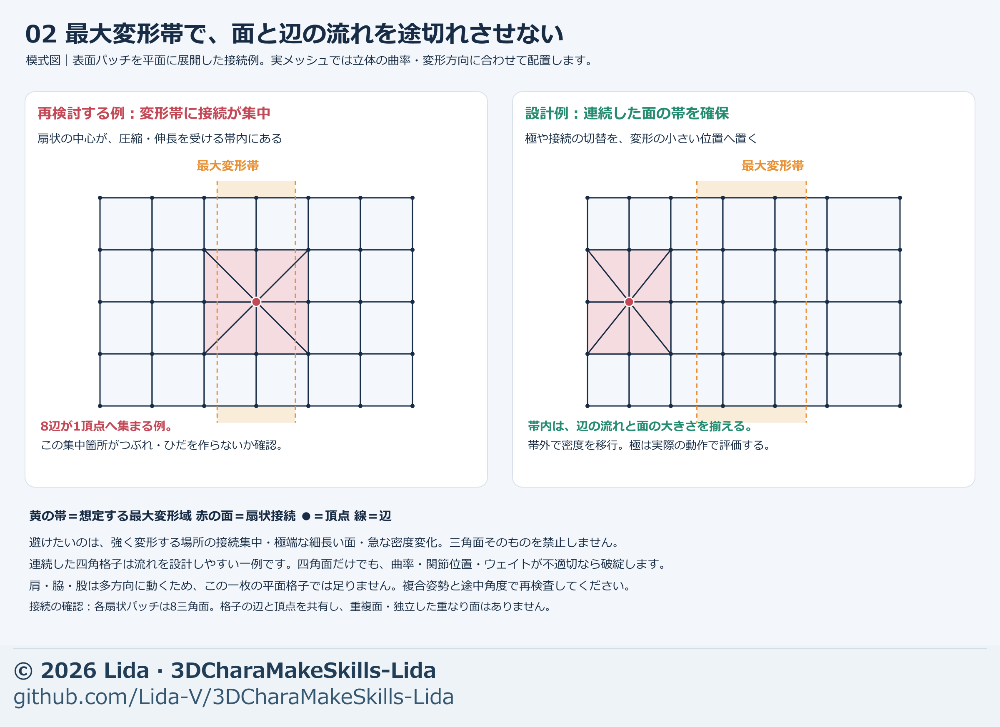

# Deforming meshes and skin weights

[日本語 / Japanese](../mesh-weight.md)

[Process index](process-index.md) · [Knee example](knee-edge-placement.md)

For holes, wrong joins, or missing parts, first define face-addition scope and corresponding boundaries using [mesh repair/completion](mesh-repair-completion.md). Then inspect joints, face flow, and weights here.

For a new moving humanoid with no initial rig, establish neutral shape/joint topology, then use [FBX-based Tripo VRM 1.0 autorig](tripo-autorig.md). Compare returned results with the original before adjusting here. Automatic results are starting values; good existing bones/weights need not be regenerated.

A mesh is the surface's points, edges, and faces; weights determine how much each point follows each bone. Assess natural deformation through topology, bone centers/axes, weights, and skinning method together.

Use the [bundled helper](model-tools.md) for repeated topology/deform-weight numerical inspection. After receiving/changing bones, also use `rig-audit` to check explicit humanoid mapping and mesh references. Weight normalization is separate from improving bone positions, face layout, and natural deformation. Judge with [actual images and intermediate motion after mechanical checks](mechanical-visual-review.md).

## Establish first

- Accepted neutral form, front/side/oblique views of the same body, and matched pre-edit images.
- Units, model-side/front/back, joint centers, bone longitudinal axes, and bending axes.
- Destination reference pose and required bends, twists, both sides, and combined motions.
- Target region, fixed connection loops, and dependencies such as clothes, ornaments, and expression keys.

Use neutral, intermediate, and required maximum poses to show actual compression/stretch sides. Do not infer bones/deformation bands solely from a visible joint crease or narrowest region.

## Check bones and reference pose before topology

**If the bend occurs at the wrong place, inspect bones before repainting weights.** Choose joint positions/axes/motions from body proportions and destination, not example coordinates/counts.

1. **Separate reference and display.** Record saved original's Rest Pose, current displayed pose, and destination-required pose. T-shaped arms do not prove a T Rest Pose. Also perform [saved-version comparisons](visual-handoff.md).
2. **Overlay bones and surface landmarks.** On matched front/side images show joint centers, long axes, bend directions, and kneecap/ankle/shoulder landmarks. Surface landmarks are estimates; do not automatically infer centers from the narrowest section.
3. **Use a small bend to test location.** Inspect intended bend location on both sides and through intermediates. Correct location alone does not establish corrected collapse/thickness.
4. **Apply equivalent motion.** Match hierarchy, local axes, controls, and motion mapping as well as names. For “135 degrees,” define zero pose and rotation axis. Do not mix angles measured from A pose and arms-down.
5. **Update dependencies after bone edits.** Check adjoining endpoints, bone lengths, pose switches, weight rules, and clothing/ornament correspondence. Rebinding to old bones does not establish new centers; verify actual saved coordinates and motion.

Example first request: “Before topology/weight edits, overlay bones and surface landmarks in front/side views and show saved reference/current pose, angle zero, and motion path. If adjusting joints, update related bones/clothes/ornaments and compare matched intermediates and saved-file results.”

## Place loops in the bending region

A loop here is a closed edge row around an arm, leg, or finger. At knees, elbows, and fingers, place transverse loops before/after the joint and connect them longitudinally.

The right side of the shared Japanese diagram adds rows for explanation. **In actual work prioritize placement over count: move existing loops to improve spacing/flow and add only where insufficient.** This comparison does not isolate or prove row-count effects.

| Region | Placement and motion checks |
| --- | --- |
| Inside bend | Distribute compression across rows; inspect crowding, overlap, inversion, sharp valleys |
| Outside bend | Distribute spacing for roundness instead of stretching one long face |
| Shoulder/groin | Connect flow/branches from chest, back, and torso into limbs; inspect multidirectional intermediates |
| Webbing/thenar | Maintain continuity into fingers/palm; test spread, one-finger bends, and grip |

Do not apply a one-direction cylinder diagram directly to shoulder/groin. Oblique loops and diamond connections are alternatives to compare, not symbols whose imitation guarantees repair.

## At shoulders/armpits, diagnose neck-side and upper-arm regions separately

Before inflating neutral shoulders for roundness, show **clavicle-to-neck continuity, upper-arm root, and front/rear armpit connections** from front, side, and oblique. Separate clavicle motion from skin following the upper arm.

- Compare arms-down, A, T, required forward/diagonal/lateral raises, and intermediate twist. Do not finish from one path's maximum alone.
- If a valley exists in neutral, diagnose shape/connectivity; if only in motion, diagnose bones/weights/collapse. Keep plain-skin/wireframe views and appearance with sleeves/ornaments restored.
- For triangular dents/dark lines, inspect every face meeting the junction, not just the conspicuous face. Do not hide inverted slender faces or duplicates with normal settings or outward pushing.
- Compare skin, sleeve, and ornaments at corresponding positions and align intended following/clearance. Do not bulk-transfer weights from a nearby unrelated or rear face.
- Record thinning arms, stationary neck-side flesh, and armpit shelves/walls individually. One improved number/valley is not whole-shoulder visual acceptance.

This order includes lessons from rejected Lida shoulder corrections. Bone moves/local pushes alone did not produce natural continuous surfaces, so reexamine pose-specific faces/connections rather than repeating coefficients. See [hand shape, structure, and motion](hand-shape.md) for finger joints/webbing.

## Refine density and connectivity

Both sides of the shared Japanese diagram contain the same numbers of vertices, edges, and faces, but move the connection concentration. In a quad mesh, a pole is a vertex whose incident edge count differs from the ordinary four.

- Use spacing that represents surface curvature and intermediate silhouettes; gradually coarsen outside the band.
- Try moving poles/density transitions away from sharp folds. Judge necessary branches by location/motion.
- Inspect slender faces, unwanted internal faces, duplicates, holes, and geometric discontinuities.
- Preserve connectivity of skin that moves continuously. Distinguish UV/material seams from geometric cuts.
- Quads simplify flow design, but triangles/poles alone do not fail a mesh.

Uniform automatic remeshing/global subdivision alone does not define deformation-ready flow. Inspect destination triangulation too, including bend differences caused by quad diagonals.

## Align placement and weights

1. Diagram loop positions and bone proportions together, transitioning across a band spanning the joint.
2. Allocate inner folds and outer roundness separately. A wider transition alone is not necessarily better.
3. With oblique loops, do not use only world-space height for a straight weight cutoff.
4. Blend webbing through finger/palm connectivity rather than assigning one nearest finger.
5. Normalize only deform-bone weights to sum 1; exclude mask/normal groups.

After topology edits, reevaluate weight rules at corresponding positions. Do not copy weights/expression keys by old indices. Recheck UVs, clothes, ornaments, and support surfaces too.

## Separate following of nearby skin, clothes, and rigid ornaments

For close-fitting collars, compare weight-transition position/amount on corresponding skin/clothing faces. Both can sum to 1 and meet influence limits yet penetrate when skin moves fully and the clothing only half as much. See [collar diagnosis and adjustment](adjustment-methods.md#for-thin-collar-penetration-compare-motion-relative-to-the-skin).

Skin-face interpolation plus smooth clothing transitions is a candidate for closely fitting deforming regions. Do not apply it uniformly to free cloth, hair, or rigid fittings; inspect fitting shape/connection separately. Regeneration may restore old uniform rules, so record builder/delta-application order and read back saved weights/motion.

## Finish with comparisons

Using the same bones, pose, and camera, compare “original topology + original rule,” “new topology + same rule,” and “new topology + adjusted rule.” Same rule means the same method reevaluated from positions or other inputs.

Inspect neutral → intermediate → required maximum → return in plain, wireframe, and actual materials. Save both unclothed internal checks and normal clothed-distance views. Compare volume-preservation settings as separate conditions; do not assume they transfer to the destination.

In Lida's earlier knee comparison, subdivision and oblique layouts did not resolve rear-knee collapse. Neither density nor structure guarantees success; judge alongside the [actual-knee diagram cautions](knee-edge-placement.md).
