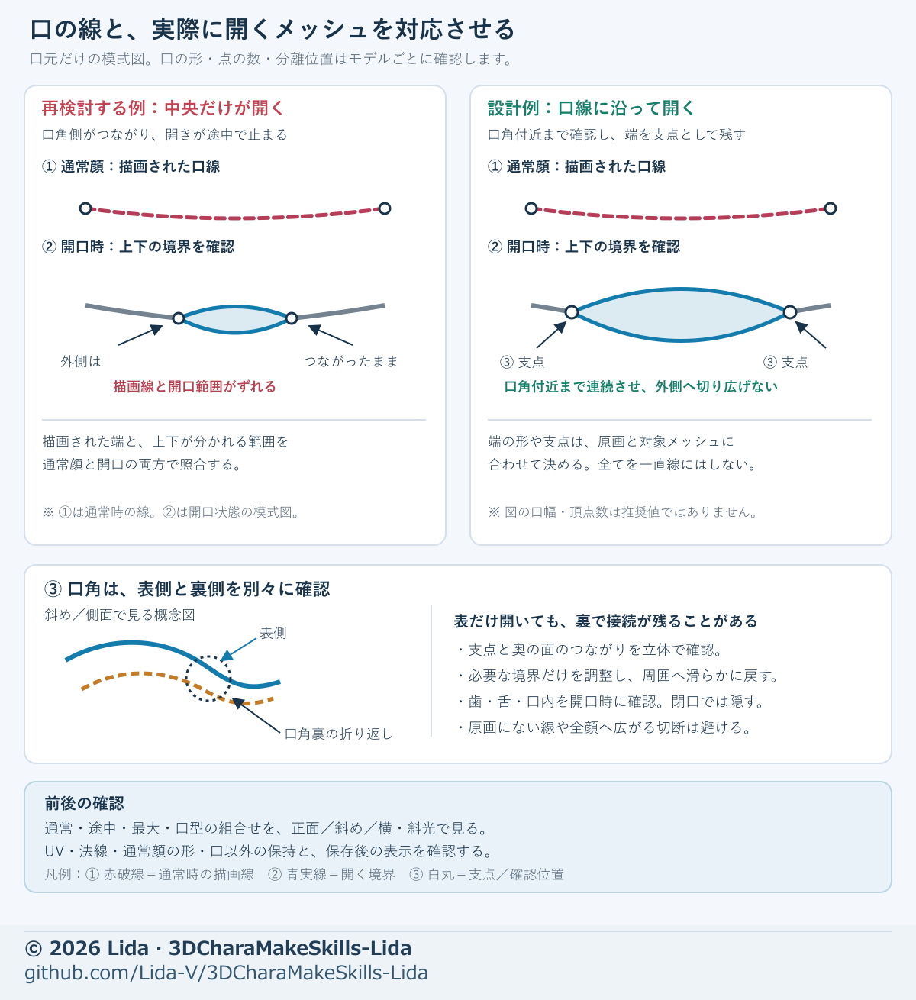

# Recent production lessons: corrections and checks

[Japanese source](../recent-production-lessons.md) · Source baseline: 2026-10-27.

These are reusable diagnostic steps based on issues observed while making another character. Record a technical candidate, checks under a finite set of poses/views/lights, user acceptance, and acceptance in the destination separately. If an improvement in numbers looks or moves unnaturally, adjust it again. Do not copy an example's coordinates, coefficients, iteration counts, or colors as defaults for other models.

Start with the existing guides to [mouth shapes](mouth-shapes.md), [eyes and expressions](expression-adjustment.md), [hands](hand-shape.md), [topology and weights](mesh-weight.md), [materials](accessory-materials.md), [appearance in the destination](cross-engine-look.md), and [secondary motion](secondary-motion.md). Also use the [diagram index](diagram-index.md) and [integration and saved-file checks](visual-handoff.md).

The following **schematic** compares a painted mouth line with the opening boundary; it is not evidence of a repaired model. Map its directions, corners, and front/back surfaces to the actual model.

Diagram legend: **① dashed red line** = the painted mouth line in the neutral face; **② solid blue lines** = the upper and lower opening boundaries; **solid gray lines** = portions still connected and not opening; **③ white circles** = hinges or locations to inspect. In the lower side-view concept, the **dashed orange line** is the fold behind the mouth corner. The left example opens only in the middle; the right checks the intended opening toward each corner hinge without cutting outward into the face. Determine endpoint shape and hinge position from the chosen reference art and actual mesh. Inspect the front and back of each corner separately, including the fold, and preserve the neutral shape, UVs, normals, and out-of-scope regions.

## Before changing anything

Select only the relevant parts and follow dependencies: **reference shape and saved original → face/bone structure → deformation and following → materials and export**. At the start of a stage, record the input version, editable and protected regions, required poses, matching comparison conditions, and exit criteria. The following order is a diagnostic guide, not an instruction to change unrelated parts.

## 1. Only the middle of a painted mouth line opens

**Symptom and possible cause:** Only the lipstick area moves, leaving the lines near the corners closed. Upper and lower surfaces may still be joined outside the opening, or the outer surface and the folded-back corner pocket may not share the intended boundary. Compare the line's intent with the reference art; do not mechanically cut every painted line.

**Adjustment:** On a working copy of the neutral face, mark the intended opening, corner hinges, and front/back connections. Separate only what needs to open. Before adding faces, plan vertex correspondence and migration for every existing shape key; connect new boundary UVs, normals, and weights to neighboring faces. Preserve the neutral face and existing keys outside the mouth, and give new points the necessary movement in affected keys. If an opening reveals a hollow or corner hole, adjust the teeth, tongue, and inner backdrop; keep them contained when closed. Preserve the jaw and face outline when they were specified as fixed.

**Check:** Compare whether the intended opening chosen from the reference art closes and opens naturally up to the hinge near each corner, when closed, partway open, and fully open, from front, oblique, and side. For each vowel in the chosen design, inspect upper/lower lip curves, width, exposed teeth and tongue, remaining old horizontal lines, and side-view protrusion. Check required vowel blends and combinations with other expressions, grazing-light wrinkles or flipped faces, and the keys after saving.

**Initial request:** “Compare the painted line with the actual opening through both front and back at the corners. Preserve the neutral face, keys outside the mouth, and specified fixed jaw; repair only the necessary boundary and interior. Compare vowels, intermediate values, and blends under matching conditions.”

## 2. Fingers move incorrectly after changing hand proportions

**Symptom and possible cause:** After shrinking or resizing a hand, finger bones become zigzagged, a middle joint stops contributing, or a neighboring finger moves. When parent and child bones are connected, moving the parent's tail also moves the child's head. A previous weight-transition width may also be too broad for the new segment lengths.

**Adjustment:** Compare hand size with the whole body, face, and props. Record the wrist reference, shape, bone heads/tails, parent relationships, connection states, rolls, weights, existing actions, and constraints. If necessary, temporarily disconnect the bones on a working copy, place them using each finger's actual mesh center, joint position, bending axis, and nail direction, then restore the original parent relationships and needed connection states. A change to the bone rest pose can affect existing animations and constraints, so check the affected scope and make any needed adjustments. Inspect actual influence on each segment and leakage to neighboring fingers before smoothly correcting only the necessary weights. Straight fingers or perfect left/right symmetry are not requirements for every model.

**Check:** Inspect individual bends, extensions, spreads, thumb opposition, gripping, and pinching through intermediate poses and return. Compare the wrist with the cuff, nails, and the hand/forearm boundary. Recheck saved motion including existing actions and constraints, as well as bones and motion in the destination. Normalized weights alone do not establish natural bending.

**Initial request:** “Adjust the hands to the whole-body proportions, account for connected parent/child bones, and align finger joints, axes, and weights. Check neighboring-finger leakage and the cuff in intermediate poses and after saving.”

## 3. Colored lines stretch on closing eyelids, or the inner corner gaps

**Symptom and possible cause:** Painted lashes or double-eyelid lines stretch vertically; the sclera or iris shows through a closed lid; or only the inner corner forms a step. Skin faces carrying painted lines, separate lashes, sclera/iris, and the inner-corner connection may have different causes.

**Adjustment:** Use the neutral face as the baseline and display each layer. Map the painted line to the faces that move. Create only the required shape deltas and, in keeping with the chosen design, adjust overlap, containment near the lashes, or UVs so the line does not stretch. Diagnose exposed sclera/iris separately and connect inner and outer corners smoothly. Preserve the other eye, brows, mouth, and other out-of-scope shapes.

**Check:** Inspect each side, blinks and winks, intermediate and closed values, required left/right combinations, and combinations with mouth shapes from front and oblique views. Check folds and show-through, saved keys, and bindings in the destination. Matching key values alone do not guarantee safe contact or appearance.

**Initial request:** “Diagnose stretched lines, visible sclera/iris, and the inner-corner step by layer; check both sides, intermediate values, expression combinations, and the saved result.”

## 4. Correcting mouth or local UVs contaminates another area

**Symptom and possible cause:** A different color appears on the back of the neck after correcting the mouth interior. The selection may include unrelated faces; a shared UV island or image margin may have been overwritten; or a projection may have passed through onto a back surface.

**Adjustment:** Do not identify the target by mesh name alone. Inspect face ownership, UV islands, actual material/image sharing, front/back surfaces, and occlusion; separate editable faces from protected ones. Match projections to the intended face and visible depth, adding directions where needed. Declare effects on image boundaries and UV padding, and protect other islands, the face, neck, and clothing. Generated reference images are aids, not inspection renders of the finished model.

**Check:** Compare close front, back, oblique, and back-of-neck views in BaseColor-only and material display; check neutral and open-mouth states. Reopen the saved model and its export and check the same regions again, not just the image file.

**Initial request:** “Identify target faces, UV islands, and image sharing first; correct only the mouth interior. Protect the face, back of the neck, and other islands, and check front/back/oblique views and the saved result for regressions.”

## 5. A white line or washed-out appearance may have several causes

**Symptom and possible cause:** A thin white line remains although the local paint looks right, or the whole character looks pale. Old padding outside a UV boundary may be sampled; display mode, lighting, color management, material reflections, and images may interact; or a Normal node may reference a UV name that does not exist.

**Adjustment:** Inspect the display mode and BaseColor alone first, then compare lighting/color management, actual material-node connections, and images. For a UV-edge line, fill the surrounding padding with a suitable color, checking protected neighboring islands and mipmaps. After correcting the Normal UV reference and inspecting its image, compare strength or connected/disconnected alternatives under matching conditions. An apparently unused color may also be multiplied into an FBX and darken it in some pipelines, so check the actual export and re-import. Change only what the evidence requires; do not unconditionally change environment, material, and image at once.

**Check:** Compare normal and close views, grazing light, BaseColor and material display, the saved file, and the destination. State when padding changes pixels outside the strict target UV and verify that protected islands are unaffected.

**Initial request:** “Separate the white line and washed-out appearance into display, lighting, color management, image, UV, and material causes; compare before changing only the necessary part, and recheck after saving.”

## 6. Integration or export shows an old image or a different color

**Symptom and possible cause:** Different images with the same name may merge; a node may reference a UV layer missing from its mesh; embedded image bytes may be old; or an FBX color multiplier may darken the result.

**Adjustment:** Distinguish actual face, hair, and clothing images by data reference and content, not name alone, and rename on a copy if needed. Map faces, material slots, images, UV layers, and nodes together; check the coordinate system and save destination. If baking retains old packed image bytes, compare a method that creates a new image and transfers the required pixels, preserving the original.

**Check:** Verify the actual image format and decoded pixels, not just its extension. Save, reopen in a fresh session, and compare the relevant images, UVs, materials, embedded content, and front/side renders. Evaluate destination shader differences separately.

**Initial request:** “Compare the actual same-named images and their material/UV assignments; integrate only necessary copies, then re-import the saved output to check for old images and dark multipliers.”

## 7. Do not replace the original directly with an automatic-process return

**Symptom and possible cause:** A returned model may look identical but have a changed center/scale, face ownership, UVs, materials, or images. Similar counts or appearance alone do not guarantee correspondence between vertex indices or assets.

**Adjustment:** Preserve the original, submission copy, and received result. Compare corresponding points and coordinate transforms, faces, UVs, materials, and images. Where preservation is needed, transfer only the required information—such as matched bones or part ownership—to a candidate based on the original. If a new UV cannot be represented by the original face structure, evaluate a triangulated copy that preserves the original surface, comparing face correspondence, shape keys, weights, UVs, and renders. Do not average away inconsistencies or reuse old vertex indices without checking.

**Check:** Inspect front/back/side, protected parts, actual image dimensions and assignments, intermediate joint motion, the saved model, and the destination. Distinguish receiving a result from integrating it correctly into the production model.

**Initial request:** “Compare the return with the original for coordinates, faces, UVs, materials, and images; transfer only necessary information to a candidate. If correspondence changes, validate on a separate copy.”

## 8. Correcting inward feet makes them look overly outward

**Symptom and possible cause:** The outline of an asymmetric shoe decoration is mistaken for the direction of the foot, and applying the same rotation from ankle to knee overcorrects both. Moving the knee too far outward can also change the leg silhouette.

**Adjustment:** Separately inspect the sole/toe without decoration, ankle, front of the knee, and thigh positions against front/side views and approved art. Decide foot orientation and leg centerline independently and adjust only the necessary range in small steps. Compare from the original version rather than stacking corrections onto an overcorrected candidate; preserve ground contact, clothing clearance, and intended asymmetry. Toes do not always need to be parallel.

**Check:** Compare the neutral full body and feet, oblique/side views, required bending, walking and return, ground contact, and clothing interference.

**Initial request:** “Inspect sole and knee directions without using the decoration outline, and assess leg centers separately. Build a restrained candidate from the original; compare ground contact and required poses.”

## 9. Do not give moving and fixed parts the same motion

**Symptom and possible cause:** A hair base or inner clothing sways, metal accessories stretch, or secondary motion/expressions do not work after export. Roles and parent relationships, fixed roots, weights, collision targets, or expression bindings may be mixed up.

**Adjustment:** Separate moving hair/cloth, underlying parts that primarily follow the head or body, and accessories that should retain their shape. Record each root and tip, its parent/follow target, and collision targets; adjust only the necessary chains. For rigid fittings, also check their attachment and following relative to moving neighbors. Do not hide the problem by stopping all motion or enlarging every collider uniformly.

**Check:** In required head, arm, and body motions, compare secondary motion on/off, intermediate states, return, and contact with related parts. Reopen the destination and run the motion—not just inspect stored settings—and execute expression names and their deformation/material bindings. Distinguish a finite test interval from verification in actual use.

**Initial request:** “Separate the following behavior of moving hair/cloth, fixed bases, and fittings. Compare intermediate and return states in representative motions, and actually test secondary motion and expression bindings in the saved destination.”
## 10. A generated image shows a color break along a UV seam

**Symptom and possible cause:** A color boundary or thin line runs along the seam between two UV islands, for example on the neck. A generated image may paint each island in a different tone (say, the back of the neck pale and the jaw side skin-colored), so the seam becomes a color edge. Light bands or thin lines can also be baked along mesh edges, and the gutter outside the islands may differ from the skin. When the repaint area is chosen by distance from the center of a tube such as the neck, measuring that center with protruding points like the chin or cheeks shifts the area, and only one side of the seam gets fixed.

**Adjustment:** Confirm the line with base color alone, then trace a visible line pixel back to its face and UV to tell an island tone difference from a baked line or the gutter. Decide color per 3D point, not per island: keep the colors outside the area fixed, blend the inside smoothly from its surroundings (for example by harmonic interpolation), and paint that color into the image triangle by triangle so both sides of the seam receive the same color. Where the original painting is nearly plain, do not keep its fine detail—that also keeps the baked lines; bring back the original shading only at the area's border so the border does not show. Painting beyond a triangle overwrites another island that touches it in UV space, so paint inside only and fill the gutter outward from the island edges. If another part reads the same image through UVs that stretch across islands, leave those faces out of the gutter check and review their appearance separately.

**Check:** Confirm the line is gone with base color alone and with a reduced image close to a far mip level. Compare front, oblique, side, and head-turn views, and close views in the destination. Verify that faces and other islands outside the area, including the eyes, are unchanged and that the saved image is the intended one.

**Initial request:** “Confirm the seam line with base color alone and trace its pixels back to UVs to isolate the cause. Blend color by 3D position rather than by island, paint inside triangles only, fill the gutter, and check close views in the destination.”

© 2026 Lida · Source: [3DCharaMakeSkills-Lida](https://github.com/Lida-V/3DCharaMakeSkills-Lida)
