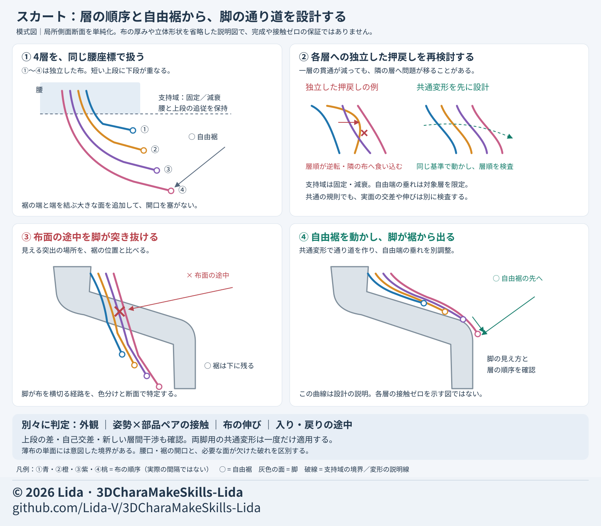

# Skirt failures and completing hidden areas

[Japanese original](../skirt-hidden-modeling.md)

Review the outer design, inner body, and movement routes separately. Reducing penetration can stretch cloth or move the problem into another layer.
See the [process index](process-index.md) for stage order and [mesh and weights](mesh-weight.md) for surface structure.
For filling small holes, matching connection boundaries, and rebuilding missing regions, use the decision table and construction diagrams in [mesh repair and completion](mesh-repair-completion.md). This chapter covers checks specific to layered cloth and hidden body geometry.

## Materials to prepare

- Approved front, side, and back artwork, plus a diagram with each cloth layer color-coded.
- Images of the same body, pose, and scale with the costume shown and hidden.
- Views from below showing waist, hem, slits, interior, and body boundaries.
- A plan for completing hidden areas such as arms and torso. Distinguish inferred shapes from shapes established by the artwork.
- Comparison images for walking, forward/backward leg raises, sitting, kneeling, and intermediate entry and return poses.

## Diagnose structure first

1. Show one cloth layer at a time and distinguish missing faces, reversed faces, duplicates, and accidental connections to other layers.
2. Do not mistake UV or normal boundaries for real holes. Separate intentional openings such as waist openings and hems too.
3. Do not cap the entire hem with a large face or close the legs' passage.
4. Correct and review one layer before extending a working method to others.
5. Preserve tier lengths, overlap, front/back hem lengths, pleats, and edge shapes. Waist ornaments are not additional cloth layers.

A boundary is not itself a defect in single-surface thin cloth. Add a back surface and rim if thickness is needed while retaining designed openings.
Higher mesh density alone cannot correct wrong connections, layer order, or differing support.

## Correct major penetration first

The diagram simplifies a local side section. Keep free-hem openings and distinguish a leg protruding through the middle of a cloth surface from a leg emerging beyond its hem.
Panels ①–④ show common waist coordinates, independent pushbacks versus shared deformation, mid-surface penetration, and exit past a free hem. The layer colors are ① blue, ② orange, ③ purple, ④ pink; circles mark free hems, gray shapes are legs, and dashed lines mark support boundaries or explanatory deformation guides. Spacing is illustrative.
Separate shared deformation of layers from free-end droop, and review appearance, contact, stretching, and intermediate poses individually. This is not a completed candidate or evidence of zero contact.

- Distinguish knees or legs piercing a cloth surface from movement outside a free hem.
- Pushing each layer back independently can make it enter its neighbor. Design a shared deformation that preserves layer order first.
- In this production, the reference shape and weights were preserved while a smooth shared deformation was derived from the real free hems and leg positions. Inverse skinning returned it to the pre-bone-deformation space to create shape-key differences.
- This locally changed major protrusions in specified movements into a leg-emerging-from-the-hem appearance.
- Droop was then added only to the lower free ends extending beyond the knees, reducing their forward, board-like shape.
- Separate waist and supported upper tiers from free ends. Apply the common deformation once for two-leg movements; do not add left and right versions twice.
- Even with a common rule, fix or fade the supported region and check evaluated differences in preserved upper tiers. Limit free-end droop to the intended layers.

## Adjust folds, stretching, and support

- Rounding only hem tips leaves the curl immediately above them. Extend smooth tangent continuity into the cloth surface.
- If deformation depends on hidden support surfaces, update corresponding surfaces and rebind where needed.
- When aligning support for bodice, waist ornaments, and skirt, check the order so the waist transform is not applied twice.
- Reject a push-out that achieves zero intersections if edge stretching or cloth length becomes excessive.
- Compare per-pose part pairs, new pairs, self-intersection, and worsening of existing pairs, not only total intersection counts.
- Report numeric contact, visible protrusion, layer inversion, cloth stretching, and movement continuity separately.

## Complete hidden body areas and connections

- Hide clothing and distinguish a body hole from a body part that never existed. Filling a local hole and making an entire body are different tasks.
- Added torso or arm regions must match connecting face rows, weights, shape keys, and dependent controls.
- Fitting inside clothing at rest does not prove safety when changing clothes or bending.
- When transferring weights from clothing, use corresponding faces on the same side, not another layer or the opposite side.
- Prioritize body continuity, clothing changes, crotch and leg openings, and movement penetration before fine shading in normally hidden areas.
- Preparing body → clothes → outerwear in separate stages may make boundaries easier to explain next time. Treat this as a prevention proposal, not an already demonstrated success.

## A first request

> Preserve the artwork's layers and silhouette. First diagnose actual mesh misconnections, intentional openings, and missing hidden body areas. Prioritize major visible penetration and distinguish a leg piercing the cloth surface from exiting a free hem. Design support regions, free ends, and layer order with a common reference. Compare rest, intermediate poses, and return under the same conditions. Report contact, stretching, inversion, appearance, and export dependencies separately.

## Separate results from unverified areas

The shared deformation and droop adjustments were local candidates. Stiff upper tiers, narrow folded returns, angular intermediate shapes, and nonzero intersections with the body or neighboring layers remained.
Model and shape-key export checks do not establish reproduction of game-side activation rules, secondary motion, or collision handling. Plan transfer of Blender-specific controls separately.
Final user adoption and whole-body integration are separate reviews too. See [Lida's design](lida-design.md) for preferences and [AI instructions](ai-instructions.md) for communicating requests.
