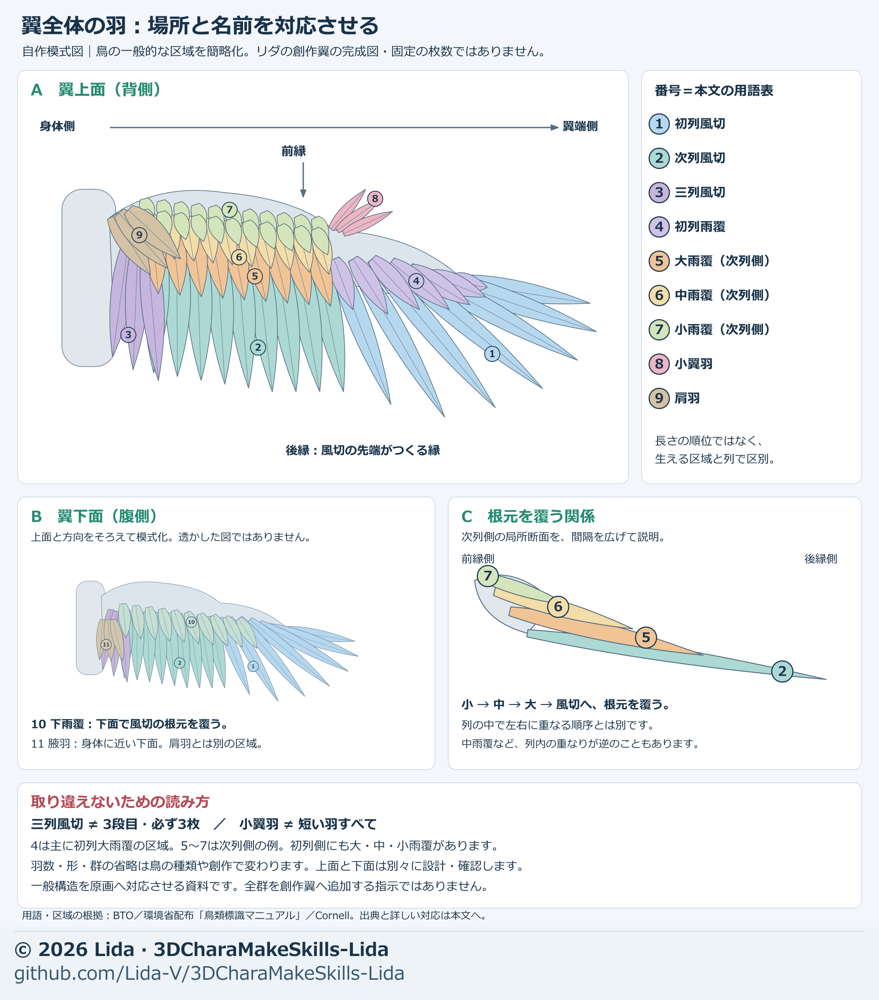

# Feather groups and their positions across a wing

[Japanese original](../wing-feather-terms.md)

[Wing-making workflow](wing-workflow.md) · [Diagram index](diagram-index.md)

Instructions limited to “long feathers and short feathers” can confuse attachment regions and covering rows. Separate **flight feathers arranged from body toward wingtip from the coverts covering their bases**, and map the numbered groups below to the artwork.

This reference summarizes general bird structure for designing fictional wings. It is neither a finished diagram of Lida's wings nor a fixed specification for every fictional wing. Counts, shapes, and rows vary by species; the diagram simplifies the groups needed for this explanation.

## Establish orientation first

**The upper surface is dorsal; the underside is ventral.** Mark the direction from body to wingtip, the leading edge at the front, and the trailing edge formed by the flight-feather tips. Specify which surface of which wing you mean, rather than relying on screen up/down.

Panel A maps upper-surface regions. Panel B maps underside regions in the same direction; it is not a transparent view through the top or an instruction to duplicate top-side geometry underneath. Panel C expands spacing in a local section to explain which groups cover the bases of others. Numbers correspond to the English table below; the groups' colored areas are location guides, not a ranking by feather length.

## Diagram numbers and names

| Number | Name | Location and what to inspect when building |
| --- | --- | --- |
| 1 | Primaries | Flight feathers attached to the hand-like outer wing. Inspect the wingtip fan, length progression, and continuity of the outline. |
| 2 | Secondaries | Flight feathers along the forearm's ulna, closer to the body. Their overlap forms the inner wing surface. |
| 3 | Tertials | A name distinguishing the innermost secondaries. How distinct they are varies by species. It does not mean a third tier or exactly three feathers. |
| 4 | Primary coverts | Groups covering primary bases. The diagram mainly represents the greater primary covert region and omits finer subdivisions. |
| 5 | Greater coverts | Here, 5 indicates greater secondary coverts: a longer row covering flight-feather bases. Greater primary coverts are included under 4. |
| 6 | Median coverts | Here, the secondary-side group nearer the leading edge than the greater coverts, covering their bases. |
| 7 | Lesser / marginal coverts | Here, smaller feather groups covering the area still nearer the leading edge. Greater, median, and lesser are distinguished by region and row, not size alone. |
| 8 | Alula | A small group on the first digit, or thumb, near the wrist and leading edge. It is not a name for all short feathers. |
| 9 | Scapulars | Feathers of the back and shoulder. They appear to overlap the body side of the wing but are distinct from tertials and coverts. |
| 10 | Underwing coverts | Groups covering flight-feather bases on the underside. Subdivisions are combined here for simplicity. |
| 11 | Axillaries | Feather groups on the underside close to the body. Do not confuse them with dorsal scapulars. |

**Numbers 5–7 are secondary-side examples. The primary side also has greater, median, and lesser coverts.** General bird diagrams sometimes abbreviate greater primary coverts to “primary coverts” and greater secondary coverts to “greater coverts.” These are not unrelated classification systems.

## Check different kinds of overlap separately

1. **Covering bases:** As in panel C, shorter groups cover the bases of groups behind them, forming a wing surface without exposed flight-feather attachments.
2. **Neighbors within a row:** Inspect which vane lies on top and how much remains exposed. All rows need not overlap in the same direction; median coverts can overlap opposite to flight feathers or greater coverts.
3. **Upper and lower surfaces:** Each has its own covering feathers. A double-sided material does not define underside layout.

Separate hidden roots from exposed tips and check for sudden gaps between rows during opening and closing. See [the wing workflow](wing-workflow.md) for attachment surfaces, support volume, and weights.

## Map the terms to fictional wings

First map the roles of 1–9 provisionally to the approved artwork. Mark included groups, omitted groups, and original ornaments separately. The “three tiers” in Lida's artwork describe design tiers and do not necessarily mean tertials. Do not change an approved outline or tier count merely to match a general bird diagram.

Use the same numbers and body-side/wingtip-side labels on back, side, and any required underside views. Before choosing feather counts, check that the flight-feather fan corresponds with the extent of covering groups, then proceed to [testing a few representative feathers](wing-workflow.md).

> AI request: Map primary-like and secondary-like flight feathers and the groups covering them to approved artwork [version], using this diagram's numbers. Mark upper/underside, body/wingtip side, and leading/trailing edges. Do not interpret tertials as the third tier or alula as all short feathers. Explicitly mark groups omitted in the fictional design. Present only a layout diagram first, preserving the approved outline and tier count.

## Sources checked for names and regions

This is an original schematic drawn after checking names and positions. It is not a reproduction or tracing of these illustrations.

- [BTO: Topography of a bird](https://www.bto.org/sites/default/files/u17/downloads/about/resources/topography%281%29.pdf): feather groups and positions on upper and lower surfaces.
- [BTO: Moult in Birds](https://www.bto.org/sites/default/files/moult-in-birds-web.pdf), pp. 12–13: flight feathers, tertials, abbreviated primary/greater covert names, and alula.
- [Bird Banding Manual, Yamashina Institute for Ornithology, distributed by Japan's Ministry of the Environment](https://www.biodic.go.jp/banding/pdf/banding_manual.pdf), section 1.2.1: primary/secondary-side and upper/lower-surface coverts, alula, and overlap within rows.
- [Cornell Lab: All About Feathers](https://academy.allaboutbirds.org/feathers-article/): flight feathers and the role of coverts in covering attachments and forming a smooth wing surface.
