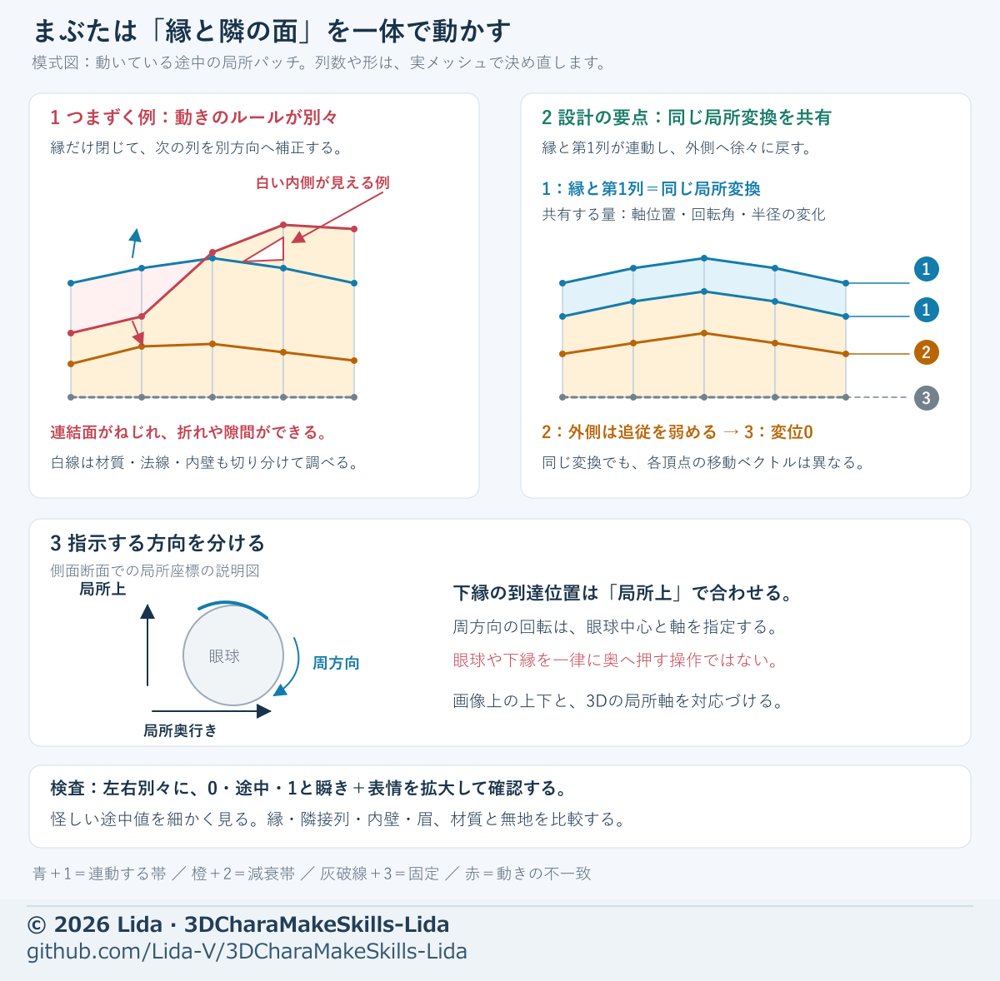

# 表情メッシュを崩さずに調整する

表情は、輪郭線、隣接する面、途中の動きを一緒に調整する。完成時だけ自然でも、途中で折れたり穴が開いたりすれば未完了。
工程全体は [工程索引](process-index.md)、変位とフェードの指定方法は [調整方法](adjustment-methods.md) を参照する。

眼球そのものの球面・虹彩・白目・線の層・視線を作る場合は、先に[眼球モデリング](eye-modeling.md)を確認する。キーの構造や値の検査には[同梱ツール](model-tools.md)を使い、まぶたの外観・接触・途中動作は本章で判断する。

## 用意する素材

- 採用した通常顔のメッシュと、同じ顔から作った目・口・表情の参考画像。
- 正面・左右斜め・横・下からの、同じカメラと大きさの比較画像。
- 目頭／目尻、上下まぶた、口角／唇の縁を示した拡大図。
- 基準ファイル、変更対象、固定する部位、既存キーの一覧。
- 色なしの表示と実際の材質の表示。画像の役割は [画像による引き継ぎ](visual-handoff.md) に明記する。

## 調整前に分ける問題

1. 通常顔の丸みが違うなら、先に基準顔を直す。
2. 面の折れ、描かれた線、法線の乱れ、空洞の内側の露出を、色なし・部品色分け・裏面表示で区別する。
3. シェイプキーは一つの基準メッシュ上で作る。別々に生成した顔の頂点番号や顔全体の差分は移さない。
4. 変更範囲と、その外側へ変位をゼロに戻す帯を指定する。新しい基準顔へ旧キーを移す場合は再検査する。

## 目の閉じ方

1. 正面で閉じたまぶたの線を決め、目頭・中央・目尻の高さを指定する。
2. 眼球中心を基準に、目の局所的な「上・奥行き・周方向」を示す。顔全体の上下と混同しない。
3. まつ毛と描かれた二重線を帯として扱い、帯の形を保ったまま移動させる。
4. 縁と隣接する面の列を連動させ、無地の皮膚で徐々に基準形へ戻す。眉は指定した範囲で固定する。
5. 左右を同じ式で始めても、目頭の面の向きと隙間は左右別々に確認する。

制作例では、上側の6列・下側の2列を帯として扱った。輪数はメッシュに応じて選び、一律の必要数にはしない。
笑顔の弧は、両端を結ぶ線に中央の高さを加えると指示しやすい。例：`h(u)=H×(4u(1-u))^1.25`。
ここで `u=0` は目頭、`u=1` は目尻、`H` は中央の盛り上がり。高さと閉じる割合は別々の調整値にする。
下まぶたを上へ押すだけでは、途中で虹彩を横切る直線になりやすい。上下のまぶたと両端を同じ閉鎖曲線へ対応させる。

## 目頭の白い線・穴・折れ

白い帯の原因例を、縁と隣の面列の動きの不一致として示した模式図。実際の成功メッシュや普遍的な必要列数を表す図ではない。
縁と第1列で共有するのは局所変換の軸位置・回転角・半径変化。全頂点へ同じ平行移動を与えるという意味ではない。
口にも共通する固定範囲・減衰・途中確認は、[口キーの局所図](mouth-shapes.md#手順)を参照する。

- 縁だけが動き、次の列が別方向へ動くと、間の面がねじれて白い帯を露出する。
- 最初の隣接列には縁と同じ局所的な回転・軸位置・半径変化を与え、次の列から弱める。
- 制作例では、2列目を約50%の追従にし、眼幅の10〜20%程度の距離で基準形へ戻した。
- 下の縁を上の縁へ合わせる調整は、眼球の局所的な上方向で行う。「奥へ移動」と取り違えない。
- 折れた面を直す際は、縁・上まぶた・内壁・眉を固定し、問題の下側の面だけを少量ずつ動かす。
- 片側で成功した上下制限を反対側へそのまま適用すると、別の穴や線を作ることがある。
- 穴がないとの判定は、検査の細かさにも依存する。怪しい区間は拡大と細かい途中値で再確認する。

## 悲しげな目・穏やかな目

- 閉じる余地の一定割合だけで高さを決めず、目頭・中央・目尻の3点と、その間の滑らかな線を指定する。
- 目尻だけを下げると輪郭が不自然になりやすい。元の曲率を残し、内側との高さの関係を調整する。
- 目頭を上げて隠れていた眼球が露出する場合は、上げ幅だけでなく、周辺の下げ方も見直す。
- 眉を固定した調整を、眉を含む表情全体の完成として扱わない。

## 口の横顔・歯の露出

- 正面が丸くても、口角が奥へ絞られると横顔では角張る。正面の幅と高さを保持し、唇の縁の奥行きを別に調整する。
- 制作例では、特定の母音の縁の奥行きを最大約0.35mm調整し、隣接する唇の2列にも同じ変位を与えた。
- この量は制作例。口の大きさ、単位、面の間隔を確かめて決める。
- 描かれた口の線と内壁の色も確認する。唇全体を巻き込んで線を隠すと、新しい交差を起こしやすい。
- 歯は閉口・途中・開口で見る。全母音で歯を隠すと、必要な母音の見え方まで変わる。
- 口だけのキーの作り方と顎の固定は [口型](mouth-shapes.md) を参照する。

## 影・描かれた線・別パーツ

- 皮膚を修正したら、その上にある影や線のパーツも確認する。皮膚の裏へ沈むことと、表面から浮くことを分けて測る。
- 必要な表情の差分だけを調整し、通常顔や別の表情までまとめて移動させない。
- 別パーツのまつ毛は対応する皮膚の面に追従させる。開いた根元を無条件に回転すると内側が見える。
- 描かれたまぶたの線が視線移動で動いてしまう場合は、顔に固定する線と眼球側の模様を分ける。

## 確認する順序

1. 単独キーを0・10・25・50・75・100%で確認し、左右ウィンクも別々に見る。
2. 口型同士、笑顔と瞬きなど、実際に使う組み合わせを確認する。
3. 口型の合計を1以下にする方式や、同じ目の瞬きとウィンクを合計1以下にする方式は、入力規則として明示する。
4. 閉じる動きを二重加算する組み合わせでは、例えば笑顔を `e`、瞬きを `1-e` とする遷移も検討する。
5. 異常が出る区間は通常の刻みより細かく検査する。端点の合格だけで途中を保証しない。
6. 正面だけでなく左右斜め・横・下、色なしと実材質、全体と拡大を確認する。
7. 保存して開き直し、キー0への復帰、固定部位の変位、UV・材質・他キーの保持を確認する。

## 初回の依頼文

> この通常顔を基準に、指定した目／口周辺だけを修正してください。輪郭線と隣接する面の列、途中の移動を一緒に設計し、図の局所座標で変位量と戻す範囲を示してください。固定部位と対象外キーは保持し、左右別々の拡大、単独と組み合わせの途中値、保存後の復帰を比較してください。候補、確認できた改善、残る問題を分けて報告してください。

## 成果の範囲

制作例では閉鎖線や口の横顔を局所的に改善できたが、目頭の細かな隙間、口角の点、途中の歯の露出などは別の検査が必要だった。
顔の局所合格を、全身接続・視線・出力形式・ゲーム内の合格へ広げない。意匠上の好みは [リダのデザイン](lida-design.md) にまとめる。
