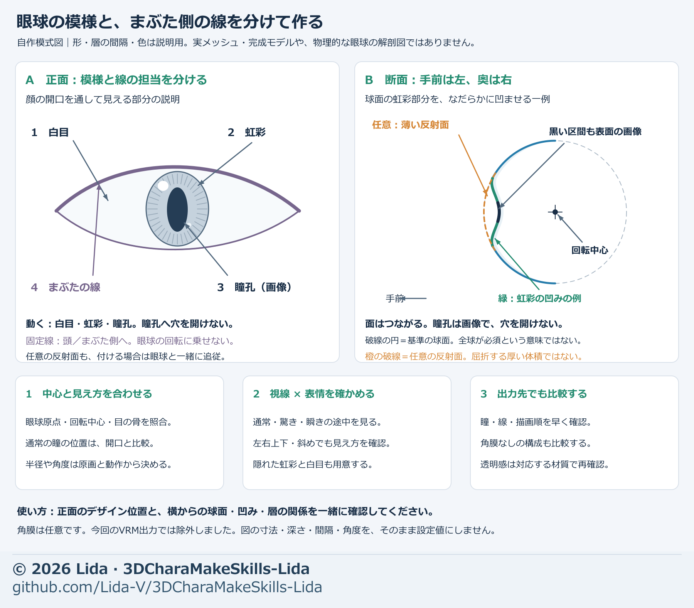
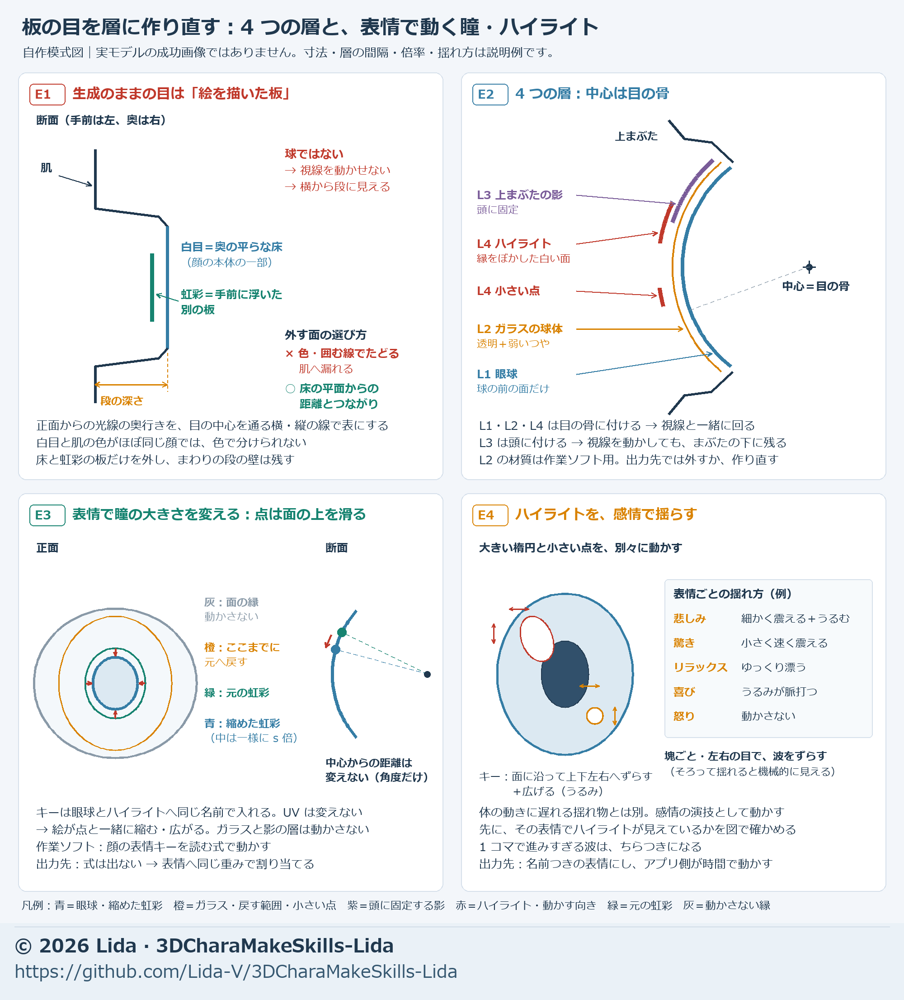

# 眼球・瞳・視線を作る

[日本語](eye-modeling.md) · [English](en/eye-modeling.md)

眼球は、球面の形、画像のデザイン、まぶた、回転の中心を一組で作る。正面の通常顔だけで終えず、驚き・途中の瞬き・視線移動で新しく見える部分まで用意する。

目を閉じる帯や眉の固定は[表情の調整](expression-adjustment.md)、保存・出力の照合は[画像の引き渡し](visual-handoff.md)へ。外観の好みは[リダのデザイン](lida-design.md)に分ける。

## 用意する素材と最初のゴール

全体制作の[最初の計画](production-plan.md)で、既存の眼球が用途を満たすかを診断します。足りない場合は必要なモデリング・画像補完・視線調整を計画へ入れ、個別の追加指示待ちにしません。既存構成が足りれば保持し、眼球の全再制作は不要です。笑った片目の閉眼は[ウインクの閉じ方](wink-closure.md)へ進みます。

生成のままの目が平らな板の時は、7 節の作り直しから読みます。表情で瞳の大きさを変える・ハイライトを揺らすのは 8・9 節です。

- 採用した通常顔と目の拡大画像。正面・斜め・横、必要なら下からの見え方をそろえる。
- 目のデザイン画像。虹彩、瞳孔、白目、ハイライト、まぶたの線を区別し、どこを保持するか示す。
- 顔メッシュ、目頭／目尻／上下まぶたの目印、現在のUV・材質・表情・目の骨の一覧。
- 使用先、見る距離、必要な視線範囲、驚きなど目を大きく開く表情、出力形式。

制作初回は[品質の提案と工程ゴール](quality-goals.md)を使う。例えば「会話用の顔アップ。通常顔のデザインを保ち、左右上下を見る・瞬き・驚きが使え、出力先でも瞳が見える」を到達状態として提案する。眼球の半径や角膜を付けること自体を品質目標にしない。

作業開始時は、入力版、変更／固定対象、比較画像、終了条件、提出する候補を短く決める。通常顔の合格と、視線・表情・出力の合格は分けて記録する。

| 工程 | 今回のゴール | 次へ進む前に見るもの |
| --- | --- | --- |
| 開口と球面 | 原画の目の形を保ち、回転できる面を内側へ配置 | 正面・横・斜め、目頭と目尻、球面とまぶたの距離 |
| 目の画像 | 採用デザインを保ち、隠れ部もつながる | 通常・驚き・左右上下の視線、画像の描いた範囲 |
| 層と質感 | 動く瞳と固定する線を分け、必要な透明感を作る | 線の追従、角膜あり／なし、同条件の色と反射 |
| 視線と表情 | 中心・向き・入力範囲が対応する | 通常の視線、瞬き途中、表情との組合せ |
| 保存と出力 | 保存版・読み戻し・使用先の差を把握する | 画像欠落、視線の軸、描画順、瞳の消失 |
| 瞳の演技（任意） | 表情で瞳の大きさが変わり、ハイライトが感情で揺れる | その表情でハイライトが見えるか、途中の値、出力先での動かし方 |

図は構造の考え方で、実メッシュや完成画像ではない。寸法・凹み・層の間隔は説明用。球全体を必ず作る指示でもない。

## 1. 開口・球面・回転中心を合わせる

目頭と目尻、上下まぶたを正面へ投影し、原画と開口の幅・高さ・傾きを比較する。横からは球面の出方と目の奥行きを見る。目が平らな画像だけのモデルなら、画像の板とまぶたの皮膚を区別してから、開口と内壁を作る。

球面は、正面の黒目の位置だけでなく、**開口の縁との距離が片側だけ狭くならない中心・半径**を選ぶ。全体を前へ押す、球を一律に縮める方法で、横顔や目頭の穴を隠さない。既存の良い開口・眉・顔輪郭・他の表情を固定して局所的に試す。

眼球の原点、回転させる中心、目の骨の中心を対応させる。球の一部を使う構成では、必要な視線範囲で端や頭の内側が見えないだけの面を用意する。全球を作る方法でも、不要な奥の面や他部品との接触は別に確認する。

## 2. 虹彩・瞳孔・白目を、動く範囲まで用意する

- **白目**：球面に沿う明るい部分。目頭側の色や影を含め、どこまで画像があるか確認する。
- **虹彩**：黒目の色と模様。原画の縦横比、境界、濃淡、ハイライトを実UVへ貼った状態で比較する。
- **瞳孔**：今回の制作では画像で表現した。黒く見えることを、眼球へ穴を開ける指示と取り違えない。

通常時にまぶたへ隠れる所も、驚きや視線で見える。既に見える画素を保持して、虹彩の続きと白目を別の範囲へ補完し、境界に継ぎ目が出ないか確認する。隠れている虹彩の上端は推定なので、採用絵を変更した実績と混ぜない。

画像単体が良くても、UVの縦横比やまぶたの開口で瞳孔が細く見える、ハイライトが隠れることがある。正面・斜めと普段の距離で確認してから採用する。上まぶたの線まで眼球の画像へ描くと、視線と一緒に線が動くため次の工程で分ける。

## 3. 虹彩の凹みと、任意の角膜を調整する

今回の眼球は球面を基にし、虹彩の範囲だけ中央を奥へ凹ませ、白目へ滑らかにつないだ。凹みは前後方向へ付け、正面投影のデザイン位置を保った。これはアニメ調の透明感を作る一例で、全キャラクターに必要な形ではない。

調整する量は、**凹みの深さ・広さ・白目へ戻す幅**に分ける。横から見て急な段や薄い板に見える場合は、深さだけでなく遷移幅と断面の曲がりを確認する。正面の虹彩位置、UV、回転中心、まぶたとの余裕を保持して比較する。

角膜は任意。今回のBlender側の試作では、虹彩の上だけに薄い透明な反射面を置いた。屈折する厚い体積ではない。反射の強さ・粗さ・マスクの範囲を分けて調整し、元の瞳の色やハイライトが変わりすぎないか、角膜なしとも比較する。

角膜の質感を使用先が再現できない場合は、画像や対応する材質で見せる案と比較する。今回のVRM出力では角膜が白い円盤に見える問題があり、**角膜を出力せず、目の画像で瞳を見せる構成**にした。角膜付きの作業モデルと出力モデルを同じ構成だと説明しない。

## 4. まぶたの線は、眼球の回転から分ける

虹彩と白目は眼球と回す。まぶたの縁の線、まつ毛の印、目頭の色などは、必要に応じて頭／まぶた側へ固定した層や材質へ分ける。今回の制作は色＋アルファの薄い層を使い、驚きではまぶたの縁へ対応するキーで動かした。

層を付ける場合は、縁の両端と途中、表裏、顔からの浮き、目玉への沈みを確認する。正面で短い辺でも、目尻の曲面上では長い弦になって球面へ入ることがある。分割は画像上の間隔だけで決めず、実際の立体の辺長と曲がりから選ぶ。

暗くする掛け算だけの層では、元画像の明るい色や白い点を再現できない。固定線と眼球を合成した通常時の画像を、元の見え方と比較する。まぶたの閉じ方と外側への変形の戻し方は[表情の調整](expression-adjustment.md)へ。

## 5. 通常の視線と「寄り目」の原因を分ける

骨が正面を向いていても、描いた瞳孔や虹彩が開口の鼻側へ寄れば、寄り目に見える。正面の同じ投影で、開口の中心、虹彩の中心、瞳孔の中心、目頭側／目尻側の白目の幅を別々に測る。原画とは、開口幅に対する割合で比較する。

原因を **開口形・目の骨の基準方向・眼球の置き方・画像の位置** に分けてから直す。今回の制作では骨と開口が原因ではなく、眼球に描かれた瞳の位置が内側へ寄っていた。球面の中心まわりに、眼球の面と虹彩の凹み・角膜を一緒に外向きへ回す候補を比較した。

UVだけを動かすと絵と凹み・角膜がずれ、骨の基準方向を変えると視線制御の基準まで変わる。どの変更が最小かは、そのモデルの構造で判断する。左右へ同じ角度を与えても元の差は残るため、左右別の正面と斜めを確認する。

通常の向きを変えたら、視線の内向き／外向きの残り範囲を測り直す。今回の出力では、この差を視線設定へ対応させた。制作例の角度を他モデルへそのまま適用したり、見え方を確認せず可動域を狭めたりしない。

## 6. 組合せ・保存・使用先で確認する

1. 通常、瞬きの途中と閉眼、左右ウィンク、驚きなど、使う表情を固定した同条件画像で比べる。
2. 正面・斜め・横・下、左右上下の視線と表情の組合せで、白目漏れ・描いていない所・内壁・突き抜けを見る。
3. 瞬きと笑顔、驚きと瞬きなどの加算規則を明記する。入力側で抑制される組合せと、自由加算した試験を区別する。
4. 面の交差、光線で見えるもの、普段の距離で目立つものを別に記録する。透明な角膜を光線から除く判定と、角膜自体の接触検査も分ける。
5. 全キーと視線を基準へ戻し、顔輪郭・眉・口・対象外の形状、UV・材質・骨を保持したか照合する。
6. 別名の候補を保存して開き直し、画像・層・骨の参照を確認する。出力を読み戻し、視線の中心と軸、表情、描画順、角膜の扱いを比較する。
7. 読み戻しだけで使用先の完成とはしない。使うアプリの顔アップと動作で確認し、未確認の環境を明記する。

検査範囲の端で見える内側や微小な隙間がある場合は残件にする。有限の姿勢と方向の検査を、全視点・全表情の安全へ広げない。

## 7. 生成のままの「板の目」を、4 つの層へ作り直す

3D 生成の顔は、目が「絵を描いた板」のことがある。白目は肌より数 mm 奥にある平らな床で、顔の本体の一部。虹彩はその手前に浮いた別の板。球ではないので視線を動かせず、横からは段に見える。この場合は板を外して、次の 4 つの層に作り直す。1〜6 節の考え方（中心・画像・固定する線・確認）はそのまま使う。

図は自作の模式図で、実メッシュや完成画像ではない。寸法・層の間隔・倍率・揺れ方は説明用。

**板の目かを確かめる**：目の中心を通る横と縦の線に沿って正面から光線を当て、当たった奥行きを表にする。肌から床へ数 mm の段があり、虹彩が顔とつながっていない別の部品なら、板の目。

**外す面は、段の深さで選ぶ**：白目と肌の色がほぼ同じ顔では、色で分けられない。濃い線に囲まれた範囲を塗り広げる方法も、面の色でたどる方法も、下まぶたの線の切れ目から肌へ漏れた。虹彩の奥の面を種にして、正面を向いた面だけをたどって床の平面を出し、その平面からの距離とつながりで選ぶ。外すのは床と虹彩の板だけで、まわりの段の壁は残す。

| 層 | 作り | 付け先 |
| --- | --- | --- |
| L1 眼球 | 球の前の面だけ。球は床より少し奥を通し、中心を目の骨にする。目の絵を正面から貼る | 目の骨 |
| L2 ガラスの球体 | 眼球と同じ中心で、少し大きい半径の面。透明に弱いつやを足す | 目の骨 |
| L3 上まぶたの影 | まぶたの線から下へ、なだらかに消える暗い帯。L2 と L4 の間の半径に置く | 頭 |
| L4 ハイライト | いちばん外の白い面。大きい楕円と小さい点。縁へ向かって不透明度を下げる | 目の骨 |

- **目の絵**：外す前の面をそのまま正面から描いて作ると、通常時の見た目が変わらない。欠けた所を画像生成で直す時は「そのまま保って、ここだけ直す」と書き、直す所を並べる。「同じ模様できれいに描き直す」と頼んだ時は、線のはっきりした別の絵柄になった。
- **貼る時に測る物**：元の虹彩の大きさ・位置に加えて、向き（長い軸の傾き）も測って合わせる。まっすぐ貼った時は、つり上がった目の形に対して上が内側へ傾いて見えた。白目の色は値を決めて入れる。元の白目の明るい所から取ると、まぶたの影の色を拾った。
- **ガラスの球体**：つやは弱くする。強いと、まわりの明るさを映して目全体が白くかすんだ。この材質は作業ソフト用なので、出力先では外すか、向こうの材質で作り直す。
- **ハイライト**：別の部品にすると、消す・形を変える・頭に固定するを後から選べる。縁のぼかしは、中心から縁への値を UV と頂点色のアルファの両方へ入れておくと、ほかのエンジンでも作れる。白い面なので、出力先へそのまま持って行ける。
- **上まぶたの影**：元の目にあったまぶたの下の影が無くなると、同じ寸法の虹彩でも全体が明るく見え、縦長に感じられた。影は頭に付けて、視線を動かしてもまぶたの下に残す（4 節）。
- 白目をきれいな白にすると、元からあった瞳の寄りが目立つことがある。5 節の測り方で確かめる。
- **トゥーンの顔に足す時**：眼球（L1）は顔と同じトゥーンの材質の目の設定にそろえる。L2〜L4 は、光で陰影が付かない平らな色（透明と発光を頂点色のアルファで混ぜる）にし、半透明の重ね（BLENDED）で、影を落とさない設定にする。L2 はほぼ透明、L4 は白、L3 は顔の影の色に寄せる。
- **上まぶたの影が見えない時**：まつ毛の帯がまぶたの縁より下へ垂れていると、影のいちばん濃い所がその裏に隠れる。影の材質を一時的に赤・不透明にして描くと、見えている範囲がすぐ分かる。帯を縁から下へ長く取り、隠れていない所で濃さが出るようにする。

## 8. 表情で、瞳の大きさを変える

驚きで瞳が縮み、喜びや悲しみで少し広がる、という演技を入れる場合の作り。入れるかどうかは、キャラクターと用途で決める。

- **キー**：「小さく」「大きく」の 2 つを、眼球とハイライトへ同じ名前で入れる。
- **形**：目の骨（球の中心）から見て、虹彩の中心の向きからの角度を写像する。虹彩の中は一様に s 倍にし、その外側でなめらかに元へ戻す。点は中心からの距離を変えず、面の上を滑るだけ。UV は変えないので、絵が点と一緒に縮む・広がる。
- **範囲**：虹彩の範囲は、目の絵の「白目でない画素」の外枠から取る。面の縁の点は動かさない。縁が動かなければ、まぶたの裏とのすき間は変わらない。
- **動かさない物**：ガラスの球体と上まぶたの影。
- **動かし方**：作業ソフトでは、顔の表情キーを読む単純な式で 2 つのキーを動かす。出力先に式は出ないので、表情ごとに同じ重みでこのキーを割り当てる。
- **確かめる**：面の裏返りが無いこと、縁の点が動いていないこと、表情の途中の値、まばたき・視線との組み合わせ。

作例の倍率は、驚き 0.74、怒り 0.91、リラックス 1.05、喜び 1.06、悲しみ 1.07。見た目の了承を得る前の案で、既定値ではない。原画と表情の見せ方から決める。

この作りは虹彩ごと拡大・縮小する。瞳孔だけを縮めるには、瞳孔を虹彩と別の層にする必要がある。

## 9. ハイライトを、感情で揺らす

体の動きに遅れて揺れる[揺れ物](secondary-motion.md)とは別の話。うるんだ目のハイライトが細かく震える、といった感情の演技として動かす。

- **キー**：ハイライトの塊（大きい楕円、小さい点）ごとに、球面に沿って上下左右へずらすキーと、塊の中心のまわりに広げるキー（うるみ）を作る。
- **動かし方**：顔の表情キーの値と時間を読む式で動かす。作例は、悲しみ＝細かく震える＋うるむ、驚き＝小さく速く震える、リラックス＝ゆっくり漂う、喜び＝うるみがゆっくり脈打つ、怒り＝動かさない。
- **ずらす**：塊ごと、左右の目ごとに波の位相をずらす。全部がそろって揺れると機械的に見える。
- **出力**：式は出力されない。キーを名前つきの表情として出し、アプリ側が時間に沿って動かす。

分かったこと：

- 揺れを付ける前に、その表情でハイライトが見えているかを図で確かめる。悲しみでは上まぶたが下がり、大きい楕円はほとんど隠れた。見えている小さい点の動きを大きくした。喜びは目を閉じるので、閉じきると見えない。
- 1 コマで進みすぎる波は、ちらつきになる。作例の 24fps では、1 コマあたり約 3 ラジアンを超える波が細かすぎた。
- 塊を点の数で見分けない。作例は 2 つの塊の点の数が同じで、広がりで見分けた。
- 揺れの量と速さは、見た目の了承を得る前の案。アプリ側での動かし方は確かめていない。

## 10. 応用：透明なドーム、すき間をふさぐ面、暗い場面で光る瞳

別の制作で使った作り。どれも任意。

- **凹みと透明なドーム**：虹彩の範囲を奥へ凹ませ（3 節）、開口より少し広い透明なドームを白目まで重ね、虹彩のまわりで少しふくらませる。L2 のガラスの球体の代わりになる。
- **すき間をふさぐ面**：まぶたの縁と眼球のすき間から、頭の中が抜けて見えることがある。まぶたの縁から眼球まで頭の側に内壁を張り、眼球の横から後ろに白目の色の殻を置く。真横から見ると、視線が頭の中を横切って反対の目のすき間から抜けることもあるので、眼球の鼻側に白目の色の仕切りを立てる。内壁の色は 6 節の後の表（横から奥に見える）を参照。
- **暗い場面で光る瞳**：材質の中で、場面の暗さに応じて虹彩だけに発光を足す。暗さは、主光の強さと背景の明るさから読む。目は前髪やドームの影に入るので、面に当たる光では測らない。虹彩は画像の彩度で分け、白目は光らせない。強さ、光り始める明るさ、全体の倍率を、後から変えられる値にする。作業ソフトの材質の作りなので、出力先では作り直す。

## 繰り返した失敗を、初回条件へ入れる

| 失敗 | 次回の指示へ入れる条件 |
| --- | --- |
| 驚きで虹彩の上が切れる | 通常顔で隠れる虹彩・白目も、必要な表情と視線の範囲まで用意する |
| 線が眼球と回り、まぶたから離れる | 動く目の模様と、頭／まぶた側へ固定する線を最初に色分けする |
| 反射で灰色の瞳が青く見える、光の点が増える | 反射の強さと粗さを分け、角膜なし・同じ照明で比較する |
| 虹彩が横から薄い板や段に見える | 凹みの深さだけでなく、白目へ戻る断面と幅を確認する |
| 骨の向きだけ直しても寄り目が残る | 開口・虹彩・瞳孔の位置と白目の比を測り、原因を分ける |
| 角膜が出力先で白くなり瞳が消える | 代表の片目で早く出力を試し、角膜を除く構成も確認する |
| 横から見ると眼球が奥に入って見える | まぶたの縁から眼球までの面の色を確かめる。全周を肌色にすると横から肌の壁に見えるので、目頭・目尻側は白目の色、上下はまぶたの色に分ける。眼球を前へ出せるかは、閉じたまぶたとの隙間で決める |
| 白目を色や囲む線で選んだら、肌まで選ばれた | 板の目は、床の平面からの距離とつながりで選ぶ。色が肌とほぼ同じ顔がある |
| 欠けを直す画像生成で、目の絵柄が変わった | 「そのまま保って、ここだけ直す」と書く。貼る時は大きさ・位置・向きを元の部品から測る |
| ガラスの球体で、目全体が白くかすむ | つやを弱くし、ガラスなし・同じ照明と比べる |
| 目の絵を直したら、雰囲気が変わり虹彩が縦長に見える | 元の目にあった上まぶたの影を、頭に固定した層として戻す |
| ハイライトの揺れが見えない・ちらつく | その表情でハイライトが見えているかを先に確かめる。1 コマあたりの波の進みを抑える |

## 初回の統合依頼文

> 添付の通常顔と目のデザインを基準に、眼球・瞳・視線を作ってください。最初に使用先、見る距離、視線範囲と必要な表情から到達状態を短く示してください。目の開口、球面と回転中心、虹彩・瞳孔・白目、頭／まぶた側へ固定する線を分け、既に見えるデザインと顔輪郭・眉・口を保持してください。瞳孔は指定がなければ画像として扱い、角膜は任意の構成案として使用先で早く比較してください。隠れる虹彩と白目も補い、正面・斜め・横・下、途中瞬きと驚き、視線との組合せを確認してください。通常の視線は骨・開口・絵の位置を診断してから調整し、固定角度を自動適用しないでください。原本を上書きせず、候補・同条件画像・保持結果・保存再読込・出力先での確認範囲と残件を提出してください。

生成のままの板の目を作り直す時は、次を足します。

> 目が「絵を描いた板」かを、正面からの奥行きの断面で確かめてください。板の場合は、白目の床と虹彩の板だけを段の深さで選んで外し、眼球（球の前の面、中心は目の骨）・ガラスの球体・上まぶたの影（頭に固定）・ハイライト（別の部品、縁をぼかす）の層に作り直してください。目の絵は今の見た目をそのまま保ち、欠けた所だけ直してください。表情で瞳の大きさを変える・ハイライトを感情で揺らす場合は、倍率と揺れ方の案を表で示し、その表情でハイライトが見えるかを図で確かめてください。作業ソフトだけで動く物（ガラスの材質、式）と、出力先へ持って行ける物（キー、表情への割り当て）を分けて報告してください。

## 制作の記録とツールの範囲

網目・UV・ウェイト・キーの値と保存版の項目別比較には[同梱の制作補助ツール](model-tools.md)を使える。眼球中心、原画との一致、まぶたとの接触、視線の自然さはこのツールの自動判定対象ではなく、上記の比較で確認する。

実制作では、新しい顔の開口と眼球・まぶたを作り、表情の後に虹彩の凹み・画像補完・任意角膜・固定線の層を追加した。その後に通常時の視線を比較し、出力側の視線設定と角膜除外へつないだ。古い顔の検査や角膜試作を、新しい顔と出力版の合格へ引き継がない。

この専用章は、確認できた方法を次回へ使えるよう整理したもの。既存の制作スクリプトは固有メッシュ・画像・対応表へ依存するため、同梱ツールが眼球を自動生成したり、自動で原画再現を合格にしたりする機能はない。必要な形の生成と見た目の判断はAIと制作者が行う。

7〜10 節は、生成のままの板の目を作り直した別の制作から足した。確かめた範囲は、作業ソフトでの静止図と表情ごとの図、式で動いたキーの値、出力の読み戻しでの表情とモーフの有無まで。アプリ側での時間による動かし方、ほかのエンジンでのガラスと発光の作り直しは確かめていない。倍率と揺れ方は見た目の了承を得る前の案。
