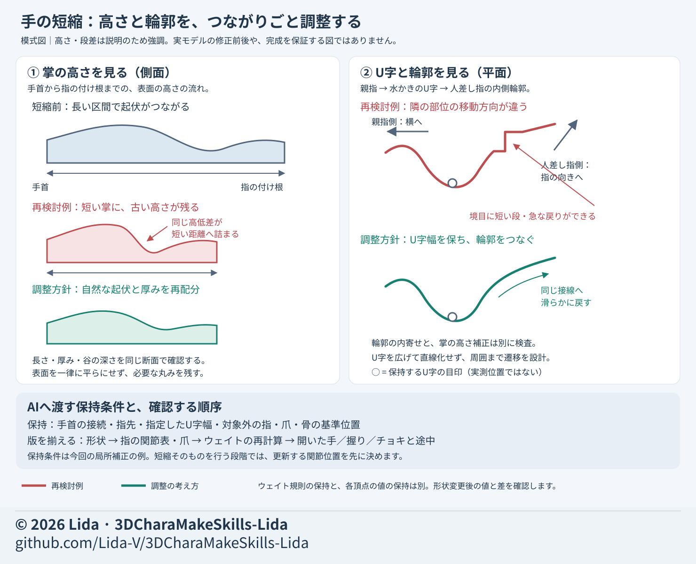

# 手の丸みと関節を整える

開いた手ですでに段差や深い谷がある場合は、骨やウェイトより先に基準形を診断する。
関節付近の面の配置は [メッシュとウェイト](mesh-weight.md)、局所補正は [調整方法](adjustment-methods.md) を参照する。

## 用意する素材

- 採用した手の基準形と、手の甲・掌・側面の同条件画像。
- 色なしの面、ワイヤー、実際の材質を同じ角度で表示した画像。
- 手首の接続、指先、爪、親指と人差し指の間のU字部分を示した図。
- 指の関節位置、骨の基準位置、ウェイトを計算する規則の版。
- 開いた手、握り、チョキと、それぞれの途中姿勢。

## 手順

1. 手の長さだけでなく、厚みとの比率と掌の高さの流れを確認する。
2. 親指と人差し指の間は、隙間の幅と、そこから指の付け根へつながる曲率を別々に見る。
3. 手首、指先、採用済みの隙間幅、対象外の指、爪を固定する。
4. 修正の端で急に元形状へ戻さず、接線が滑らかにつながる範囲まで調整する。
5. 形状、関節位置、爪、ウェイト規則を同じ版で揃える。
6. 左右と途中姿勢を確認し、保存後に同じ検査を行う。

## 具体的な調整例

図は原因と保持条件を示す模式図で、実モデルの修正前後ではない。掌の高さと内側輪郭は別に診断し、指先・爪・手首など保持する端へ滑らかにつなぐ。
図中の骨位置保持は局所補正の条件。短縮そのものでは、新しい関節位置を先に決め、形状・関節表・爪を同じ版で揃える。

- 掌を短くした後に以前の高さ分布を残すと、付け根の谷が急になる。長さと厚み・高さの分布を一緒に再評価する。
- 制作例では、骨の基準位置を保持したまま掌の高さを局所的に最大約±2.6mm補正した。
- 親指側を横へ動かし、人差し指側を指の向きへ動かすと、隣接部分の変位方向がずれて段差になった。
- 約2.7mmの変位を約7mmで戻す形から、約20mmの曲線区間を使う形へ変更した。
- その例では傾きが約24度から12度へ緩み、最大約1.03mmの内寄せを約7mmで弱めて周囲へつないだ。
- 親指の関節付近の切れ込みは別の対象として、最大約0.46mm補った。
- これらは手の大きさに依存する制作値。短い直線で平らにする指示に置き換えず、残す曲率と両端の接線を示す。

## ウェイトで誤解しやすい点

- 「規則を保持」と「各頂点の値を保持」は違う。座標に基づく規則では形状が変わると値も変わる。
- 上の輪郭補正例では規則を保持して値を再計算し、補正前との差は最大0.031だった。
- したがって、この例を「ウェイト変更なし」と記録しない。規則の差、値の差、骨位置の差を別々に検査する。
- 関節表と違う版の形状へ骨を作ると、付け根がずれる。基準形を決めてから対応する関節表で構築する。
- 連続する修正版を統合する際は、最終候補に含まれる差分を確認し、古い補正を二重に加えない。

## 初回の依頼文

> 開いた手の甲・掌・側面で、指の付け根とU字部分に段差がないか確認してください。手首、指先、指定したU字幅、対象外の指、爪、骨の基準位置を保持し、曲率と接線をつなぐ局所補正を行ってください。変位量と戻す距離を示し、ウェイト規則の保持と値の再計算を分けて報告してください。左右の握り・チョキと途中姿勢で比較し、使用した関節表の版を揃えてください。

## 成果の範囲

制作例は段差と深い親指の侵入を改善した局所候補。指定した検査姿勢での改善を、全ての指接触・隠れた浅い折れの解消へ広げない。
実画面の採用確認、FBX・VRMの読み戻し、ゲーム内の変形は別検収にする。数値合格だけでユーザー採用済みとしない。
手の見た目の好みは [リダのデザイン](lida-design.md)、次の工程は [工程索引](process-index.md) を参照する。
