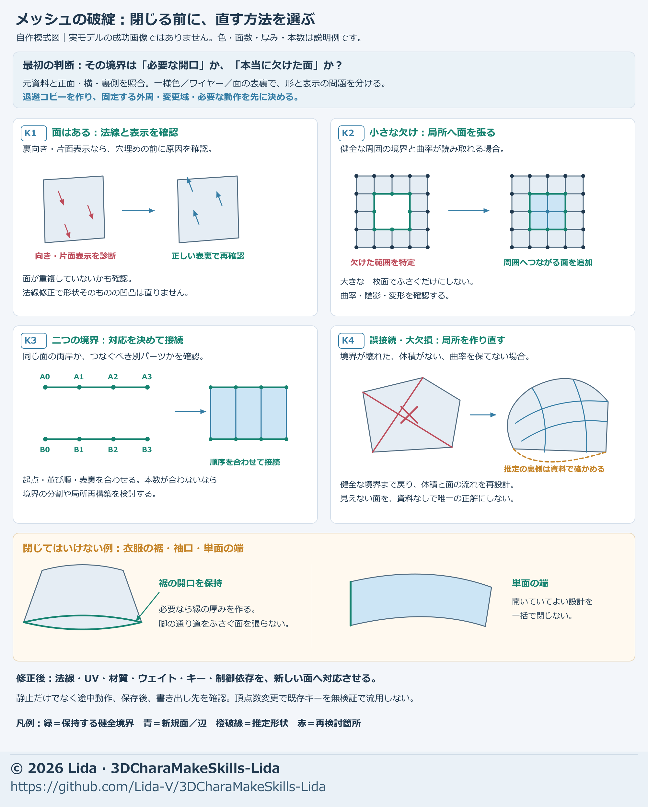
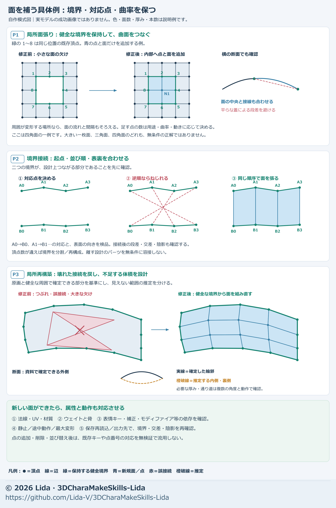

# メッシュの破綻を直す・足りない面と体積を補う

[日本語](mesh-repair-completion.md) · [English](en/mesh-repair-completion.md)

**先に原因と残す開口を決め、健全な境界から必要な範囲だけ直します。** 穴を全部閉じる、全部溶接する、細分化する、といった一括処理では欠落・誤接続・動作時の潰れを区別できません。

[工程索引](process-index.md) · [調整量と固定範囲](adjustment-methods.md) · [スカートと隠れた身体](skirt-hidden-modeling.md) · [曲がる網目と重み](mesh-weight.md)

## 始める前に決めるゴールと素材

[品質目標](quality-goals.md)から、用途・見る距離・必要動作・使用先を引き継ぎます。通常作業ごとの再承認は不要です。

> 開始例：入力モデルの【部位】を、採用した輪郭と必要な開口を保って修復します。【接続輪・対象外の形・材質】を固定し、変更部と戻す幅を図示します。同条件の正面・横・背面・断面、通常→途中→必要な最大→戻りで段差・反転・裂け・見える貫通を確認し、属性の再対応と保存読込を今回の区切りにします。使用先の検証範囲は別に記録します。

- **原本と作業コピー**：入力版、単位、左右前後、基準姿勢、骨・キー・モディファイアなどの依存を記録する。保護原本へ直接穴埋めしない。
- **形の資料**：採用した正面・横・背面と接続部の拡大。衣装あり／衣装を隠した同じ姿勢を用意する。
- **問題の範囲**：部品・面・時刻・見える方向、固定境界、変更範囲と滑らかに戻す帯を示す。
- **動作と出力条件**：必要な曲げ・ねじり・表情、入りと戻り、指定した使用先と出力形式をそろえる。

資料にない部分は「推定」と記録します。提出物は修正モデル、変更範囲図、同条件比較、属性の対応表、保存／出力の結果と残件です。

## 1. 穴に見える原因を分類する

図は施工の選び方を説明する模式図です。実モデルの成功例、面数や配置の推奨値、自動修復機能を示しません。

| 観察した状態 | 最初の確認と選ぶ施工 |
| --- | --- |
| 裏からだけ消える、暗線だけがある（K1） | 無地・網目・面の表裏で確認。面が存在し健全なら法線・片面表示・輪郭線・画像を直す。新しい面を重ねない |
| 面はつながり、通常形に段やくぼみがある | 座標と断面を局所補正。固定境界へ変位をなだらかに戻す。同じ網目で足りるなら再構築しない |
| 健全な面に囲まれた小さい欠け（K2／P1） | 境界と周囲の曲率を確認し、局所パッチで面を補う |
| 本来つながる二つの境界が離れている（K3／P2） | 接続相手・点の対応・輪の順序を決め、間を面の帯でつなぐ。同位置の継ぎ目なら対応点の結合も比較する |
| 誤接続・潰れ・細長い面が広く続く（K4／P3） | 健全な境界を残し、問題部分の面の流れを局所的に作り直す |
| 胴・腕・頭皮下地など部位の体積自体がない（K4／P3） | 接続断面と複数角度から立体を設計して補完する。小穴の平面埋めでは代用しない |
| 通常形は良く、動くとだけ裂ける・潰れる | 骨・重み・面の流れ・キーと制御を診断。動作中の形へ穴埋めせず、必要なら基準形と変形を一緒に直す |

腰口・裾・袖口・スリット、口や目の設計上の開口、薄布や髪カードの縁は、境界があるだけで不良ではありません。別部品や別毛束の重なりも一括溶接しません。

UV・材質・硬い法線の切替と、幾何の穴は別です。出力時に頂点が分割されても、位置と変形が一致して継ぎ目が開かなければ、点数だけで穴と判断しません。

## 2. 中立状態で、健全な境界を確保する

1. 複製で基準姿勢と全キーの状態をそろえ、無地・網目・表裏の表示を切り替える。陰影だけが原因なら[材質の切り分け](accessory-materials.md)へ進む。
2. 裏面・重複面・内部の不要面・別層への誤接続を一つずつ示す。重なる面を残したまま上からパッチを貼らない。
3. 問題の外側に、位置と面の流れが健全な境界を取る。境界頂点と隣の面を保持し、どこまで作り直すか番号や色で残す。
4. 正面・横・背面と断面を同時に見て、厚み、曲率、表裏、層の順序を決める。一方向で閉じて見えても完了にしない。
5. 元の網目で座標を直す場合と、点・面を増減する場合を分ける。後者はUV・重み・キー等の再対応まで含む工程にする。

修復のために全体の頂点数を維持する必要はありません。保持する対象外と、変更・再対応する領域を分けます。使用先や既存キーの制約で再構築が難しい場合は、その理由と代替案を先に示します。

## 3. 境界から具体的に面を作る

図内の番号は対応点の例です。実際の頂点数・輪数は、曲面と必要な変形を表せる間隔から決めます。

### 面を作り直さずに直す場合

- 図K1のように面の向きが逆なら、意図する表側へ向きをそろえる。内面や単面布の意味を確認せず、全オブジェクトを一律に外向きへ反転しない。
- 座標を直すなら、症状の中心を動かし、固定境界へ変位を滑らかに0へ戻す。正面だけの押し出しで横の厚みを失わせない。
- 同じ網目でも、基準形とキーの相対差を保つ部分、作り直す補正を特定する。平滑化で接続誤りや欠損を隠さない。

### K2／P1：小穴へ局所パッチを張る

1. 穴を囲む辺をたどり、境界が一周し、別層の辺が混ざっていないことを確認する。残す開口を選択から外す。
2. 境界の凹凸と隣の面の接線から、埋める面の膨らみを断面で決める。平面の蓋で丸い身体を切り落とさない。
3. 小さくほぼ平らなら単純な面張りも使える。曲面や曲がる領域では面を分け、隣の列へ流れをつなぐ。大きい一枚の多角形で済ませない。
4. グリッド状の穴埋めを使う場合も、頂点の並びと開始位置を確認し、斜めのねじれや中心への細長い面の集中を直す。
5. 表裏・面積の小さすぎる面・重複・三角化後の対角線を確認し、境界に段差や鋭い影がないか比較する。

Blenderの操作例：対象を限定したコピーで、穴の境界だけを選んで **Grid Fill（グリッドフィル）** を試します。

- おおむね四角い囲みや、対応する対辺を面の格子へつなぐ用途で使う。任意形状の大穴や欠落体積にそのまま適用しない。
- `Span`で格子の並び、`Offset`で開始位置を調整し、図P1の周囲の列へ流れがつながるか見る。
- 曲率・必要な密度は別に調整する。自動でできた格子を、そのまま関節用の完成網目と判断しない。

選択条件と操作は[Blender公式：Grid Fill](https://docs.blender.org/manual/en/latest/modeling/meshes/editing/face/grid_fill.html)を参照します。

### K3／P2：二つの境界を帯でつなぐ

1. 接続する輪をA・Bとして区別し、正面などの目印をA0・B0にする。同側・同層・同じ前後位置の点を対応させる。
2. 輪をたどる順序をそろえ、A0→B0、A1→B1…の接続線が交差しないか見る。開始点のずれによるねじれを直す。
3. 点数が違う場合は、必要な側を局所的に分割・整理するか、滑らかな密度遷移を設計する。近い点への一括結合で無理に一致させない。
4. 離れた輪なら間に面の帯を作り、曲率と厚みに必要な列を置く。同位置で一続きにする継ぎ目なら、対応点だけを結合し、UVや硬い縁を保つ。
5. 面の表裏、断面の段、巻き付き、細長い面、二重面を確認する。別部品・縫い目・重なる毛束などの意図した分離は残す。

接続点の距離だけでなく、面が同じ方向へ流れるか、内側へ折れ込まないかを見ます。見た目だけ重ねた輪は、動作で離れないことも確認します。

Blenderの操作例：不要面を整理し、接続する二つの辺の列だけを選んで **Bridge Edge Loops（辺ループのブリッジ）** を使います。

- 閉じた輪だけでなく、必要な範囲の辺の鎖も対象になる。選択に別層や残す開口を混ぜない。
- `Twist`で接続の開始対応を調整する。点数が同じでも、A0とB0の目印がずれれば面はねじれる。
- `Merge`は間に面を足す設定とは異なり、対応する列を統合する。離れた断面をつなぐ帯に必要か、施工目的から選ぶ。

点数を無理に同じにすることを必須条件にはしません。接続と操作は[Blender公式：Bridge Edge Loops](https://docs.blender.org/manual/ja/5.2/modeling/meshes/editing/edge/bridge_edge_loops.html)を参照します。

### K4／P3：局所の作り直し・体積の補完

1. 誤接続や潰れが続く範囲を健全な外周まで戻し、対象外は残す。全体リメッシュを既定の解決策にしない。
2. 欠落した身体や下地は、接続断面、原画、反対側などの資料から粗い体積を作る。左右差のあるデザインを無条件に鏡写ししない。
3. 正面・横・背面の輪郭と断面を合わせる。資料で確認した形と、隠れていて推定した形を図で区別する。
4. 曲がる部位は[変形帯の面の流れ](mesh-weight.md)に沿って列を配置し、健全な外周へ密度と曲率を徐々につなぐ。
5. 身体を衣装内へ収める場合も、関節の体積と着脱条件を確認する。髪の下地は見せる肌・まぶたの動く範囲を避け、不足領域だけ補う。

隠れた身体を一律の円筒、髪の不足を肌色の塗りで代用すると、動作や別角度で問題が残ります。首・頭・胴体との連続と必要な厚みを形で確認します。

## 4. 新しい面と変形・画像の対応をそろえる

点・面の増減後は、旧頂点番号でウェイトやキーをコピーしません。転写元と先を同じ基準姿勢・座標系へそろえ、変わらない点と、新しい対応が必要な点を明示し、同側の対応面・表面上の位置などで移し方を決めます。

| 項目 | 具体的にやること |
| --- | --- |
| 接続・法線 | 重複点、誤接続、反転、カスタム法線、鋭い縁を確認。必要なスムージングと法線を作り直し、三角化後も見る |
| UV・材質 | 新規面のUVと面ごとの材質を設定。格子で伸び・反転・継ぎ目、実画像で模様の方向を確認する。意図するUV重複は保つ |
| ウェイト | 同側・同部位・同じ層の面から補間し、接続輪の既存割合へ滑らかにつなぐ。反対側や近い別層から拾わず、変形骨だけを正規化する |
| 表情・補正キー | 各キーの影響範囲を確認し、新規頂点にも必要な変位を与える。対象外のキーは変位0を確認する。全点を基準形のまま放置したり、全キーで無理に動かしたりしない。旧キーの転写・再制作・退役と検証を記録する |
| その他の属性 | 頂点色、AO、マスク、法線用グループなど、シェーダーや制御が参照する属性を新規点・面にも設定する |
| 支持・拘束 | 非表示の支持面、Surface/Mesh Deform等の対応を更新し、必要な再バインドを基準状態で行う。変換の二重適用を確認する |
| 焼き込み・出力 | 形に依存するAO等を必要な範囲で再作成。元画像を保持し、出力対象・材質割当・骨・キーへの新規部品の追加を確認する |

身体補完で衣装の重みを参考にするときも、衣装の揺れ骨を身体へそのまま移す方法にはしません。頭皮下地と首肌も、近い場所という理由だけで同じ追従にせず、頭・首の役割を確かめます。

同じ網目の座標補正でも、相対キー・依存部品・旧AOが無条件に正しいわけではありません。[UVと画像の対応](adjustment-methods.md#uv画像材質を一組で渡す)と[保存版の照合](visual-handoff.md#統合と保存版を照合する)を使います。

点・面を増減したメッシュ全体のsnapshotハッシュが変わるのは正常です。元の健全な点・面と修正後の対応表を残し、変更を許した領域と保持領域を分けて比較します。古い番号が同じだけで対応を決めず、対象外を保持した根拠と新規面の検証を報告してください。

## 5. 合格・中断・残件の判断

- **形と保持**：必要な開口を残し、採用した輪郭・厚み・接続の曲率を保つ。対象外の形・UV・重み・キー等は、事前に決めた許容差で比較する。
- **通常形と動作**：無地・網目・実材質で、通常→入り→途中→必要な最大→戻りを同条件で比較する。衣装なしの内部と、衣装ありの普段の距離を両方見る。
- **接触と伸び**：修復箇所の反転・裂け・潰れだけでなく、相手別の新規貫通・自己交差・過大な伸びを見る。総交差数が減っても別層へ問題を移していないか調べる。
- **保存**：別名保存して開き直し、同じ形・キー・重み・画像・依存が再現するか確認する。メモリ上の成功と分ける。
- **出力と使用先**：出力ファイルを読み戻して接続・骨・キー・材質を比較する。指定した使用先の三角化・変形・描画も別に確認し、未検証は残件へ置く。

基準が不足する、別層への誤対応が見つかる、依存やキーを再対応できない場合は、影響範囲を記録してその施工を止め、健全なコピーへ戻します。同原因の連続2候補で実使用の見え方が改善しなければ、係数の反復より境界・断面・変形構造を再診断します。

[同梱補助ツール](model-tools.md)は構造・値の監査、snapshot/compare、限定したウェイト正規化用です。自動穴埋め、形状再生成、表面の自己交差や全動作の衝突検査は含みません。監査成功を造形・動作の完成に広げないでください。

## 制作の試行錯誤から、次の初回指示へ

| 起きたこと | 次回の最初に含める判断 |
| --- | --- |
| 静止時だけ身体を服の内側へ収め、動作で露出した | 接続端を固定し、同側の対応する面から重みを補間。首・腕など必要な途中動作も確認する |
| 膨張や重み変更だけでは股の折れ込みが直らなかった | 身体の実面を基準に下部の網目を作り直し、旧構成の補正キーを無検証で流用しない |
| 裾先を丸めても、直上の巻き込みが残った | 布面まで遷移を広げ、非表示支持面とバインドも対応させる |
| 法線を外しても髪の凹みが残った | 断面の平板・谷を形で直し、必要な内側下地だけ追加。新規面のUV・重み・AOをそろえる |

いずれも制作の局所的な改善例です。当時の検査成功を全身・全時刻・使用先の合格へ広げず、残件と採用を別に記録します。

## AIへ渡す短い依頼文

**診断と局所修復：**

> 【入力版・部位・症状・必要動作】を確認してください。最初に今回のゴールと固定／変更範囲を示し、意図した開口、表示・法線、座標の段差、小穴、二境界の切断、誤接続、欠落体積、動作だけの破綻を区別してください。無地・網目・表裏・前後横の断面を使い、選んだ施工と理由を説明してください。健全な境界を残し、一括溶接・全穴閉塞・全体リメッシュをせず必要範囲だけ修復し、同条件の通常・途中・最大・戻りで対象外と別部品への悪化も確認してください。

**再構築・補完と引渡し：**

> 【不足部位・形の資料・使用先】に合わせ、確認済みの形と推定形を図示し、接続断面・曲率・厚みと面の流れを合わせて補完してください。新規点・面は旧番号でキーや重みを流用せず、同側の対応からUV・材質・法線・ウェイト・全キー・AO等の属性・支持依存を再対応してください。新規点のキー変位を放置せず、移植できないキーや制御は再制作／退役の判断を残してください。変更範囲図、対応表、同条件の形と動作、保存後・出力先の結果と残件を提出し、局所改善と最終採用を区別してください。

© 2026 Lida · [3DCharaMakeSkills-Lida](https://github.com/Lida-V/3DCharaMakeSkills-Lida)
