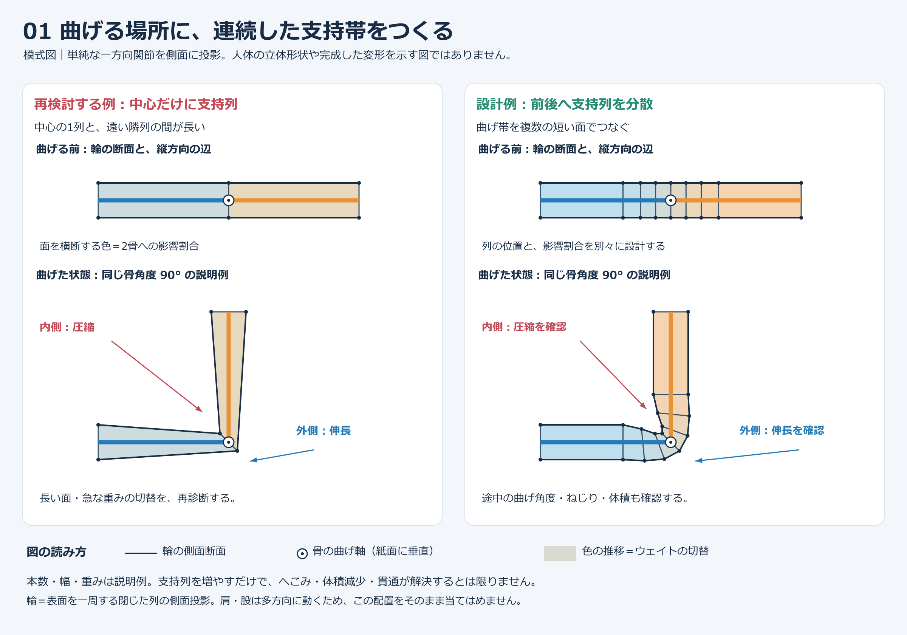
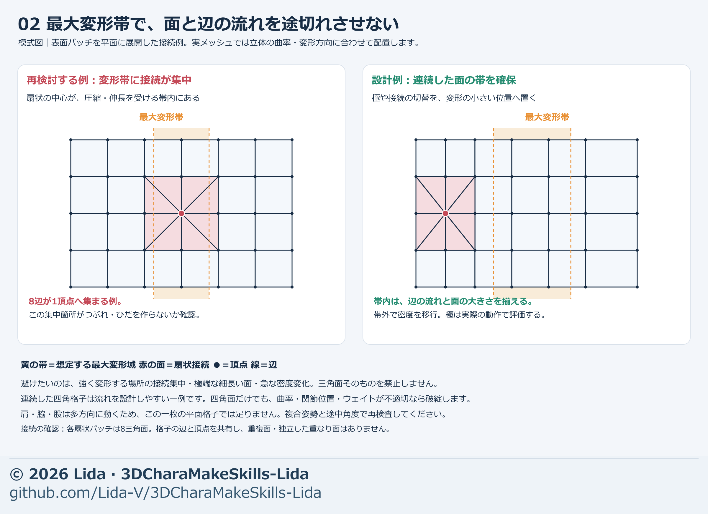

# 曲がるメッシュとスキンウェイト

[日本語](mesh-weight.md) · [English](en/mesh-weight.md)

[工程索引](process-index.md) · [膝の具体例](knee-edge-placement.md)

穴・誤接続・欠落部位を直す場合は、[メッシュ修復と補完](mesh-repair-completion.md)で面を追加する範囲と対応境界を先に決める。修復後にこの章の関節・面の流れ・重みを確認する。

新規の動く人型で初期リグがない場合は、通常形と関節の網目を整えた後に[FBXでTripoのVRM 1.0オートリグ](tripo-autorig.md)を行い、受領結果と原本を照合してからこの章の調整へ進む。自動結果は初期値であり、既存の良い骨・重みの再生成は不要。

メッシュは表面の点・辺・面、ウェイトは各点がどの骨へどれだけついていくかです。自然な変形は、網目・骨の中心と軸・ウェイト・スキニング方式を組み合わせて確認します。

網目・変形ウェイトの値を繰り返し調べる時は[同梱の制作補助ツール](model-tools.md)を使う。骨の受領/変更後は`rig-audit`も使い、指定した人型対応とメッシュの参照を確認する。総和の正規化と、骨位置・面の配置・自然な変形の改善を混同しない。[機械検査後の実画像と途中動作](mechanical-visual-review.md)で判定する。

## 最初にそろえるもの

- 採用する通常形、同じ体型の正面・横・斜め、修正前の同条件画像。
- 単位、モデルの左右前後、関節中心、骨の長軸、曲げ軸。
- 使用先の基準姿勢、必要な曲げ・ねじり・左右・複合動作。
- 変更部位、固定する接続輪、服・飾り・表情キーなどの依存部品。

通常・途中・必要な最大姿勢を見て、実際に縮む側と伸びる側を示します。見た目の関節線や一番細い場所だけで骨と変形帯を決めないでください。

## 網目を直す前に、骨と基準姿勢を確かめる

**曲がる位置が違う場合は、ウェイトの塗り直しより先に骨を確認します。** 体型と使用先に合う関節位置・軸・必要動作から決め、作例の座標や骨数は引き継ぎません。

1. **基準と表示を分ける。** 保存原本の基準姿勢（Rest Pose）、今表示しているポーズ、使用先で必要な姿勢を記録する。腕がT字に見えるだけで、基準姿勢もTだと判断しない。[保存後の照合](visual-handoff.md#統合と保存版を照合する)も行う。
2. **骨と体表の目印を重ねる。** 正面・横の同条件画像へ、関節中心・長軸・曲げ方向と、膝のお皿・足首・肩の目印を示す。体表の目印は推定であり、最も細い断面だけで中心を自動決定しない。
3. **少し曲げて位置を確かめる。** 意図した場所に曲がり角が来るか、左右と途中姿勢で見る。曲がる場所が合っても、潰れや厚みまで改善したとは判断しない。
4. **同じ動きを与える。** 骨名だけでなく親子関係・局所軸・制御と動作の対応をそろえる。「135度」などには0度の姿勢と回す軸を書く。Aからの角度と、腕を下げた位置からの角度を混ぜない。
5. **骨を変えたら依存も更新する。** 接続する骨の端点・骨長、姿勢切替、ウェイト規則、服・飾りへの対応を確認する。旧骨へ再バインドするだけで新しい関節中心になるとは考えず、保存後の実座標と動作を照合する。

初回指示例：「網目・ウェイトの修正前に、骨と体表の目印を正面・横へ重ね、保存基準と現在のポーズ、角度0と動作経路を示してください。関節位置を直す場合は、関連する骨・服・飾りまで更新し、同条件の途中姿勢と保存後を比較してください。」

## 輪を曲がる場所へ配置する

ここでの「輪」は、腕・脚・指の表面を一周する閉じた辺の列です。膝・肘・指では長軸を横切る輪を前後へ配置し、縦方向の辺でつなぎます。

図の右側は説明のために列を増やしています。**実制作では、本数より配置を優先し、既存の輪を移して間隔と流れを整え、足りない場所だけ追加します。** この図は、列数だけの効果を証明する比較ではありません。

| 場所 | 配置と動作確認 |
| --- | --- |
| 曲げの内側 | 複数列で圧縮を受け、点を詰めすぎて重なり・反転・鋭い谷を作らないか確認 |
| 曲げの外側 | 長い一面だけへ伸びを集めず、列間隔を配分して丸みを表す |
| 肩・股 | 胸・背中・胴体から肢への流れと分岐をつなぎ、多方向の途中姿勢で確認 |
| 指間・母指球 | 指と手のひらへ面を連続させ、開く・一本だけ曲げる・握る動作で確認 |

肩・股へ一方向の円筒図をそのまま当てはめません。斜めの輪やひし形の接続も比較案であり、記号を真似すれば解決するという意味ではありません。

## 肩・脇では、首側と上腕側を分けて診断する

肩を丸くするために通常形を膨らませる前に、**鎖骨側から首へつながる部分、上腕の付け根、脇の前後のつながり**を正面・横・斜めで示します。鎖骨の動きと、上腕へ付く肌の動きを別々に見ます。

- 腕下ろし・A・T、用途に必要な前上げ・斜め前上げ・横上げとひねりの途中を比較する。一つの経路の最大姿勢だけで仕上げない。
- 通常形にも谷があれば形と接続、動作時だけなら骨・重み・面の潰れを診断する。肌だけの無地・網目と、袖・飾りを戻した外観を残す。
- 三角のくぼみや暗線は、目立つ一面だけでなく接合点に接する全ての面を調べる。細長い面の反転や重複を、法線設定や正方向への押し出しだけで隠さない。
- 肌・袖・飾りを同じ位置で比較し、意図する追従と余裕をそろえる。近い別の面・裏側から一括で重みを転写しない。
- 腕が細くなる、首側の肉が止まる、脇に棚や壁ができる症状を個別に残す。数値や一つの谷の改善を、肩全体の外観合格へ広げない。
- フード・襟・背中の布のように体の中央の線をまたぐ部品に、左右の肩・上腕の重みが半々で入っていると、腕を下げた時に中央で左右へ裂ける。伸びた辺を「休止の位置と両端の重み」で一覧にすると見つかる。中央に近いほど腕・肩の重みを胸の骨へ移し、中央からの距離でなめらかに減らす。境を一本の線で切らない。

この診断順は、リダ制作で不採用となった肩修正も含めて整理したものです。骨の移動や局所の押し出しだけでは自然な連続面へ届かなかったため、同じ係数の反復より、姿勢ごとの面と接続を見直します。指の関節と指間は[手の形状・構造・動作](hand-shape.md)を使います。

## 密度と接続を整える

図の左右は点・辺・面の数が同じで、接続が集中する位置を変えています。極は、四角面の網目で通常の4本と異なる本数の辺が集まる点です。

- 密度は曲面と途中姿勢の輪郭を表せる間隔にし、帯の外へ少しずつ粗くする。
- 極や密度の切り替えは、強く折れる場所から外す案を試す。必要な分岐は位置と動作で判断する。
- 細長い面、不要な内部面、重複面、穴、幾何の切れ目を調べる。
- 一続きに動く肌の接続を保つ。UV・材質の境と、幾何の切れ目を区別する。
- 四角面は流れを設計しやすいが、三角面や極があるだけで不合格にしない。

均等な自動リメッシュや全体の細分化だけでは、変形に合う流れは決まりません。使用先で三角化される面も確認し、四角面の対角線による折れ方の違いを調べます。

「リトポロジー」を頼まれた時も、先に網目つきの図で関節のまわりの輪の数と並びを見ます。整った四角面で輪が関節をまたいでいれば、崩れの原因は骨の位置・ねじれ・重み・スキニングの方式の側にあることが多いです。網目を作り直すと、UV・画像・重み・表情キー・揺れ物の対応を全部移し直すことになるので、作り直さない場合はその理由を図と数で示します。

## 配置と重みを合わせる

1. 輪の位置と骨への割合を同じ図へ描き、関節をまたぐ帯で切り替える。
2. 内側のしわと外側の丸みを分けて配分する。遷移幅を広げるだけで改善すると決めない。
3. 斜めの輪なら、切り替えを世界座標の高さだけで一直線にしない。
4. 指間を近い指一本へ決め打ちせず、指と手のひらのつながりで混ぜる。
5. 変形骨の重みだけを合計1へ正規化し、マスクや法線用グループを混ぜない。
6. 領域マスクによる重みの切断はメッシュ上の平滑化より先に行い、平滑化対象も必要な骨ペアへ限定する（平滑化後にステップ関数で切ると境に折れ筋が立ち、平坦な面では`0.01`程度の粗い足切り閾値でも曲げた時に微小な段差が出るため、微小な量子化閾値を使う）。

網目を変えたら、対応する位置でウェイト規則を再評価します。旧頂点番号で重みや表情キーをコピーせず、UV・服・飾り・支持面も再照合してください。

## 肘・膝の深い曲げは、半分だけ回る補助の骨で受ける

重みの割合で頂点を混ぜる方式（線形のスキニング）では、関節を深く曲げると内側が細くつぶれます。切り替えの幅が十分でも残る、方式そのものの限界です。

1. **つぶれを数で比べる。** 関節の中心から一定の距離の点について「関節の中心までの距離（曲げた後 ÷ 基準姿勢）」の下位の値を、90°と用途の最大（例：130°）で出す。ふくらんだ袖のように肌が中心から離れた部品は、範囲を点の近さに合わせて広げる。
2. **補助の骨を足す。** 親は上の骨、根元は関節の中心、向きは下の骨と同じにし、下の骨の回転を半分だけ受けさせる（Blenderでは Copy Rotation、ローカル→ローカル、加算、影響0.5）。VRM Add-onはこれを `VRMC_node_constraint` の回転のコンストレイントとして書き出せる。書き出したファイルを読み、コンストレイントの数と重みを確かめる。
3. **関節の輪をその骨へ移す。** 骨の軸に沿った位置で、上の骨→補助の骨→下の骨へなめらかに移す。幅が狭いと曲げの内側に小さなくぼみが出ることがあるので、幅を変えた候補を同じ姿勢と同じ物差しで並べる。
4. **曲げの外側と全身も見る。** 膝や肘の前が丸く残るか、伸びた辺の数、ほかの姿勢での悪化を、元の版と比べる。

リダの作例では、130°での距離の比（下位5%）が膝0.56→0.86、肘0.48→0.87になり、幅は膝±6.5cm・肘±8cmを採った（±4.5cm・±6cmでは膝の裏にくぼみ）。値は体格と網目による作例の値です。使用先がノードのコンストレイントを再生しない場合は、補助の骨は親の回転だけで動くので、使用先での動きを別に確かめてください。

## 近接する肌・衣装・固い装飾の追従を分ける

肌に近い襟などは、肌と衣装の重みの切替位置・量を対応する面で比較します。どちらの総和も1、影響骨数も上限内でも、肌が大きく動き衣装が半分しか動かなければ貫通します。[襟の具体的な診断と調整](adjustment-methods.md#薄い襟の貫通は肌との相対追従を比べる)を参照してください。

肌面からの補間と衣装上でのなめらかな遷移は、密着する変形部の候補です。自由な布、髪、固い金具へ一律適用せず、金具の形と接続は別に検収します。再生成後に古い一律ルールへ戻る場合もあるため、再生成・差分適用の順を記録し、保存後の重みと動作を読み直します。

## 比較して終える

同じ骨・姿勢・カメラで「元の網目＋元規則」「新網目＋同じ規則」「新網目＋調整後規則」を比べます。同じ規則とは位置などから再評価する方法が同じという意味です。

通常→途中→必要な最大→戻りを、無地・網目・実材質で確認します。衣装を隠した内部確認と、衣装を戻した普段の距離を両方残します。体積保持の設定も別条件として比較し、使用先で同じになるとは決めません。

リダの過去の膝比較では、細分化や斜めの配置でも膝裏の潰れは解決していませんでした。密度や構造だけを成功保証にせず、[実膝図の注意](knee-edge-placement.md)と合わせて判断してください。
