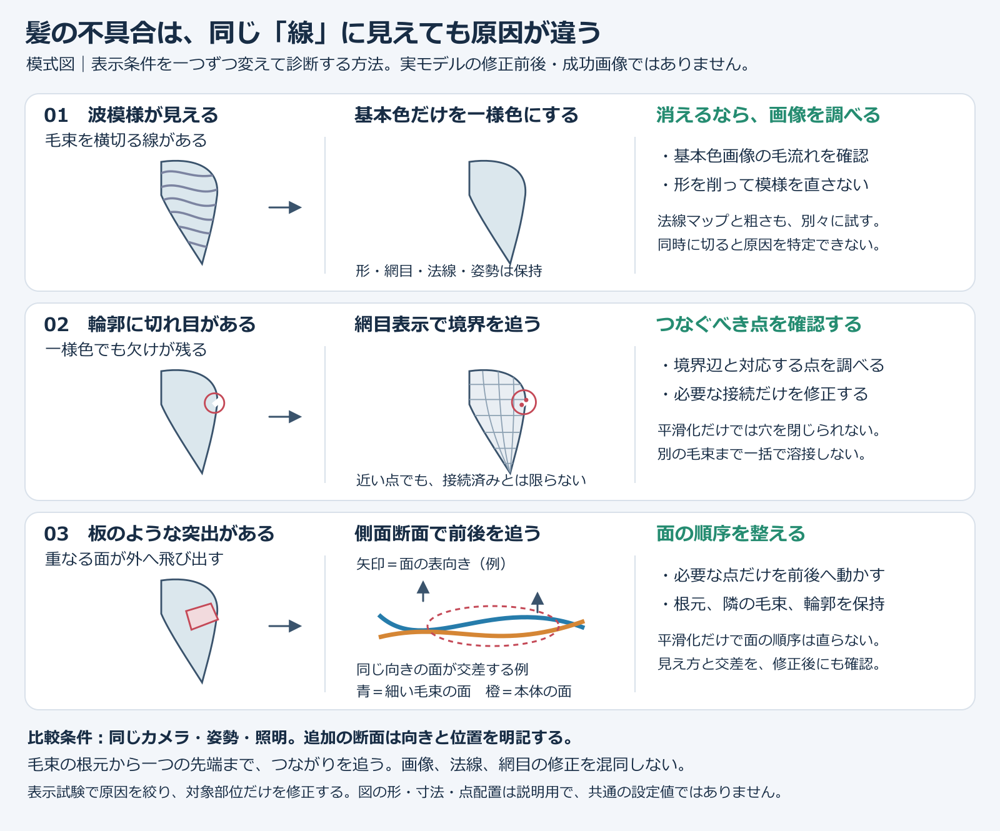
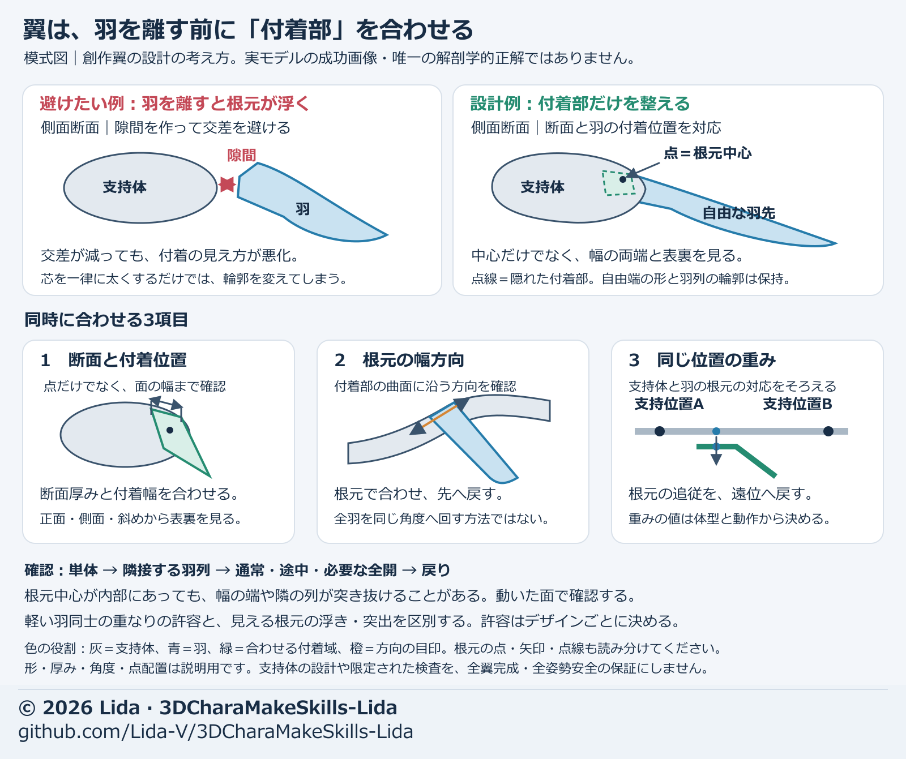

# 試行錯誤を次回の指示へ変える

失敗を「調整した」で終わらせず、原因、変えた条件、比較結果、次回の初回指示を残す。
候補数や工程番号を進捗率にせず、確認できた改善と残件で判断する。

## 残す記録

- 使った基準素材と版、実際の依頼文、後から追加された条件。
- 依頼した担当と、実際に確認できた担当。未確認の担当へ成果を帰属させない。
- 変えた部位、値、座標軸、戻す範囲、保持した部位。
- 同条件の比較、単独・途中・組み合わせ、保存後の確認。
- 候補／局所改善／ユーザー採用／出力・実行環境での検証の区別。
- 次回の統合依頼文。「一回で成功」は実際に初回採用を確認した場合だけ記録する。

## 繰り返した問題から得た指示

| 問題 | 原因・修正の要点 | 初回から加える条件 |
| --- | --- | --- |
| 髪だけの素材に顔が出る、顔を消すと空洞になる | 顔を取り除く指示だけでは、その後ろの髪と根元を補えなかった | 顔を表示せず、隠れていた髪も連続させ、根元をつなぎ、毛先を枝分かれさせない |
| 三面図から作った顔が平たくなる | 横顔や斜めの丸みを判断する情報が不足した | 同一人物の複数角度を先に揃え、その資料から三面図を構成する |
| 表情の線は合うが、白い帯や折れが出る | 縁と隣接する面が別々に動いた | 線・隣接列・途中の移動を一緒に設計し、左右を個別に検査する |
| 手を短くすると付け根が急になる | 長さに対して高さの分布と戻す距離が合わなくなった | 長さ・厚み・曲率を一緒に確認し、ウェイト規則と再計算値を分ける |
| スカートの交差を減らすと別の層へ食い込む | 層ごとの独立補正と総数だけの判定 | 層順序を共通基準で保ち、姿勢×部品ペアで新しい干渉を調べる |
| 交差ゼロでも布が大きく伸びる | 接触の押し戻しだけで布長を検査しなかった | 接触、辺の伸び、布長、反転、外観を別検収にする |
| 羽を一律に丸めても機械的に見える | 数学的な輪郭検査だけで、羽種や付着を揃えなかった | 少数の隣接羽で、羽種別の輪郭・根元・軸・重なりを先に確認する |
| 羽の交差回避で付け根が浮く | 深度分離が付着を壊した | 支持体断面・付着幅・方向・ウェイトを一緒に合わせる |
| 首衣装のフィットで原画の広がりが失われる | 身体への密着を意匠より優先した | 原画の輪郭と広がりを先に固定してから、許容範囲で追従を直す |
| UV画像だけ渡して模様を移せない | 画像に各面のUV座標が含まれていない | UVを持つメッシュと対応画像を揃え、基準形への対応を示す |
| 同名モデルの画像と動画が違う | 再保存後に動画を更新しなかった | 保存モデルと各資料の入力ハッシュを対応させ、修正の影響がある資料を再生成する |
| 要約は完全一致だが実測に差がある | 許容差以内の合格を差0へ言い換えた | 単位・対象・最大差・許容差を記録し、完全一致と区別する |
| 部位の形は合うが統合後の動きや陰影が違う | 関節・ウェイト・法線・制御依存の版が混在した | 部位入力と関連データを一組で合流し、同じ姿勢の保存モデルで確認する |
| プレビューでは自然に揺れるが出力先で違う | 独自の角度制限・慣性・片側制限も移ると思い込んだ | [揺れの保存と出力](secondary-motion.md)を使い、設定・ベイク・独自制御と使用先の実動作を分ける |
| 髪のまだらを高解像度にしても直らない | 頂点AOが影の境目をまだらに動かしていた | [基本色・AO・影・法線・艶を分け](adjustment-methods.md#髪のまだらをaoから診断する)、対象部品の平滑化と暗さを別に比較する |
| 追加髪を焼くと既存の画像が変わる | 同じUV領域と焼き込み先を使い回した | [出力用コピーで材質・UV・画像を分離](adjustment-methods.md#追加した髪のuvと焼き込み)し、元画像を保持する |
| 書出し成功でも見た目や動作が違う | 構造検査と外観・使用先の再現を混同した | [実ファイルの読み戻しと指定動作](visual-handoff.md#vrmを読み戻し提出動作を確認する)を分け、測定範囲と問題時刻を残す |

## 図で原因と修正範囲を確認する

髪の波模様、切れ目、板状突出は別の原因です。同じカメラと姿勢で表示条件を一つずつ変え、基本色・法線・網目を混同せず、原因に合う部分だけを修正します。模式図であり、実モデルの修正成功画像ではありません。

翼は交差を避けて羽を離す前に、支持体の断面、根元面の幅方向、付着位置、同じ支持位置の重みを合わせます。中心点だけで判断せず、隣接羽の表裏と途中動作まで確認します。創作翼の設計を説明する模式図で、唯一の解剖学的正解や全翼完成を示しません。

## 原因を切り分ける順序

1. 基準形を確認する。形が間違ったままウェイトで隠さない。
2. 対象部位だけ表示し、材質なし・ワイヤー・実材質を比較する。
3. 静止、単独動作、途中、組み合わせを分けて調べる。
4. 形状、接続、ウェイト、制御、材質のどこに原因があるかを決める。
5. 一つの原因に対する補正単位を決めて比較する。対象外の差を同時に確認する。
6. 同原因の連続2候補で実使用の見え方が改善しない場合は、値の探索を止め、構造を再診断する。

## 次回の依頼へ統合する

> 基準は添付の採用素材です。前回は【原因】により【失敗】が起きました。今回は最初から【後から追加した条件】を含め、【保持部位】を固定し、【変える部位・軸・量・戻す範囲】を調整してください。【同条件の角度・途中姿勢】で比較し、局所改善、採用確認、残件、実行環境の未検証を分けてください。

複数角度の資料で三面図と顔の丸みが改善したことは制作上の観察であり、その要素だけの効果を測った比較試験ではない。
担当AIの評価も工程に限った観察として残し、ユーザーの指定を優先する。誤解の原因をユーザーの文章だけへ帰さない。
制作で後から出た条件を初回指示へまとめても、次回の初回成功はまだ保証されない。

詳しい手法は [表情](expression-adjustment.md)、[口型](mouth-shapes.md)、[手](hand-shape.md)、[スカートと補完](skirt-hidden-modeling.md)、[翼の制作と繰り返した修正](wing-workflow.md) を参照する。
共通の依頼構成は [AIへの指示](ai-instructions.md)、見た目の好みは [リダのデザイン](lida-design.md) に分ける。
提出画像・動画の版、基準姿勢、揺れの確認範囲は[統合と保存版の照合](visual-handoff.md#統合と保存版を照合する)で確かめる。
