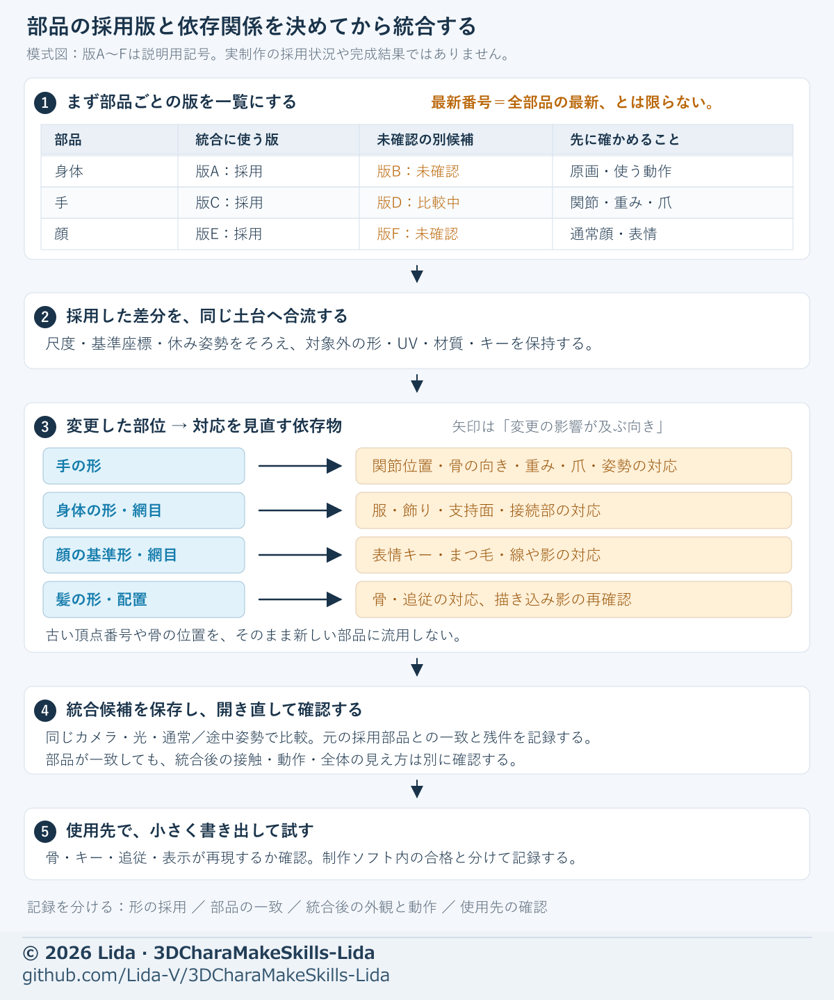

# 画像と短い文でAIへ修正を伝える

[日本語](visual-handoff.md) · [English](en/visual-handoff.md)

[工程索引](process-index.md) · [AIへの指示](ai-instructions.md)

[機械検査と画像・動作の判定](mechanical-visual-review.md)を分け、CLIが通っても同じ保存版の見た目を確認します。

文章だけで位置と採否を伝えず、必要な比較画像を添えます。どの画像のどこをどう変え、何を保つかを短く書いてください。

FBXで髪が消える・古い画像になる時は[材質枠・描画範囲・埋込画像の診断](generation-feedback.md)へ。Blender内の表示と実出力の内容を別々に確認する。

## 最小の画像セット

1. **目標・了承形：** 基準の版、角度、残す特徴。
2. **問題：** 指摘された向き、普段の距離、必要な無地・網目の拡大。
3. **候補：** 同じカメラ・姿勢・照明の修正後。問題が出る途中動作も含める。

髪や服を診断のために隠したら、その条件を書き、戻した外観も確認します。大量の参考をまとめて渡さず、今回の部位に必要なものを選んでください。

## 画像ごとに書く5項目

| 項目 | 書き方の例 |
| --- | --- |
| 図番号と役割 | 図02＝失敗例。完成目標には使わない |
| 列・向き・姿勢 | 左が基準、右が候補。モデル左側面、腕上げの途中 |
| 見る場所と症状 | 中央段右の肩下に広いへこみがあり、腕が差し込むように見える |
| 目標と固定部分 | 肩の丸みをつなぐ。了承した胸、衣装、骨構成は保つ |
| 終了条件と残件 | 通常と途中を無地・実材質、普段の距離で比較。残る谷も示す |

画面の左右とモデルの左右を区別します。ファイル名だけで版を判断せず、入力モデルと画像の対応を確認してください。

## 実結果と図解を区別する

- [支持帯](../assets/bend-support.svg)・[面の流れ](../assets/flow-continuity.svg)は設計を説明する模式図で、成功済みの実モデルではない。
- [膝の配置図](../assets/actual-knee-layout.svg)の灰線は実エッジ、色破線は未実施・未検証の配置案。
- [膝の曲げ図](../assets/actual-knee-bend.svg)の色線は同じ実エッジの追跡。以前の比較で折れ込みは解決していない。
- 本数より配置、実接続、骨とウェイトの対応を見る。仮ガイドをそのまま実装済みと説明しない。

検証画像は保存モデルから取得し、画像生成で形を描き直しません。隠れ線を省いた図だけで、内部接触や体積の全域を合格にしないでください。

## そのまま使う依頼文

```text
入力：[確定版]。図01：[目標]、図02：[問題]、図03：[同条件候補]。
最初に各図の役割と、見えている問題を短く説明してください。
図02の[段・列・部位]を[目標の見え方]へ直し、[固定部分]を保ってください。
形・接続・骨・ウェイト・法線・画像を切り分け、原因に合う範囲を調整してください。
[通常・問題の途中・必要な最大・戻り]を同条件で比較し、実画像を提示してください。
数値を満たしても外観が不自然なら未達とし、保持結果と残件を記録してください。
```

## 部品を統合する前に



版A〜Fは説明用の記号で、実制作の採用状況を示さない。最新番号のファイルでも、必要な部品がすべて最新とは限らないため、採用版・未確認版を先に一覧にする。
矢印は、変更した部位から対応を見直す依存物への向き。[手の形](hand-shape.md)、[表情](expression-adjustment.md)、[関連部品の調整](adjustment-methods.md#依存する部品も直す)を合わせて確認する。
部品ごとの一致、統合後の外観と動作、保存再読込、使用先の試験を別々に記録し、未確認の候補を成功済みとして扱わない。

## 統合と保存版を照合する

髪あり/髪なしの頭部を組み合わせる場合は、[頭髪の合成手順](multiangle-threeview.md#3d生成後のメッシュ合成)から、顔・頭蓋・頭皮・耳・首・髪と、表情・影の層の入力版を一組で渡します。画像の一致と生成後の形状の一致を分け、残す顔を保持して髪の取付位置を確認します。

1. **部位と依存を一組にする。** 入力モデルの版、関節位置・軸・基準姿勢、ウェイトの規則と値、対応する服・爪・飾りを一覧にする。骨名が同じでも、位置や制御方式が違えば同じ動きにはならない。法線、補正キー、モディファイア順、driverの参照先も引き継ぎ、統合後の実データと同じ姿勢の外観を照合する。
2. **保持の判定を分ける。** 「完全一致」「事前に決めた許容差以内」「未確認」を使い分ける。数値には単位、比較対象・姿勢、最大差、許容差を添える。小さい差で合格しても「差0」と書き換えない。入力ファイルのハッシュ一致と、評価後形状の数値比較も別に記録する。
3. **基準姿勢を確かめる。** Tポーズに見えるポーズと、保存原本の基準姿勢がTであることは別。保存後に開き直して骨とメッシュの基準を確認し、必要な使用先へ出力して姿勢と変形の再現を確かめる。出力していない部分は未検証とする。
4. **提出資料を保存版へ揃える。** 最終モデルを保存して開き直し、ハッシュ（内容の識別番号）を記録する。画像・動画にも、実際に入力したモデルのハッシュと比較条件を残す。同名で修正・再保存した場合も、影響した資料は作り直す。旧資料を残すなら「旧版」と明記し、最新版の証拠には使わない。
5. **揺れを実時間で確認する。** [二次揺れと出力](secondary-motion.md)で、固定部、設定・ベイク・独自制御と使用先の実動作を区別する。動画の実秒数、動作範囲、検査対象と時刻、戻りと収束の確認範囲を記録する。

これらは統合や引継ぎの確認方法です。用途に必要な使用先と動作を選び、未確認の範囲を全体の合格へ広げないでください。

## VRMを読み戻し、提出動作を確認する

採用した表示モデル、実際に保存したVRM、同条件のカメラ・光、ユーザー指定の提出区間と自然な操作の組合せをそろえます。開始時に、どの外観・動作を確認できれば区切るか決めます。

1. **実ファイルの構造を調べる。** VRMのJSONと埋め込み画像から材質形式・画像寸法・表情やモーフの対応を確認し、数量、最大値、全要素のどれを測ったか記録する。最大変位量の一致だけで全頂点一致とはしない。画像を所定サイズへ揃えても、容量・面数・実行負荷の合格とは別。
2. **同条件で読み戻す。** 保存したVRMを再読込し、制作側と同じカメラ・光で全身・顔と、用途に必要な表情・口型・視線・翼・着座を比較する。色・影・艶・輪郭線の表現差と、対応していない制御を残す。読み戻しの表示合格を、実行先での同等動作の合格へ広げない。
3. **指定区間を検品する。** 全身と必要な顔の拡大で、提出区間全体の入り・途中・保持・戻り、髪・腕・衣装・翼の見える干渉、根元や芯の露出、表情の切替を確認する。操作の時間表と合わせ、問題は時刻・部位・操作・代表画像で残す。修正した区間と依存部分を再確認する。

短い確認動画と本番動画の役割を分けます。本番の長さと組合せはユーザー指定を引き継ぎ、検査目的で長編や全表情の詰め込みを勝手に追加しません。焼いた動作とリアルタイム揺れの区別は[二次揺れと出力](secondary-motion.md)を使い、提出資料の版は前節で照合します。

初回指示例：「【指定区間】で【自然な表情・口・翼の組合せ】を使い、全身と顔を確認できる動画を作ってください。実VRMの構造検査と同条件の読み戻し、提出区間の外観検品、実行先の未検証を分け、問題時刻と残件を報告してください。」

## 保存と公開の確認

画像と一緒に、入力版・列の説明・姿勢・役割・採否を保存します。画像を更新したら説明も更新し、古い部品を新しい統合版の画像として使わないでください。

このパックの作例はリダ自身の制作画像と自作図解に限定します。掲載前に画像内文字、混在する比較対象、リンク先を確認し、個人情報・ローカル経路・非公開素材を含めません。公開用画像の相対リンクと、[試行錯誤の記録](trial-and-error.md)も合わせて更新します。
