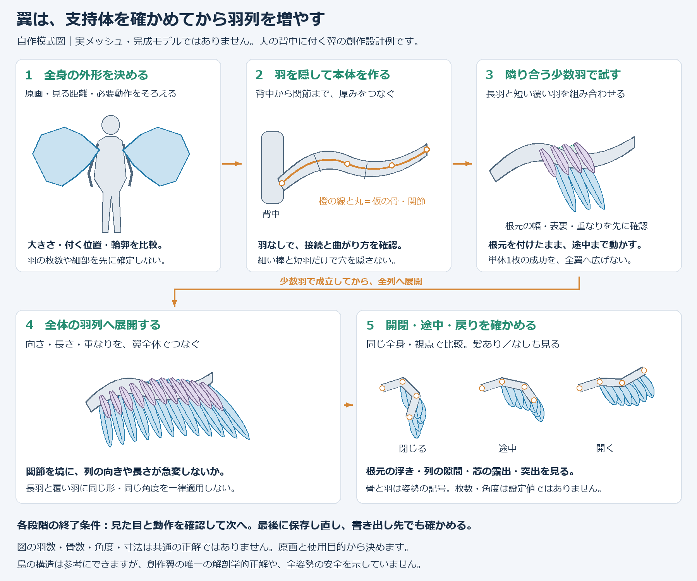
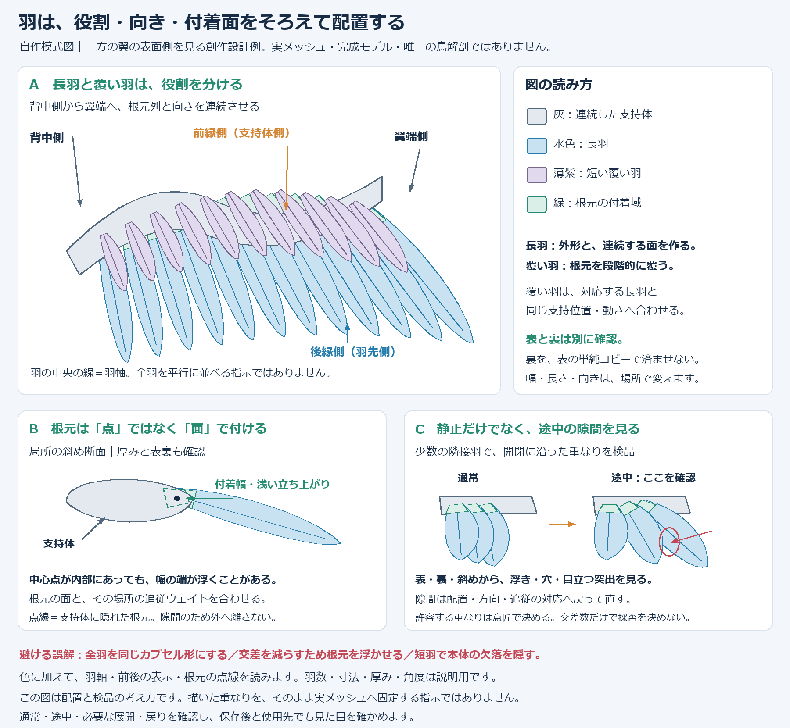

# 翼を設計し、羽を配置して動かす

[工程索引](process-index.md) · [品質とゴール](quality-goals.md) · [図解索引](diagram-index.md)

**大きい輪郭と支持体 → 少数の羽で重なりを試す → 全翼へ広げる → 身体へ追従させて動かす → UV・材質・出力**の順に進めます。羽を大量に並べてから付け根や関節を直すと、配置・重み・動作をまとめて作り直すことになります。

ここでは背中から生える創作翼を扱います。鳥の構造は役割を整理する参考で、唯一の解剖学的正解や飛べる仕組みを保証するものではありません。以下の順序は制作の試行錯誤を整理した**次回向けの手順**です。同じ手順を一度通して初回成功した実績とは分けてください。

## 用意する素材と、最初の完成像

- 採用したキャラクターの正面・背面・側面・斜め。翼の外周、背中の付着位置、羽の段数が読み取れるもの。
- 通常・開く・閉じる・畳む形の資料。必要な状態だけ用意し、不明な裏側や途中形は設計案として区別する。
- 身体・髪・衣装の基準モデルと、翼のベースまたは参考モデル。Tripoなどの生成モデルは形の参考に使えますが、骨格・分離した羽・動く網目が用意されているとは限りません。既存の良い形は利用し、再生成を必須にしません。
- 翼を見せる距離、必要動作、使用するソフト・出力形式、軽さの制約。動作資料は身体姿勢と、どちらへ動く行程かもそろえる。

初心者には、[品質案](quality-goals.md)に沿って「全身で使うなら、必要動作で根元が離れず、羽列が急に割れない状態」「背面アップも見せるなら、表裏の付着と羽の縁・陰影まで整える」と具体的に提案します。静止画用なら指定画角の外観、動く用途なら動作と使用先での再現も終了条件です。既に決まった高品質や原画再現は引き継ぎます。

## 各工程の開始ゴール

着手前に入力版、変更部・固定部、同条件の比較、終了条件、提出物、残件を[ゴールカード](quality-goals.md#各工程の開始時に残すゴールカード)へ残します。通常の工程開始ごとに再承認を求める意味ではありません。

| 工程 | 今回どこまで作るか | 次へ進む時に見るもの |
| --- | --- | --- |
| 1. 粗い設計 | 輪郭・付着位置・関節・羽列を一枚に対応させる | 通常と必要な展開形が同じ翼として読める配置図 |
| 2. 支持体 | 羽を隠しても背中から先へ形と厚みがつながる | 通常・途中・展開の背面、側面、羽なし拡大 |
| 3. 代表区画 | 長羽と覆う羽の根元・方向・重なりを成立させる | 単色の表裏、根元断面、開閉途中 |
| 4. 根元の取付 | 支持体断面・根元面・重みを合わせ、目立つ離脱を防ぐ | 根元の中心と端、段同士の表裏・側面・開閉途中 |
| 5. メッシュ・全翼・身体追従 | 曲がる網目と重みを整え、羽列を左右と身体へつなぐ | 全身と拡大、左右単独、全体移動、前傾・ひねり・腕上げ |
| 6. 開閉・羽ばたき・しなり | 指定した行程で関節と羽列を連動させ、根元を保って先端を曲げる | 側面のコマ送り、通常・途中・必要な最大・戻り、しなり無／有と組合せ |
| 7. 仕上げと出力 | UV・材質を整え、保存版と出力先の再現を照合する | 格子、実材質、保存再読込、出力の読み戻し、使用先 |

図は制作順の説明です。形・枚数・骨数は固定仕様ではなく、実モデルでの完成や出力成功を示しません。

### 制作で実際に進んだ経路

初期は支持体と羽列を作り直し、キーやGeometry Nodesで開閉・しなりを試しました。その後、出力しやすい**骨とウェイトによる構成へ再設計**し、利用できる羽の殻とUVを新しい中心線へ対応させました。生成サービスの出力をそのままリグ化したものではありません。

続いて、長羽の扇と覆う羽の追従を一緒に調整し、根元の切り口・差し込む角度・支持体の局所厚みを補正しました。全身統合では風切羽の中ほどから先へ揺れを追加し、根元・雨覆・支持体は姿勢へ固定追従させました。保存した動作の見た目確認と、標準スプリング設定の保存・出力、独自制御の使用先での再現は別の確認です。旧いGeometry Nodes試作を最終実装や、そのまま移植できる推奨リグとして扱いません。

## 1. 輪郭・関節・羽列を先に対応させる

背面と側面の資料へ、背中の付着域、支持体の中心線、折れる位置、前縁・後縁、羽の根元と先端を描きます。モデルの左右、表裏、根元から翼端への方向を明記してください。画面の「上・下」だけでは、前傾や反対側を見た時に方向が逆になります。

粗い骨やガイドと低密度の形で通常・半開・全開・必要な収納形を試します。原画の翼端を骨の終点だけでなぞらず、**支持体の先から生える羽の長さも含めて外周を作る**と考えます。髪や衣装と占める空間も側面から確認します。

> AIへの依頼：添付の採用原画を基準に、翼の外周、背中の付着域、支持軸、関節、長羽と覆う羽の列を同じ図へ示してください。まず低密度の片翼で通常・途中・展開を比較し、形を判断できる段階まで作ってください。羽の大量生成や最終材質はこの確認後に進めます。

## 2. 羽を隠して、翼本体の厚みを作る

支持体は骨の周囲にある翼本体の形です。背中の接合域から根元・関節・末端へ体積をつなぎ、羽を付ける面を用意します。骨だけを置く、細い棒を短羽で隠す、球で接続を覆うだけでは、付着する幅が不足することがあります。

調整では、中心線に沿う断面を選び、**横幅・奥行き・羽が付く側の厚みを別々に**変えます。足りない区間だけを膨らませ、前後の断面へ滑らかに戻します。全体を太くして根元を収めると、前縁や手首まで膨らみ原画の輪郭を変えます。

関節を開くと細長く伸びる場合は、細分化の前に中心線の曲がり、隣接断面の向き、骨の回転中心、ウェイト遷移を確認します。断面を急に反転させず、関節前後で面と厚みがつながる配置にします。根元・肘相当・手首相当をまとめて一律に細くする修正も避けます。

**終了時の確認**：髪と羽を隠して背中への接続を見せ、通常・途中・展開で棒状化、膨らみ、鋭い折れ、穴が目立たないか比較します。羽で覆われる設計でも、内部構造の確認を省略しません。

## 3. 羽種別と列を、少数の隣接羽で試す

| 役割 | 配置と形で確かめること |
| --- | --- |
| 翼先側の長羽（初列風切に相当） | 末端の支持域から扇状に広げ、長さ・幅・先細りを外周へつなぐ |
| 身体側の長羽（次列風切に相当） | 内側の支持域に沿わせ、隣接羽の重なりで連続した翼面を作る |
| 根元を覆う短羽（雨覆に相当） | 長羽の取付を覆う位置から配置し、必要な段数・長さを原画へ合わせる |

名称や段数は役割の説明です。すべての創作翼を同じ列数や鳥の枚数にそろえません。原画の「三段」などの指定は、表裏の二面や単なる厚みと取り違えないよう、画像へ番号を振ります。

まず内側・関節をまたぐ所・翼先から代表区画を選び、長羽と表裏の短羽を少数作ります。長羽の短縮コピーを全雨覆に使う、一律に丸いカプセルへ変える、乱数だけで自然さを足す方法に頼りません。単体の形と、翼内で見える形を両方比較します。

**羽軸の向き**と**根元を横切る辺の向き**は別です。羽軸は支持する部位の基準方向と翼全体の扇に合わせ、根元の横幅は支持曲面へ沿わせます。支持曲面の接線をそのまま全羽の羽軸にすると、関節で羽が逆向きになることがあります。

隣接羽の長さ・角度・根元位置を連続的に変え、内外の境界だけ急に折れないようにします。重なりの順序は表裏を別々に見て決め、反転コピー後も面の表向き、羽弁、羽軸を確認します。

長さだけを変えても、下の羽に隠れて見た目が変わらないことがあります。隣の羽との角度差、根元間隔、実際に露出する長さ、羽先の段差を同じ画像で見ます。長羽の付着位置や扇の中心を変えたら、それを覆う短羽も同じ対応で置き直してください。雨覆だけ元の中心で回すと、小さい穴や暗い縁が残ります。

## 4. 根元の形・配置・重みを一緒に合わせる

根元が浮く時は、羽を奥へ移すだけで終えず、次を順に調整します。

1. **支持体**：付着する側に必要な幅と厚みがあるか確認する。
2. **根元面**：中心だけでなく両端も支持面へ収まるよう、幅・横断方向・差し込む向きを合わせる。
3. **戻す範囲**：根元だけを収め、自由な羽弁と羽先へ滑らかに元の形へ戻す。根元を平らに潰して箱状の段を作らない。
4. **列の順序**：覆われる根元が上段の羽を突き抜けないか、段を対にして表裏・斜めから確認する。
5. **追従**：同じ支持位置の本体と羽根元が、同じ関節の切り替えへ追従するようウェイトを合わせる。

根元の中心が支持体内にある検査だけでは、横幅の端の浮きや切り口の露出は分かりません。実際の根元面、側面、途中姿勢も見ます。支持体へ埋めた根元が、稜線から小片のように再び露出する場合も確認します。

差し込み点の先に鉤や山ができる場合は、**切り口の幅、そこからの立ち上がり、芯との隙間**を断面で見ます。接触を見つけるたびに押し上げ量を足すと、既存の重なりを追って山が大きくなります。必要な高さを基準形から一度求め、差し込み点からの高さと傾きに上限を設け、先へ滑らかにつなぎます。具体的な上限はモデルの厚みと必要形で決め、上限を超える接触は羽列や付着位置へ戻って診断します。

羽同士を離して交差数を減らすと、根元が浮き、翼面が何枚もの板へ分かれることがあります。隠れる重なりを許容するかは用途とユーザー指定で決め、目立つ突き抜け、穴、接続の離脱を別に扱います。

> AIへの依頼：対象は添付の代表区画です。支持体の基準位置と自由な羽先を保持し、羽が付く側の断面、根元面の幅・傾き・挿入位置、同じ支持位置の重みを合わせてください。根元中心だけで合格にせず、両端と上段／中段の関係を表裏・側面・開閉途中で比較してください。単純な奥行き分離や全体の肥大化で隙間を隠さないでください。

## 5. メッシュとウェイトを整え、全身へつなぐ

支持体では中心線に沿う断面列と、それを結ぶ辺で曲面を作ります。関節付近に連続した変形帯を設け、長い一面へ伸びを集中させません。羽では長軸方向に根元から先へ列をつなぎ、必要な曲がりを表す所へ面を配ります。全体へ均等に線を増やすことと、曲がる形を設計することは別です。密度・分岐・スキニングの詳しい判断は[メッシュと重み](mesh-weight.md)を使います。

本体と羽根元の重みを対応位置で共有し、自由端へ必要な重みへ戻します。関節の切替が狭すぎて隣の羽との角度が飛ぶ時は、本体と羽を一緒に見て遷移帯を調整します。短羽を含めた全体へ同じ強さの曲げを付けません。

同じ追従とは、骨名や割合を全部同じにすることではありません。腕側の骨の子として羽根元を運ぶ構成なら、その親子変換も含めて支持体との一致を評価します。二つの異なる回転中心へ根元を引っ張る混合を避けます。長羽の曲げは羽軸に沿う位置から重みを切り替え、幅方向へ不要な差を作ってねじれないようにします。正規化、影響骨数、変形方式は使用先の制約に合わせます。

出力する用途では、必要な曲げを骨とウェイトで再現する代表羽を早めに試します。面数や骨数を増やす前に、根元保持、滑らかな曲がり、出力後の再現を比較します。旧羽の殻やUVを流用する場合も、旧い骨・キー・重みの頂点番号対応を無検証で引き継ぎません。

片翼の代表区画で確認してから全翼へ広げます。反対側へ反映した後は、左右同時だけでなく片側だけの開閉を試します。片方の操作で反対側が動かないことも確認します。

身体への接続は、**胸などの身体骨 → 翼リグ → 支持体・羽メッシュ**の追従経路を確認します。リグだけが胸に従い、羽メッシュの全身移動が抜ける場合があります。親子付けや制約、アーマチュア変形が重なって二重に動かないかも調べてください。

身体全体の移動・回転、前傾、ひねり、腕上げを単独と組合せで試します。髪なしの接続確認と、髪・衣装を戻した普段の距離での確認を両方残します。

## 6. 開閉・羽ばたき・しなりを分けて調整する

- **開閉・収納**：根元、肘相当、手首相当と羽の扇を連動させる。見かけの羽幅だけを縮めて畳んだ状態にしない。
- **羽ばたき**：主に動く方向と、押す／戻す行程の関節形を先に決める。前傾した身体に対する前後・上下を側面で確認する。
- **しなり**：根元を保持し、支持されていない先端へ必要な曲げを増やす。長羽と短羽で範囲・強さを分ける。

一つずつ動かした後、開閉＋羽ばたき＋しなり、左右非対称、身体姿勢との組合せを確認します。角度の端だけでなく途中・保持・戻りを動画とコマ送りで見ます。数姿勢では見えなかった短い区間の羽交差や角度飛びがあるため、問題区間は間を細かく確認します。

姿勢操作と揺れが同じ骨の回転を上書きし合わないよう、担当する範囲と評価・合成の順序を決めます。骨を分ける方法でも、同じ鎖へ差分を重ねる方法でも、揺れを止めれば採用した姿勢へ戻ること、全操作を基準値へ戻せば通常形へ戻ることを確かめます。特定の骨名だけで担当を固定せず、実際の制御と揺れの仕組みを見て決めます。

隣接羽が別々の基準で曲がって裂ける時は、共通の支持位置・曲げ基準・変形順へ合わせる案を小区画で比較します。共通変形にしただけで、離散した三角面の交差や羽軸の伸びがなくなるとは限りません。曲げる前後の長さ・幅・面の反転と外観を確認します。

制作では、動作方向を整理し直し、左右独立の開閉と身体への追従を確認しました。一方、キーや時間差で作ったしなりは制御アニメーションです。空気への応答やライブ物理の成功とは扱いません。揺れ骨・減衰・固定根元・出力時の制限は[二次揺れ](secondary-motion.md)へ進みます。

## 7. UV・材質・保存と出力を確認する

形と基本追従が固まってから、羽の表裏・必要な端面・支持体のUVを整理します。曲がりが強い根元は区分を増やす案を試し、格子で伸び・反転・潰れ・継ぎ目を確認します。各部品を別々に0〜1へ展開した状態と、一枚の画像へ重ならず配置したアトラスは別です。

羽軸と羽毛の方向をUVへ対応させ、根元から先へ模様が逆流しないか見ます。細い縁や透けを使う場合は、アップと普段の距離、表裏、使用先の描画方式で比較します。形や重なりの問題を暗い影・細かい模様で隠しません。

仕上げ前に支持体と長羽・短羽の代表区画を小さく書き出し、骨、キー、UV、材質と変形順を読み戻します。制作では骨と補正キーによる指定クリップを読み戻した一方、独自のGeometry Nodesのしなりはそのまま含まれませんでした。これはその検証対象の結果で、全翼・全形式の互換保証ではありません。

この読み戻しは旧試作の検証です。後の骨とウェイトによる翼では、出力用コピーで身体と翼のリグを統合し、標準スプリング設定を持つ試験出力も確認しました。それでも、独自の角度制限・全翼の慣性・操作パネルまで使用先へ再現された証拠にはなりません。現在の入力版に対して再確認してください。

出力先へ必要な動きを渡す方法を選びます。骨や対応するキーで再現する、固定映像用なら動きを記録する、使用先で同等の制御を実装する、などです。固定クリップの記録と、任意の操作に追従するリグは区別します。制作ソフトの操作UI・ドライバー式が自動で移るとは考えません。

保存を閉じて読み直し、同じ版から通常・動作画像を再生成します。最終的に[保存版・出力・使用先を照合](visual-handoff.md)し、外観、有限範囲の動作、保存、使用先のそれぞれで確認済みと残件を報告します。

## 繰り返した失敗を、次回の最初の指示へ入れる

| 制作で起きたこと | 次回は最初から何を指定するか |
| --- | --- |
| 骨と羽だけで、翼本体や背中の接続が薄かった | 羽なしの支持体を先に作り、付着域・厚み・関節を検品する |
| 全羽を丸めても板やカプセルの反復に見えた | 羽種別の代表形と隣接区画を、単体／翼内の両方で比較する |
| 局所パッチごとに羽の方向が変わった | 内外をまたぐ羽軸・長さ・重みの連続を一枚の配置図で示す |
| 長羽を置き直すと、覆う羽との間に穴ができた | 扇の角度差と付着位置を調整し、覆う羽も同じ回転中心へ対応させる |
| 羽を離して交差を減らしたら、根元が浮いた | 支持断面・根元の横幅と方向・挿入・追従を一緒に合わせる |
| 根元中心の検査は通ったが、上の段へ突き抜けた | 根元面の端と、隣接する段を対にして表裏・斜め・途中で確認する |
| 接触を押し上げる反復で、根元の先に山ができた | 基準形から必要高さを一度求め、差し込み点からの高さと傾きを制限する |
| 片翼は動いたが、身体姿勢を変えると追従しなかった | 身体骨からメッシュまでの経路を図示し、全体移動と複合姿勢を試す |
| しなり単独は良くても、畳みや左右の組合せでぶつかった | 通常・開閉・収納と正負のしなり、左右非対称を組み合わせて確認する |
| プレビューの動きが書き出し後に消えた | 早期に代表区画で読み戻し、骨・キー・独自制御と変形順を分ける |

表は実際の問題から得た予防指示です。次回の一回での成功や、未検査の全時刻・全関節の安全を保証しません。同原因の連続2候補で実使用の見え方が改善しなければ、数値の変更を止め、支持・付着・羽列・変形の基準を再診断します。

### 次回にまとめて渡す依頼文

> 用途は【用途・使用先】、目標は【見る距離・必要な外観と動作】です。基準は【採用原画・モデル版】で、【保持する輪郭・段数・部位】を維持してください。
> 最初に各工程の到達状態、固定部、比較条件、終了条件、提出物と残件を短く示してください。支持体を羽なしで確認し、羽種別の代表区画で羽軸・根元面・重なり・共通追従を整えてから全翼へ広げてください。
> 【必要な開閉・収納・羽ばたき】を通常・途中・最大・戻り、表裏・側面・左右単独・身体との組合せで比較してください。根元の中心だけで合格にせず、端と段同士の露出も見てください。しなりは固定根元と自由端を分け、隣接羽と同じ基準で調整してください。
> 最終UVの前に代表区画で出力依存を確認し、保存版と画像・動画の版をそろえてください。変更内容、対象外の保持、実際に確認した状態、採否と残件、使用先の未検証を分けて報告してください。

リダの原画に合わせた輪郭や羽の重なりなど、好みの選択は[あとがき](lida-design.md)へ分けます。記録の残し方は[試行錯誤](trial-and-error.md)、参照画像の役割と図番号は[画像の引き渡し](visual-handoff.md)を使ってください。
