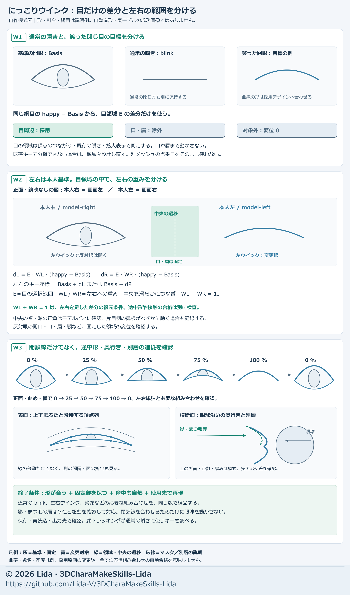

# ウインクの閉じ方を作る

[日本語](wink-closure.md) · [English](en/wink-closure.md)

**初心者向け：普段の瞬きと、表情としての片目閉じを分ける。** 既に良い笑い目があれば、その目の動きだけを左右へ分けて使える。口まで笑わせたり、反対の目を動かしたりしない。閉じ切った形だけでなく、閉じる途中と使うアプリでも確かめる。

にっこりした弧、平らな線など、採用する形は参考と用途で決める。にっこりを全キャラクターの正解にしない。外観の好みは[リダ固有の選択](lida-design.md)、まぶたの帯と隣接列は[表情の調整](expression-adjustment.md)、眼球・視線は[眼球モデリング](eye-modeling.md)を参照する。

## 用意する素材と開始時のゴール

片目閉じの目標資料がなければ、[表情シート生成](expression-sheets.md)で通常瞬きと左右ウインクを区別して用意します。既に良い笑い目の資料やキーがあれば、その利用から始めてください。

- 採用した通常顔と、普通の瞬き・狙う片目閉じの参考。目頭・中央・目尻の高さ、眉と口も入った正面・左右斜めの画像。
- 同じ顔の基準形と既存キー。喜びなどの参考キー、まつ毛・線・影の層、ドライバーと出力の結び付け。
- 使用先、顔を映す距離、左右の閉じ量を受け取る方法、実際に使う表情・視線の組合せ。

開始時は「どの形を作るか、どこだけ動かすか、どの確認で終えるか」を短く記す。例：**通常の瞬きは保ち、片目は参考の弧で閉じ、反対眼・眉・口を保つ。左右の途中・戻り・実用組合せを比較し、保存読込と指定使用先で確認する。**

最初にキーの役割を調べる。`blinkLeft` などの名前だけで「ウインク専用」と決めない。顔・別パーツ・VRMの表情設定・アプリ入力が、どのキーをどの重みで動かすかを対応表にする。普通の瞬きも左右キーで動かすアプリでは、キーの形を変えると両目の瞬きまで変わる。



図は考え方を示す模式図。実メッシュ、必要な面列数、全組合せの安全を表すものではない。左右はキャラクター基準で、正面画像では画面の左右と反対になる。

## W1：基準顔から、使う目の動きだけを選ぶ

1. 全キーを0にして通常顔を保存し、修正する左右キーと保持する通常瞬きを特定する。通常顔の丸み・眼球・開口が違う場合は先にその原因を診断する。
2. 狙う閉じ線の**目頭・中央・目尻**を参考へ対応させる。笑い目なら中央の盛り上がりと両端の位置を、閉じる割合とは別に決める。
3. 上下まぶたを同じ閉鎖曲線へ近づけ、まつ毛と隣接する面の帯も追従させる。下まぶただけを上げて虹彩を横切る直線を作ったり、縁だけを動かして穴を作ったりしない。眼球に沿う局所的な上・奥行きを確認する。
4. 既存の良い笑い目を使う場合は、**同一の顔・頂点対応・基準形に対する差分から、目周辺だけを抽出**する。口角、口、眉などの混入を色分けして除く。別々に生成した顔の頂点番号や顔全体の差分は流用しない。

実制作では、喜びで動く頂点同士のつながりを調べ、通常瞬きで動く頂点を含むかたまりを目として選べた。これは目と口の可動範囲が分かれていたため使えた方法。頬を介して目と口がつながるモデルなどで自動的に判別できるとは限らない。判別できなければ、目周辺の作用マスクを可視化して決める。

## W2：左右へ分け、中央の二重変形を防ぐ

AIへ渡す差分の表記例：

```text
dHappy = happy - Basis
dL = E * WL * dHappy
dR = E * WR * dHappy
leftKey  = Basis + dL
rightKey = Basis + dR
```

- `Basis` はこの計算で共有する通常顔、`happy` は採用した参考キー。キー名は例。既存キーの `relative_key` が同じ基準かを確認し、別基準の差分をそのまま加えない。
- `E` は目だけの作用マスク。目以外は0、必要な周辺で滑らかに0へ戻す。まずマスク単独で、口・眉・鼻先など固定部位が入らないことを確かめる。
- `WL` と `WR` はキャラクター基準の左右マスク。鼻の付け根の遷移帯を滑らかにつなぎ、`WL + WR = 1` とする。中央を両側とも1にすると、両方を動かしたとき中央だけ二重になる。
- 左右位置は同じ基準座標で評価する。遷移帯の幅は顔の大きさと動かす範囲から決め、制作例の固定mm値を他の顔へ自動適用しない。

この式では `dL + dR = E * dHappy` なので、左右両方1の差分が元の「目だけ」の差分へ戻る。片側1で反対眼の開口・口・眉が保持されるかも別に測る。中央の遷移帯は少量動く場合があり、「顔の半分が完全固定」とは扱わない。

**和が1でも、混合時に閉じることや眼球との接触安全は保証されない。** 元の笑い目にある隙間・途中の折れも引き継ぐため、W3で確認する。

## W3：途中・依存パーツ・保存・使用先を確認する

顔の皮膚を動かしたら、まつ毛・描かれた線・影の層も対象表に含める。別メッシュへ顔の頂点差分を番号だけでコピーしない。各層の基準形と対応する表情差分、または皮膚への対応を使い、左右マスクを共通座標で評価する。既存ドライバーや表情の結び付けは保持し、0・途中・1で同じ値へ追従するか確認する。

| 確認 | 見る点 |
| --- | --- |
| 左右別の0・25・50・75・100 %と戻り | 閉じ線、目頭・目尻の穴、直線に切れる白目、まつ毛の折れ、キー0の通常顔 |
| 通常瞬き、笑顔、母音、視線との実用組合せ | 閉じる動きの二重加算、口・眉・反対眼の不要な動き、目玉の漏れ |
| 正面・左右斜め・横、実材質と色なし | 見える内壁・裏面、眼球への沈み、線や影の浮き・肌裏への潜り |
| 別名保存して開き直す | 変更したキーだけの差分、他キー・通常顔・UV・材質・骨・画像参照・ドライバーの保持 |
| 出力を読み戻し、指定アプリで入力する | キーと表情の結び付け、普通の瞬きとの使い分け、左右の取り違え、途中と戻り |

怪しい区間は刻みを細かくし、顔アップだけでなく普段の距離でも比較する。使用側が抑制する組合せと、試験で自由加算した状態を区別する。可視漏れ、隠れた交差、普段の外観は別々に記録する。

## 顔トラッキングの振り分けを検討する場合

左右の閉じ量を `L`・`R`（0＝開く、1＝閉じる）で受け、両目用の普通瞬きと左右の表現を分けられる構成では、次の振り分けを**運用案**にできる。

```text
m = min(L, R)
ordinaryBlink = m
leftWink  = L - m
rightWink = R - m
```

| 入力 | 普通の両目瞬き | 左ウインク | 右ウインク |
| --- | --- | --- | --- |
| L=1、R=1 | 1 | 0 | 0 |
| L=1、R=0 | 0 | 1 | 0 |
| L=0.8、R=0.3 | 0.3 | 0.5 | 0 |

これは元の左右への入力を差分へ**置き換える**案。元の左右入力を残して両目瞬きを追加すると二重になる。両目用キーがない、二値表情、独自の上書き規則などではそのまま使えない。入力範囲、相対差分、VRMの上書き・加算設定、アプリの結び付けを先に調べる。

別のカスタムウインクを追加する方法もあるが、通常のウインク操作がその表情を呼ぶとは限らない。アプリ側の改修は別の作業範囲として扱う。この資料の更新は外部アプリの設定や実装を変更する指示ではない。

## 確認できた成果と、残った問題

実制作では既存の喜びの目から左右を分け、顔と影の層の左右4キーだけを変更した。通常の瞬き・通常顔・他の表情・口・眉を保持し、Blender、VRM・FBXの読み戻し、Unity・UEの試験プロジェクトで同条件の片目閉じと短い動作を確認できた。制作上の候補と採用原本は区別する。

指定した細密な視線標本では左右各100 %の閉じ側に眼球の可視漏れはなかった。一方、途中の白目端が直線に見える点、特定の瞬きと左ウインクの混合で目頭に残る微小隙間、影の層の浮きや一部の混合時の潜りは、元の喜びから引き継いだ。粗い検査で0でも細かくすると検出する場合があった。本文要約と詳細結果が食い違う場合は、条件付きの詳細結果を優先する。

これらを全組合せ・全視点・本番アプリの完成としない。新しい顔や異なる目の構造では、抽出方法も接触も再確認する。同梱の[制作補助ツール](model-tools.md)は保持やキーの比較を助けるが、この章のウインクを自動生成・自動合格にする機能ではない。

## 最初に渡す依頼文

> 通常の瞬きと、参考の片目閉じを分けて作ってください。開始時に狙う閉じ線、動かす目周辺、固定する反対眼・眉・口、使用先の入力先と終了条件を計画してください。良い笑い目を使える場合は同じ顔・同じ基準形との差分から目だけを選び、左右のマスクは中央を滑らかにつないで和が1になるようにしてください。普通の瞬きと対象外キーを保持し、線・まつ毛・影は各自の対応で追従させてください。左右の0・25・50・75・100 %と戻り、普通瞬き・笑顔・視線などの実用組合せを、色なしと実材質の正面・斜め・横で比較してください。原本を上書きせず、保存読込と出力・指定使用先の入力割当を確認し、変更したキー、保持結果、合格した標本、残件を分けて報告してください。

© 2026 Lida · 出典：[3DCharaMakeSkills-Lida](https://github.com/Lida-V/3DCharaMakeSkills-Lida)
